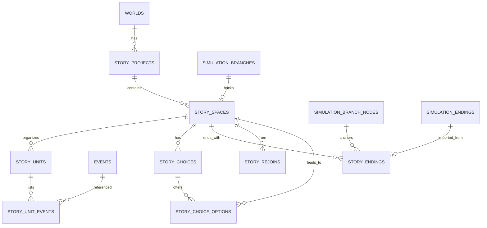

# 阶段 D：故事线管理系统完整设计

定位：管理**故事结构**（主线/支线/副本/阶段）、**选择节点**、**平行空间**与**结局**；不是第二个推演引擎，也不是剧情树编辑器。

---

## 1. 概念分层（不可混用）

| 概念 | 定义 | 落点 |
| --- | --- | --- |
| 故事（Story Project） | 一部作品的顶层容器 | `story_projects` |
| 结构单元（Unit） | 主线 / 支线 / 副本 / 阶段，是**内容组织** | `story_units` |
| 事件（Event） | 故事中发生的具体事情 | 既有 `events` |
| 选择节点（Choice） | 使故事可能分叉的决策点，属于某个空间 | `story_choices` |
| 平行空间（Space） | 关键选择后形成的**独立状态版本** | `story_spaces`（绑定 `simulation_branches`） |
| 结局（Ending） | 某空间某路径的结果，可为阶段/开放/最终 | `story_endings` |

规则：
- 单元不含状态，空间不含结构；二者通过 `story_units.space_id` 关联。
- 事件只属于世界；空间通过分支作用域「看见」自己的事件。
- 选择节点不产生状态，只有「选项 → 空间」才产生状态版本。
- 结局挂在空间（可选挂节点），不挂在单元。

## 2. 核心技术决策：空间 = 分支（复用，不新建引擎）

| 方案 | 结论 |
| --- | --- |
| A. 新建独立状态引擎 | ❌ 与任务书「不重复开发」冲突 |
| B. 空间仅存 JSON 快照 | ❌ 与既有快照/回溯/对比重复，双份数据 |
| C. **空间绑定 `simulation_branches`** | ✅ 复用快照隔离、节点回溯、分支对比、结局结构 |

- 空间创建时自动创建分支（复用 `create_branch` 逻辑），`story_spaces.branch_id` 必填（原始空间除外）。
- 状态隔离沿用既有语义：分支推演只改 `current_snapshot`；主时间线实体表不动。
- 回溯：复用 `POST /api/branches/{id}/rollback`，故事层只记录「回溯到哪个节点」。
- 对比：复用 `POST /api/branches/compare`，故事层负责把结果映射为「空间差异」。

原始空间（`is_original=true`）：`branch_id` 为空，事件为主时间线（`branch_id IS NULL`），代表正史。

## 3. 数据模型

### 3.1 新增表（8 张，全部为新增，不改旧表）

#### `story_projects`

| 字段 | 类型 | 说明 |
| --- | --- | --- |
| id | String PK | UUID |
| world_id | String, idx, NOT NULL | 所属世界 |
| title | String | 故事名 |
| premise | Text | 故事前提/背景 |
| status | String | planning / active / completed / archived |
| settings | JSON | `{core_goal, core_conflict, themes, notes}` |
| official_key | String, nullable, unique | 官方演示标记（如 `fanren-main`） |
| created_at / updated_at | DateTime | — |

#### `story_spaces`

| 字段 | 类型 | 说明 |
| --- | --- | --- |
| id | String PK | — |
| story_id | String, idx | — |
| name | String | 空间名（如「正史」「反杀线」） |
| is_original | Boolean | 正史空间 |
| parent_space_id | String, nullable | 从哪个空间分叉 |
| fork_choice_id | String, nullable | 由哪个选择节点产生 |
| branch_id | String, nullable, unique | 绑定的推演分支（原始空间为空） |
| base_node_id | String, nullable | 分叉节点 |
| status | String | active / archived |
| summary | Text | 一句话说明 |
| created_at / updated_at | DateTime | — |

#### `story_units`

| 字段 | 类型 | 说明 |
| --- | --- | --- |
| id | String PK | — |
| story_id | String, idx | — |
| space_id | String, idx, NOT NULL | 单元属于哪个空间 |
| parent_unit_id | String, nullable | 阶段/子支线 |
| kind | String | mainline / side / instance / phase |
| title | String | — |
| summary | Text | — |
| order_index | Integer | 同层排序 |
| status | String | planned / active / done / abandoned |
| meta | JSON | 目标、参与人物、完成条件等 |

约束：同一空间内 `kind='mainline'` 由应用层保证唯一。

#### `story_unit_events`

| 字段 | 类型 | 说明 |
| --- | --- | --- |
| id | String PK | — |
| unit_id | String, idx | — |
| event_id | String, idx | 既有事件 |
| role | String | normal / choice / climax / ending |
| order_index | Integer | 单元内顺序 |
| is_shared | Boolean | 是否为多空间共享的正史事件（只读语义） |
| note | String | — |

唯一约束 `(unit_id, event_id)`。

#### `story_choices`

| 字段 | 类型 | 说明 |
| --- | --- | --- |
| id | String PK | — |
| story_id / space_id | String, idx | 选择发生在哪个空间 |
| anchor_event_id | String, nullable | 锚定事件 |
| title | String | 如「是否反杀墨居仁」 |
| description | Text | — |
| precondition | JSON | 触发条件（人物/关系/世界状态/事件完成） |
| allow_rejoin | Boolean | 是否允许后续汇合（v1 仅记录，不执行） |
| status | String | open / resolved / abandoned |
| resolved_option_id | String, nullable | 实际选择 |
| created_at | DateTime | — |

#### `story_choice_options`

| 字段 | 类型 | 说明 |
| --- | --- | --- |
| id | String PK | — |
| choice_id | String, idx | — |
| label | String | 选项文案（用户可自定义） |
| description | Text | 后果说明 |
| consequence | Text | 直接结果 |
| target_space_id | String, nullable | 选择后进入的空间 |
| source | String | user / ai |
| confirmed | Boolean | AI 建议默认 false |
| order_index | Integer | — |

#### `story_endings`

| 字段 | 类型 | 说明 |
| --- | --- | --- |
| id | String PK | — |
| story_id / space_id | String, idx | — |
| node_id | String, nullable | 分支节点（用于回溯状态） |
| name | String | — |
| content | Text | 结局内容 |
| kind | String | final / stage / open |
| is_final | Boolean | 是否该空间最终结局 |
| path_event_ids | JSON | 路径事件 |
| path_node_ids | JSON | 路径节点 |
| precondition | JSON | 达成条件 |
| source_ending_id | String, nullable | 来自 `simulation_endings` 时保留来源 |
| created_at | DateTime | — |

#### `story_rejoins`（v1 建表、默认不启用）

`id, story_id, from_space_id, to_space_id, at_event_id, note, status(planned/active)`

用途：记录「允许汇合」的结构，但**第一版不做状态合并**；`allow_rejoin` 只是标记。

### 3.2 ER 图



### 3.3 与既有表的关系

- 不修改 `events`；空间事件通过 `branch_id` 归属，结构归属通过 `story_unit_events`。
- 不修改 `stories`（章节）；章节与故事的关联留到后续（见 G 清单）。
- 不修改 `simulation_*`；只读引用其 `id`。
- `world_lifecycle.world_tables()` 需把 8 张新表加入排除名单；删世界时显式级联删除。

## 4. 状态隔离方案

1. **写路径唯一**：任何人物/关系/世界状态变化，只允许发生在 `space.branch_id` 的快照里（复用 `simulate/rollback`）。
2. **事件作用域**：在空间内创建事件必须带 `branch_id = space.branch_id`（API 强校验）；主时间线视图默认排除分支事件（已实现）。
3. **故事层只存结构**：`story_*` 表不存人物状态；避免双份真相。
4. **导入不复制快照**：`import-branch` 只建空间指针。
5. **不自动应用**：从空间回主时间线只能走多路径页「应用分支」（带备份 + 二次确认）。
6. **归档而非删除**：空间删除 = `status='archived'` + 分支 `status='archived'`。
7. **共享事件只读**：`is_shared=true` 的事件可出现在多个空间视图，但不携带状态。

## 5. 结局与追溯

- 结局从 `simulation_endings` 导入时保留 `source_ending_id`，不复制人物终态（读时可回查）。
- 手工结局（未跑分支）允许 `node_id=null` 且 `kind='open'`。
- 对比：空间级用分支对比；结局级用 `POST /api/endings/compare`。
- 追溯：空间内按节点 `seq` 回溯；故事层记录「空间当前节点」由分支 `current_snapshot` 隐式表达，不重复存储。

## 6. 页面与交互（6 个区域）

| 区域 | 内容 | 关键交互 |
| --- | --- | --- |
| 1 故事总览 | 名称/前提/世界/核心人物/状态/结构统计 | 编辑总览；进入结构 |
| 2 结构管理 | 空间切换器 + 单元树（主线/支线/副本/阶段） | 新建单元、拖拽排序、挂事件 |
| 3 事件管理 | 单元内事件列表；创建/编辑/删除；前后关系；触发条件；人物/地点 | 从既有事件挑选 / 新建（空间内自动带 branch） |
| 4 选择节点 | 锚定事件、前置条件、选项列表、目标空间 | 新建选项→自动建空间；AI 建议须确认 |
| 5 平行空间 | 空间卡片：来源、分支、节点数、结局数；切换/对比/回溯 | 从选择创建空间；对比差异 |
| 6 结局 | 名称/内容/类型（最终/阶段/开放）/路径/条件 | 从分支结局导入；手工开放结局 |

布局建议：左侧空间与单元树；中间事件/选择；右侧结局与对比。与多路径页保持同一视觉语言。

## 7. API 设计（新增，约 26 条）

```
POST   /api/stories                         创建故事
GET    /api/worlds/{wid}/stories            故事列表
GET    /api/stories/{id}                    总览（含空间/单元统计）
PATCH  /api/stories/{id}
POST   /api/stories/{id}/spaces             创建空间（原始/分叉，自动建分支）
GET    /api/stories/{id}/spaces
PATCH  /api/spaces/{id}                     改名/归档
POST   /api/spaces/{id}/rollback            回溯（代理分支回溯）
GET    /api/spaces/{id}/units               单元树
POST   /api/spaces/{id}/units
PATCH  /api/units/{id}
DELETE /api/units/{id}                      仅解除结构，不删事件
POST   /api/units/{id}/events               挂事件（校验空间作用域）
DELETE /api/units/{id}/events/{event_id}
GET    /api/spaces/{id}/choices
POST   /api/spaces/{id}/choices
PATCH  /api/choices/{id}
POST   /api/choices/{id}/options            新增选项（可自定义）
POST   /api/choices/{id}/resolve            选择某选项 → 建空间
POST   /api/choices/{id}/suggest            AI 建议选项（不落库）
GET    /api/spaces/{id}/endings
POST   /api/spaces/{id}/endings             手工结局
POST   /api/spaces/{id}/import-ending       导入分支结局
POST   /api/stories/{id}/import-branch      导入分支为空间（幂等）
POST   /api/stories/compare-spaces          空间对比
GET    /api/stories/{id}/overview           聚合视图（结构+空间+结局）
```

## 8. 《凡人修仙传》官方演示接入方案

### 8.1 可用素材（实测）

9 个主线事件（按 `occurred_at`）、5 人物、15 关系、8 事件因果、2 篇真实章节、31 世界节点。

### 8.2 演示结构（基于现有素材，不新编剧情）

- **故事**：`凡人修仙传 · 七玄门篇`（official_key）。
- **正史空间**（`is_original`）：
  - 主线单元「七玄门入门」：韩立入七玄门、墨居仁收记名弟子、初得掌天瓶；
  - 支线单元「张铁之死」：墨居仁毒害张铁（关联人物张铁）；
  - 主线单元「夺舍与反杀」：墨居仁图谋夺舍、韩立反杀墨居仁、韩立离开七玄门、通过黄枫谷入门测试。
- **选择节点**：锚定「墨居仁图谋夺舍」。
  - 选项 A「反杀」→ 正史延续（`is_shared` 事件）；
  - 选项 B「出逃」→ 新空间（需新增后续事件）。
- **空间**：正史 + 「出逃线」（branch 支撑）。
- **结局**：正史「反杀后入黄枫谷」（由现有章节支撑，`kind=final`）；出逃线「亡命未定」（`kind=open`）。

### 8.3 缺失资料（必须如实列出）

| 缺口 | 影响 | 处理建议 |
| --- | --- | --- |
| 无现成平行空间/结局/方向数据 | 无法「复用已准备空间」 | 演示时新建 1 个分叉空间（需用户同意） |
| 「出逃线」没有后续事件 | 空间内无独立事件可展示 | 需新增 3 个演示事件（如：连夜出逃/坊市藏身/被追查），或把该空间标为待填充 |
| 六轴未填写 | 多路径/结局的压强依据缺失 | 演示前由用户填六轴，或标注「未配置」 |
| 事件 `participants` 为空 | 按 participants 取人会空 | 演示读取 `event_entities`（46 条） |
| 章节与故事无关联字段 | 结局无法直接挂章节 | 结局内容引用章节标题即可；关联字段列入待确认 |

### 8.4 演示验收路径

正史总览 → 结构树 → 选择节点「是否反杀」→ 两个空间 → 空间内事件 → 两结局 → 空间对比 → 回溯到分叉节点。

## 9. 兼容性与迁移

- 全部新增表，无字段删除/改语义。
- 迁移 `M016_storyline`：`create_table` + 索引 + 外键（SQLite 打开 FK 时生效；否则应用层校验）。
- 世界删除：`world_lifecycle` 增加级联清理（endings→units_events→units→choices/options→spaces→projects）。
- 回滚：删表即可，不影响既有数据。

## 10. 风险

| 风险 | 说明 | 缓解 |
| --- | --- | --- |
| 快照膨胀 | 每个空间每个节点全量快照 | v1 限制单空间节点数并提示；后续增量快照 |
| 空间与分支双写不一致 | 空间归档但分支未归档 | 服务层事务内同时改 |
| 共享事件语义被误用 | `is_shared` 事件被当作空间私有 | UI 明确标识「正史共享」 |
| 单元树过深 | 结构难维护 | 限制 4 层，超出提示 |
| 与章节表混淆 | `stories` 已是章节 | 页面统一用「故事线 / 章节」两个词，禁止混用 |
