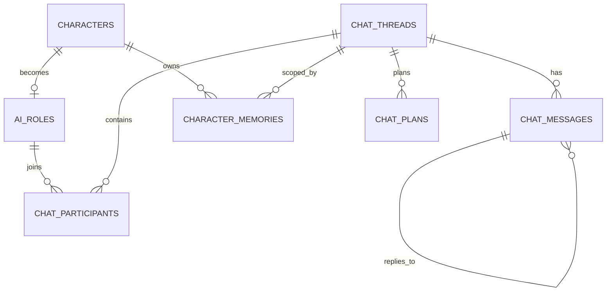

# 阶段 E：AI 角色聊天室完整设计

定位：把 03 人物转化为可互动的 AI 角色，支持**私人对话**与**多人聊天室**；独立系统，不绑定故事线。

---

## 1. 分层：人物档案 ≠ AI 角色 ≠ 聊天

| 层 | 载体 | 可变性 |
| --- | --- | --- |
| 人物档案 | `characters`（既有） | 仅用户在 03 编辑 |
| AI 角色配置 | `ai_roles`（新） | 用户可编辑；由档案生成初版，不回写档案 |
| 对话/群聊 | `chat_threads / chat_messages`（新） | 追加式，不改档案 |
| 角色记忆 | `character_memories`（新） | 角色私有；不自动变经历 |

## 2. 人物 → AI 角色转换

### 2.1 字段映射

| 人物字段 | 角色配置用途 | 规则 |
| --- | --- | --- |
| `basic_profile.name/code/gender/age/species` | `identity` | 直接取，缺失留空不编造 |
| `basic_profile.role/profession/identity` | `identity.identity_line` | 拼接为一句身份描述 |
| `basic_profile.background/intro` | `identity.background_brief` | 截断 ≤400 字 |
| `engines.ovtde.{O,V,D,E,T}.val` | `psyche.drives` | **数值转行为约束**，不把 0-100 原始分直接写进 prompt |
| `engines.ovtde.*.behavior/over/under/threat/desire` | `psyche.drives[].behavior/risk` | 取文本，每条 ≤80 字 |
| `engines.dominance` | `psyche.dominance` | 主/辅引擎，决定冲突时的优先级 |
| `defense_mechanisms` | `psyche.defenses` | 取名称列表 |
| `reality_conditions` | `constraints.reality` | 作为"不能做什么"的硬约束 |
| `thought_imprints` | `psyche.imprints` | 取前 6 条，用于价值判断 |
| `life_history.events`（最近 5 条） | `memory_seed` | 只取标题/影响，不全文注入 |
| `relationships`（与在场角色） | `relation_map` | 按需查询，会话内动态注入 |
| 用户填写 | `voice` / `boundaries` / `relation_to_user` | 新增，不来自档案 |

### 2.2 persona_config 结构（JSON）

```json
{
  "identity": {"name": "", "world": "", "identity_line": "", "background_brief": ""},
  "psyche": {
    "drives": {"O": {"val": 85, "behavior": "先观察再出手", "risk": "过度算计"},
               "V": {...}, "D": {...}, "E": {...}, "T": {...}},
    "dominance": {"engines": ["D", "T"], "description": ""},
    "defenses": [], "imprints": []
  },
  "voice": {"tone": "克制、少废话", "cadence": "短句", "vocabulary": "偏实务", "taboos": [], "examples": []},
  "boundaries": {"knows": [], "unknown": [], "refuse": ["不替用户做不可逆决定"], "can_break_character": true},
  "relation_to_user": {"stance": "谨慎的合作者", "address": "道友", "trust": 0.4},
  "constraints": {"reality": [], "power_limits": []},
  "memory_seed": [{"content": "曾被墨居仁收为记名弟子", "importance": 0.8}],
  "meta": {"source": "character", "character_id": "", "version": 1}
}
```

生成方式：
1. **确定性构建**（默认，无 AI）：按上表抽取 + 规则化措辞；
2. **可选 AI 润色**：只允许改写 `voice`/`identity_line`，必须用户确认后才保存；
3. 用户可手改任意字段，保存只写 `ai_roles`。

### 2.3 不做什么

- 不把 `engines`/`life_history`/`thought_imprints` 全量拼进一段提示词。
- 不把 0–100 数值当作"人格设定"直接喂给模型（改为行为约束文本）。
- 不因为模型好演而改 ESA/BMOS 定义。
- 不覆盖 `characters`。

## 3. 提示词分层（每次调用按需组装）

```
[L1 角色身份] identity + voice（≤300 字）
[L2 硬约束] constraints.reality + boundaries.refuse + 不得替用户做决定
[L3 关系立场] relation_to_user + 对在场角色的当前关系（四象限一句话）
[L4 记忆] 检索到的 character_memories（≤6 条）+ 线程摘要
[L5 对话窗口] 最近 N 条消息（≤12 条 / ≤3000 字）
[L6 任务] 本轮发言要求（回复谁、长度、是否允许提问）
```

## 4. 数据模型

### 4.1 新增表（6 张）

#### `ai_roles`

| 字段 | 说明 |
| --- | --- |
| id, world_id, character_id（unique） | 一个角色对应一个人物 |
| enabled | 是否可在聊天中使用 |
| display_name | 聊天显示名（可与人物名不同） |
| persona | persona_config JSON |
| source | auto / manual |
| version | 递增，便于回滚配置 |
| status | active / disabled |
| created_at / updated_at | — |

#### `chat_threads`

| 字段 | 说明 |
| --- | --- |
| id, world_id | — |
| kind | private / group |
| title | 私聊默认「与 X 的对话」 |
| status | active / archived |
| settings | `{max_speakers:3, max_rounds:2, window:12}` |
| summary | 滚动摘要（长对话压缩） |
| last_message_at | 排序 |
| created_at | — |

#### `chat_participants`

| 字段 | 说明 |
| --- | --- |
| id, thread_id, character_id, role_id | role_id → ai_roles |
| order_index | 发言优先级 |
| speak_policy | auto / when_mentioned / silent |
| joined_at | — |

唯一约束 `(thread_id, character_id)`。

#### `chat_messages`

| 字段 | 说明 |
| --- | --- |
| id, thread_id（idx）, sender_type | user / character / system |
| character_id | 角色消息必填 |
| content | 文本 |
| reply_to_id | 回复哪条（角色互相对话） |
| meta | `{plan_id, engine_label, state_hint, latency_ms}` |
| created_at（idx） | — |

#### `character_memories`

| 字段 | 说明 |
| --- | --- |
| id, world_id, character_id（idx） | — |
| thread_id | 可空；群聊记忆绑定群 |
| scope | private / group / global |
| kind | episodic / semantic / relation |
| content | ≤300 字 |
| importance | 0–1 |
| source_message_ids | JSON |
| last_used_at / created_at | — |

#### `chat_plans`（可选，建议保留）

`id, thread_id, trigger_message_id, plan JSON（发言顺序+理由）, model, created_at`

### 4.2 ER



## 5. 私人对话流程

1. 03 人物页「与 TA 聊天」→ 若无 `ai_roles` 则用确定性构建生成，弹「角色配置确认」（可改语气/称呼/边界）。
2. 创建/复用 `chat_threads(kind=private)`（同一人物默认一个活跃私聊）。
3. 用户发言 → 写入 `chat_messages(user)`。
4. 组装 L1–L6 → 一次模型调用（统一客户端，带请求级 Key/模型）。
5. 角色回复写入；触发记忆抽取（见 §7）。
6. 恢复历史：按 `last_message_at` 列表；消息分页读取。

## 6. 多人聊天室

### 6.1 创建与成员

- 创建 `chat_threads(kind=group)`，从 `ai_roles` 中选择 2–6 人加入（`chat_participants`）。
- 可移除/更换角色（归档参与行，不删历史消息）。
- 发言策略：`auto`（可被调度）/`when_mentioned`/`silent`。

### 6.2 调度（关键：不是每人各答一遍）

**第一步：调度调用（1 次）**

输入：线程摘要 + 最近 8 条消息 + 每个角色一行卡（`identity_line` + `dominance` + 当前关系）+ 规则。
输出 JSON：

```json
{"speakers":[{"character_id":"...","reason":"被点名/与自身利益相关","reply_to":"msg_id","intent":"质问"}],
 "silent":[{"character_id":"...","reason":"不关心"}],
 "rounds":1}
```

约束：`len(speakers) ≤ max_speakers(3)`；允许 0 人（用户只是告知）；`reply_to` 必须是已有消息。

**第二步：逐个发言（N 次，顺序执行）**

每个角色独立组装提示词（自己的 L1–L6 + 本轮任务），生成回复；后发言者能看到前面角色刚说的话（保证互动关联）。

**第三步（可选）：角色互相对话一轮**

若 `rounds=2` 且出现 `reply_to` 指向角色消息，允许被回复者再回应一次，总调用上限 5 次/用户消息。

### 6.3 独立性与共享上下文

- 共享：`chat_threads.summary` + 最近消息窗口（所有人可见）。
- 独立：每个角色的 `character_memories`（`scope=group` 也按角色分条存储）+ 各自 persona。
- 禁止：把 A 的记忆写进 B；同一人物在不同群可有不同记忆（thread 绑定）。

### 6.4 成本与延迟

| 场景 | 调用数/用户消息 | 预估延迟 | 控制 |
| --- | --- | --- | --- |
| 私聊 | 1（+周期性记忆抽取） | 2–8s | 窗口 12 条 |
| 群聊 3 人 | 1 调度 + ≤3 发言（+≤1 追问） | 6–20s（顺序） | speakers≤3、rounds≤2 |
| 上下文 | 每次 ≤6k tokens | — | L4/L5 截断 + 摘要 |

并发：同一 thread 串行（防乱序）；不同 thread 可并行。前端逐条渲染，显示"X 正在输入"。

## 7. 记忆机制

| 项 | 设计 |
| --- | --- |
| 写入时机 | 每轮结束；只对实际发言的角色抽取 0–2 条 |
| 抽取方式 | 规则（长度/情绪词）+ 可选轻量 AI 摘要；失败不影响主流程 |
| 检索 | `importance` + 关键词/人物/事件相似度 + 最近使用时间；每次 ≤6 条 |
| 压缩 | 消息超过窗口 → 更新 `threads.summary`（滚动摘要），原消息保留 |
| 删除 | 用户可按角色/线程清理记忆；不影响档案 |
| 隔离 | 记忆只属于角色+线程；不写 `characters` |

## 8. 与正式数据的边界

| 行为 | 允许 | 说明 |
| --- | --- | --- |
| 聊天读取人物档案 | ✅ 只读 | 包括 engines/关系（转换后使用） |
| 聊天修改人物档案 | ❌ | 任何写操作走 03 |
| 聊天写人物经历 | ⚠️ 需显式 | 「沉淀为经历」→ 追加 `life_history.events` + `state_histories(source='chat')` |
| 聊天改关系 | ⚠️ 需显式 | 「更新关系」确认后走既有 relationships 接口 |
| 聊天生成故事事件 | ⚠️ 需显式 | 「转为故事事件」→ 走事件创建接口，需确认 |
| 聊天影响故事线 | ❌ 默认 | 第一版不联动 |

## 9. API 设计（约 18 条）

```
GET    /api/characters/{id}/ai-role            读取/生成角色配置（?build=true 生成初版）
PUT    /api/characters/{id}/ai-role            保存配置（写 ai_roles）
POST   /api/characters/{id}/ai-role/enable     启用/停用

POST   /api/chat/threads                       创建私聊/群聊
GET    /api/worlds/{wid}/chat/threads          会话列表
GET    /api/chat/threads/{id}                  详情（成员/摘要）
PATCH  /api/chat/threads/{id}                  改名/归档
POST   /api/chat/threads/{id}/participants     加人
DELETE /api/chat/threads/{id}/participants/{cid} 移除
GET    /api/chat/threads/{id}/messages         分页历史
POST   /api/chat/threads/{id}/messages         用户发言 → 触发调度与回复
POST   /api/chat/threads/{id}/plan             仅生成发言计划（调试/预演）
GET    /api/chat/threads/{id}/memories         角色记忆列表
DELETE /api/chat/memories/{id}                 删除记忆
POST   /api/chat/messages/{id}/to-event        转为故事事件（确认后）
POST   /api/chat/messages/{id}/to-experience   沉淀为人物经历（确认后）
```

## 10. 页面与交互

- 入口：03 人物卡片「与 TA 聊天」；顶部导航新增「AI 角色聊天」。
- 聊天页：左侧会话列表（私聊/群聊分组）；中间消息流；右侧成员与角色卡（可切换查看 persona、记忆）。
- 群聊消息显示角色名/头像色；`reply_to` 显示引用条。
- 「正在输入」按角色显示；失败可重试单条。
- 角色配置面板：身份/语气/称呼/边界/初始记忆，带「从档案重建」按钮（覆盖前确认）。

## 11. 风险

| 风险 | 缓解 |
| --- | --- |
| 角色串味（记忆/语气混淆） | 每次调用独立组装，只注入本人记忆；测试覆盖 3 人交叉对话 |
| 群聊成本/延迟高 | speakers≤3、rounds≤2、窗口 12 条、摘要压缩 |
| 档案被聊天污染 | 所有写档案接口独立且需确认；chat 层无档案写权限 |
| 记忆无限增长 | 重要度阈值 + 每线程上限（如 200 条）+ 定期压缩 |
| 角色配置与档案漂移 | `ai_roles.version` + 「从档案重建」 |
| 长上下文超限 | L4/L5 截断 + 摘要；超限降级为摘要 + 最近 6 条 |

## 12. 验收标准

- 03 选人 → 启用 → 私聊可连续对话，重启后历史仍在。
- 角色称呼/语气/边界与配置一致；不同角色不串记忆。
- 群聊：3 人房间中用户一句话可触发 1–3 人回应，角色之间出现引用式互动。
- 调度可解释（`chat_plans` 可查）；不出现"每人各答一遍"。
- 聊天不改变 `characters`/`relationships`/`events`（对比前后指纹）。
