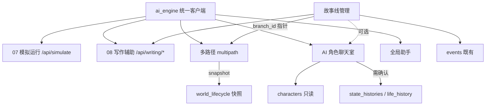
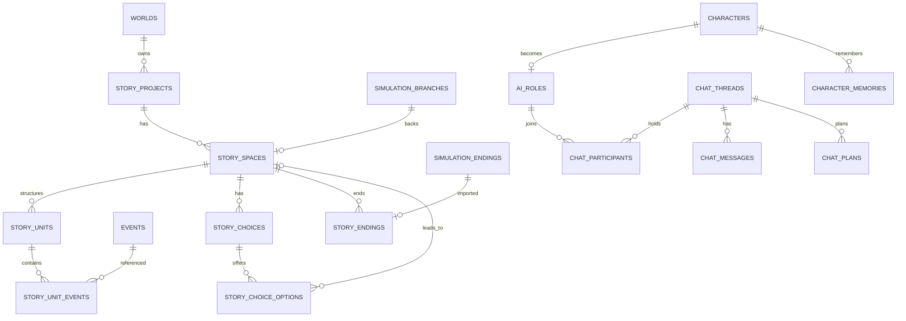

# 阶段 F：统一技术架构方案

范围：阶段 C 整合 + 阶段 D 故事线 + 阶段 E 聊天室。**全部为新增表/新增接口，不删除、不改写既有字段语义。**

---

## 1. 模块依赖关系



依赖方向：新系统依赖既有；既有系统**不反向依赖**新系统（除 07/08 的入口 UI 与写作可选参数）。

## 2. 统一 ER（新增与既有）



## 3. 数据归属与真相源

| 数据 | 真相源 | 新系统如何使用 |
| --- | --- | --- |
| 人物档案/引擎 | `characters` | 只读；生成 `ai_roles.persona` 副本 |
| 人物状态（随时间） | 分支快照 | 空间通过 `branch_id` 读取 |
| 事件 | `events` | 结构挂接；空间内事件带 `branch_id` |
| 世界状态 | `worlds/world_settings` + 快照 | 只读；六轴由用户填写 |
| 章节 | `stories` | 08 产出；故事线**不接管** |
| 多路径状态 | `simulation_*` | 故事线只存指针 |
| 聊天 | `chat_*` | 独立；不写档案 |
| 变更历史 | `state_histories` | 聊天"沉淀"时写入 |

## 4. 数据库迁移

### M016 故事线（8 张新表）

```
story_projects, story_spaces, story_units, story_unit_events,
story_choices, story_choice_options, story_endings, story_rejoins
```

- 索引：`story_spaces(story_id)`, `story_spaces(branch_id) UNIQUE`, `story_units(story_id, space_id)`, `story_unit_events(unit_id)`, `story_choices(space_id)`, `story_endings(space_id)`。
- 外键：`world_id → worlds.id`，`story_id → story_projects.id`，`branch_id → simulation_branches.id`（`ON DELETE SET NULL`，避免删分支连带删结构）。
- `world_lifecycle._MULTIPATH_TABLES` 风格：新增 `_STORY_TABLES`，世界删除时显式级联（项目→空间→单元→挂接→选择→选项→结局）。

### M017 聊天室（6 张新表）

```
ai_roles, chat_threads, chat_participants, chat_messages,
character_memories, chat_plans
```

- 索引：`ai_roles(character_id) UNIQUE`, `chat_threads(world_id, last_message_at)`, `chat_messages(thread_id, created_at)`, `character_memories(character_id, thread_id)`。
- 外键：`character_id → characters.id ON DELETE CASCADE`；`thread_id → chat_threads.id ON DELETE CASCADE`。
- 不触碰既有表。

### 兼容性

- 无 `ALTER`、无列删除。
- 旧接口返回结构不变（新增字段仅在显式请求时出现）。
- 回滚：停用功能开关 → 删新表 → 旧功能不受影响。

## 5. 接口边界（汇总）

| 域 | 新增 | 修改（兼容） |
| --- | --- | --- |
| 多路径整合 | 0 | `writing.generate` 增加可选 `branch_id/direction_id`；`config.ts` 白名单 |
| 故事线 | 26 条（D §7） | 0 |
| 聊天室 | 18 条（E §9） | 0 |
| 既有 07/08 | 0 | 增加开关 UI；错误码统一 |

命名空间：`/api/stories/*`、`/api/spaces/*`、`/api/units/*`、`/api/choices/*`、`/api/chat/*`、`/api/characters/{id}/ai-role`。

## 6. 安全与隔离

| 风险 | 控制 |
| --- | --- |
| 跨空间状态污染 | 空间写操作只允许 `branch_id`；故事层无状态字段；应用分支仅在多路径页 |
| 聊天污染档案 | `chat` 服务不持有 `characters` 写权限；沉淀走独立确认接口 |
| 访客 Key 泄漏 | 仅请求头传递，不落库；日志不打印 |
| 越权读取其它世界 | 所有新接口强制 `world_id` 校验（复用 `get_world`） |
| AI 建议未确认入库 | `confirmed=false` 默认；仅用户确认后生效 |
| 大快照 DoS | 单空间节点上限 + 快照大小告警 |

## 7. 性能与容量

| 项 | 现状/预估 | 措施 |
| --- | --- | --- |
| 世界快照 | 每节点全量 | v1 限制；v2 增量 |
| 故事查询 | 空间/单元/事件 join | 组合索引；`overview` 聚合缓存 |
| 聊天消息 | 线性增长 | 分页 + 线程摘要；每线程记忆上限 |
| 群聊调用 | 1+N（≤5） | 上限 + 超时 + 单条重试 |
| SQLite 并发 | 单写 | 事务短小；聊天串行写线程 |

## 8. 开发阶段与验收

| 阶段 | 内容 | 依赖 | 验收 |
| --- | --- | --- | --- |
| F1 | 修 A1/A2/A3/A6 + 07/08 开关 + 写作可选分支 | A | 07/08 回归 + 访客 Key 生效 + 分支素材可写 |
| F2 | M016 + 故事线 CRUD + 空间/单元/选择 | F1 | 29 项新用例 + 空间隔离 |
| F3 | 官方演示导入（正史 + 1 分叉空间） | F2 + 演示资料确认 | 演示路径可走通 |
| F4 | M017 + 角色配置 + 私聊 | F1 | 私聊连续性/隔离用例 |
| F5 | 群聊调度 + 记忆 | F4 | 3 人群聊互动用例 |
| F6 | 两系统连接（可选） | F2/F5 | 事件/空间→聊天背景 |

顺序理由：先修统一接入，避免新入口绕过请求级配置；故事线先于聊天，因为聊天后续要引用空间/事件，但第一版不强制绑定。

## 9. 测试策略

- 新增后端套件：`smoke_storyline.py`（≥30）、`smoke_chat.py`（≥25）。
- 隔离测试：两空间事件互不可见；聊天前后 `characters` 指纹不变。
- 调度测试：3 人房间不出现"全员各答一遍"；`chat_plans` 可解释。
- 回归：220 基线 + 新增。
- 前端：`tsc` + `build` + 浏览器关键路径（故事空间切换、群聊多角色回复）。

## 10. 里程碑风险

| 风险 | 触发条件 | 应对 |
| --- | --- | --- |
| 官方演示资料不足 | 无出逃线事件 | 演示降级或补 3 条事件（需确认） |
| 角色引擎双结构 | 扁平/嵌套混用 | 转换层做归一化 + 单测 |
| 快照膨胀 | 空间多、节点多 | 节点上限 + 增量快照排期 |
| 群聊成本 | 多角色长上下文 | 上限+摘要；必要时仅 2 人房 |
| 与章节表命名冲突 | 用户混淆 | UI 用词分离：故事线 vs 章节 |
