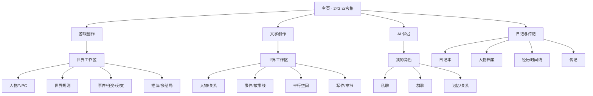
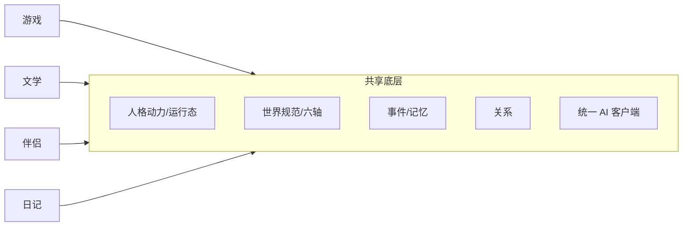
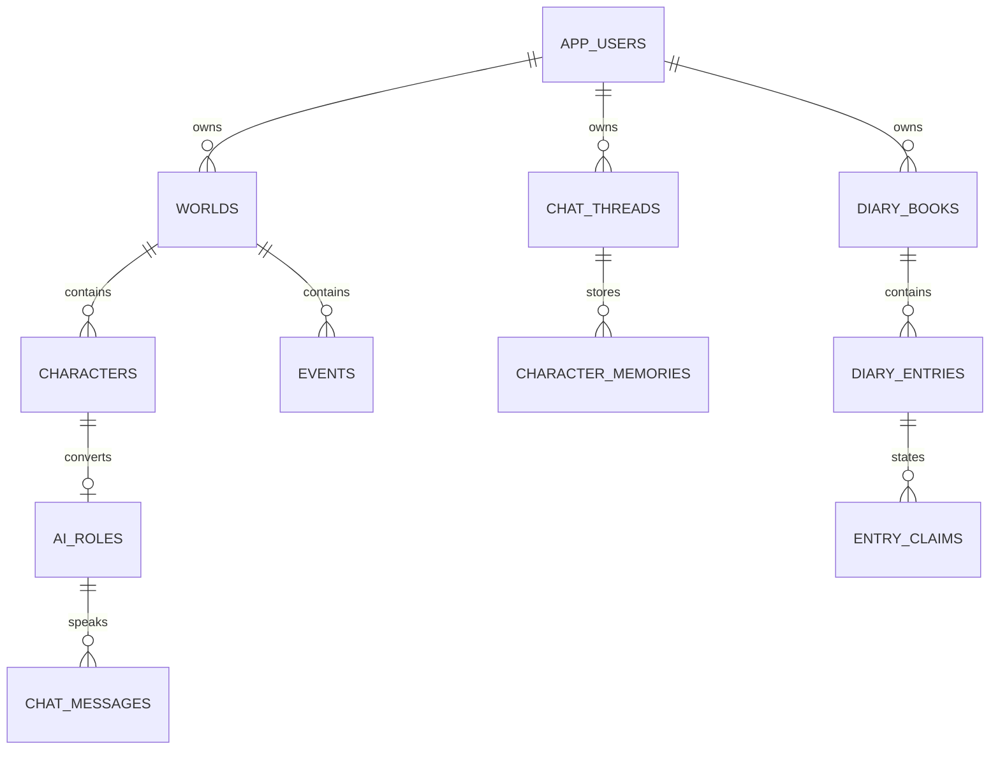

# 现有系统架构审查与四宫格产品结构

日期：2026-11-11  
目的：按"游戏创作 / 文学创作 / AI 伴侣 / 日记与传记"重新校准主页与模块职责，不推翻现有实现。

---

## 1. 现状盘点

| 项 | 数量/事实 | 证据 |
| --- | --- | --- |
| 前端页面 | 18 个 | `src/pages/` |
| 后端路由 | 166 条 | `GET /openapi.json` |
| 数据表 | 56 张 | `models.py` + M001–M020 |
| 世界 | 1 个官方演示（本地库） | `worlds` |
| 官方演示 | 8 正史事件 + 3 出逃事件、2 空间、2 结局 | 官方故事线 |
| 测试 | 356 项 / 10 套件 + 迁移演练 | `tests/run_all.sh` |
| 账号/权限 | **无** | 无 users/owner/auth 表或中间件 |

### 1.1 现有信息架构

```
01 世界总览（仪表盘）
02 世界管理
03 人物管理
04 关系与组织
05 事件管理
06 时间线
07 模拟运行
08 写作辅助
   故事线管理（独立入口）
   AI 角色聊天（独立入口）
   世界建设 / 世界结构 / 数据
   归档 / 回收站 / 时光机
```

### 1.2 现有页面与底层能力

| 页面 | 主要职责 | 可被哪些产品复用 |
| --- | --- | --- |
| WorldsPage / Overview | 世界列表、统计、入口 | 游戏、文学 |
| WorldBuilding / WorldStructure / WorldData | 世界规范、结构、数据 | 游戏、文学 |
| CharacterList / CharacterBuilding | 人物档案、人格、运行态 | 全部（伴侣/日记只读或简化） |
| Relationships | 人物关系、组织 | 游戏、文学（伴侣只读） |
| Events | 事件 CRUD、参与人、地点 | 游戏、文学 |
| Timeline / UnifiedTimeline / TimeMachine | 时间线、回溯 | 游戏、文学 |
| Simulation / MultiPath | 推演、方向、分支、结局 | 游戏、文学 |
| Storyline | 空间、单元、选择、结局、章节 | 文学（游戏可选） |
| Writing | 章节、草稿、解析、辅助 | 文学（游戏可选） |
| Chat | 角色聊天、群聊、记忆、影响 | AI 伴侣（游戏/文学可做 NPC 对话） |
| Archive / Trash | 归档、回收站 | 全部 |
| BiographyModal | 传记生成（人物内弹窗） | 日记与传记（部分） |

---

## 2. 目标产品与现状差异

### 2.1 四个入口

| 入口 | 目标 | 当前可复用 | 主要缺口 |
| --- | --- | --- | --- |
| 游戏创作 | 人物/NPC、世界规则、任务事件分支、推演、多结局、角色互动 | 02–07、故事线、聊天 | 任务/任务链、NPC 标签、游戏视图、产品场景标识 |
| 文学创作 | 人物关系、世界观、事件多剧情、主线/支线/副本/影线、平行空间、写作 | 02–08、故事线、多路径 | 人物独立故事线、DAG 叙事、作品/卷管理、文学视图 |
| AI 伴侣 | 私人角色、长期记忆、私聊/群聊、关系历史、稳定人格 | 03、聊天、关系、记忆 | 自我人物、伴侣档案、隐私隔离、简化配置 |
| 日记与传记 | 日记、人物档案、经历时间线、关系、传记 | 人物、传记（部分） | 日记数据层、来源标记、隐私空间、独立主页 |

### 2.2 关键定位差异

- 当前是"单用户的世界模拟工作台"，不是"多产品、多用户平台"。
- 当前 `world.type` 只有 `reality/fiction/historical/experimental`，**没有产品场景字段**。
- 当前所有页面围绕"世界"展开；日记不应强制依附世界。
- 当前聊天身份是会话设置，不是 03 人物；"自我身份"未落到人物档案。

---

## 3. 四宫格主页方案（建议）

### 3.1 信息架构



### 3.2 主页卡片（不新增四套系统）

每张卡片包含：

- 场景名与一句话定位；
- 最近对象（世界 / 角色 / 日记本）；
- 两个动作：`继续最近`、`新建`；
- 不展示 ESA/BMOS/六轴等后台配置。

点击后：

- 游戏/文学：进入世界选择或最近世界工作台，侧栏只显示该场景需要的模块；
- AI 伴侣：进入伴侣列表（角色卡），聊天页复用现有 ChatPage；
- 日记：进入日记本列表（新页面），人物档案复用 03 的只读摘要。

### 3.3 导航复用

| 场景 | 侧栏模块 | 隐藏/弱化 |
| --- | --- | --- |
| 游戏创作 | 01–07、故事线（可选）、聊天（NPC） | 08 默认收起 |
| 文学创作 | 01–06、08、故事线、多路径 | 07 作为"推演"工具保留 |
| AI 伴侣 | 角色、聊天、记忆、关系 | 世界建设、事件、推演、写作 |
| 日记与传记 | 日记、人物、经历、传记 | 世界模拟全部 |

同一套组件，仅入口、默认筛选、权限不同；**不复制四套页面**。

---

## 4. 四类产品功能矩阵

图例：✅ 已实现；◐ 部分实现；○ 未实现；— 不适用。

| 能力 | 游戏创作 | 文学创作 | AI 伴侣 | 日记与传记 |
| --- | --- | --- | --- | --- |
| 世界创建/规范 | ✅ | ✅ | ◐（轻量） | — |
| 人物档案/人格 | ✅ | ✅ | ✅ | ◐（简化） |
| 关系/组织 | ✅ | ✅ | ◐（只读） | ◐（人物关系） |
| 事件 CRUD | ✅ | ✅ | ○ | ○（用经历替代） |
| 事件多选择/结果/后续 | ○ | ○ | — | — |
| 时间线/回溯 | ✅ | ✅ | ◐ | ◐（人生时间线） |
| 分支/平行空间 | ✅ | ✅ | — | — |
| 多结局 | ✅ | ✅ | — | — |
| 故事线（树/图） | ◐ | ◐ | — | — |
| 写作/章节 | ◐ | ✅ | ○ | ◐（传记） |
| 私人聊天 | ◐（NPC） | ◐（角色） | ✅ | — |
| 群聊 | ◐ | ◐ | ✅ | — |
| 独立记忆 | ✅ | ✅ | ✅ | ○ |
| 日记 | — | — | — | ○ |
| 传记 | ◐ | ◐ | ◐ | ◐ |
| 来源标记/隐私 | — | — | ◐ | ○ |
| 多用户隔离 | ○ | ○ | ○ | ○ |

---

## 5. 底层共享与数据边界

### 5.1 共享能力



共享不等于同权：

- 游戏/文学可读写事件、分支、世界状态；
- 伴侣只读人物基线 + 自己的聊天记忆，不写正式事件/档案；
- 日记只读人物摘要，拥有独立事实库，不进入世界快照；
- 任何跨场景写入必须"显式转化 + 确认 + 来源记录"。

### 5.2 建议的数据边界模型



字段级建议（**待确认，未实施**）：

| 对象 | 新增字段 | 作用 |
| --- | --- | --- |
| `worlds` | `owner_id`, `product_scene` | 归属与场景 |
| `characters` | `is_user_avatar` | 自我人物（03 创建，伴侣快捷创建） |
| `chat_threads` | `user_character_id` | 绑定自我人物 |
| `diary_books` | `owner_id`, `visibility` | 私有空间 |
| `diary_entries` | `world_id?`, `character_id?` | 可选关联，不强制 |
| `entry_claims` | `source_type`, `confidence`, `confirmed_at` | 事实/回忆/他人/AI 推断 |

> 当前**没有** `app_users`，所以以上是建议方案，不是已实现。

### 5.3 隔离规则（设计）

1. **账号级**：所有私人对象必须带 `owner_id`；API 从会话取用户，不接受客户端传 owner。
2. **场景级**：`product_scene` 决定默认可见模块；伴侣不加载世界建设/事件。
3. **对象级**：世界/分支/线程/日记本 ID 必须校验归属。
4. **检索级**：聊天记忆检索限定 `thread_id + character_id`；日记默认不进入任何检索。
5. **转化级**：聊天→事件/经历、日记→传记都必须用户确认，并保留来源。
6. **删除级**：日记删除不影响人物；世界删除不删日记；跨对象引用置空或快照。

### 5.4 现状核对

| 规则 | 现状 |
| --- | --- |
| 世界内数据按 `world_id` 隔离 | ✅ |
| 分支快照排除故事线/聊天 | ✅（`world_lifecycle._CHAT_TABLES` / `_STORY_TABLES`） |
| 聊天记忆按会话/角色 | ✅ |
| 聊天不自动改档案/事件 | ✅（影响需预览+确认） |
| 故事线引用事件不复制 | ✅（`story_unit_events`） |
| 用户级隔离 | ○ |
| 日记独立空间 | ○ |

---

## 6. 页面改造清单（建议，未实施）

| 优先级 | 改动 | 类型 |
| --- | --- | --- |
| P0 | 主页 2×2 四宫格 + 场景入口 | 新增组件，复用现有页面 |
| P0 | `product_scene` + 场景侧栏过滤 | 字段 + 前端 |
| P0 | 账号/owner（先单用户本地账号也可） | 新表 + 中间件 |
| P1 | 伴侣场景：角色卡/自我人物/简化配置 | 复用 03/聊天 |
| P1 | 日记本/日记条目/来源标记 | 新页面 + 新表 |
| P2 | 游戏任务/任务链 | 新表 + 页面 |
| P2 | 文学人物故事线/DAG | 故事线扩展 |
| P2 | 05 事件选择编辑器 | 事件页扩展 |

---

## 7. 风险

1. **无账号时做四宫格 = 只换皮**：私人数据仍互相可见；账号必须先于日记/伴侣上线。
2. **场景字段若只存 JSON**：查询/权限过滤困难；建议独立列。
3. **日记强制绑世界**：会让普通用户面对复杂世界配置；必须允许 world_id 为空。
4. **四套页面复制**：维护成本翻倍；坚持同一组件 + 场景过滤。
5. **旧数据归属**：现有世界无 owner，迁移需指定默认 owner（本地单用户可设为 `local`）。
6. **跨场景自动写入**：会污染档案/事件；必须保持"确认后转化"。

---

## 8. 结论

- 现有 02–08 与聊天/故事线**足以支撑**游戏与文学两个创作场景；
- AI 伴侣可复用人物+聊天，但缺"自我人物/伴侣档案/隐私"；
- 日记与传记只有传记半成品，**日记完全未实现**；
- 四宫格是入口与权限重组，不是四套新系统；
- 最大架构阻塞是**没有账号/归属**，其次是**没有产品场景字段**。
