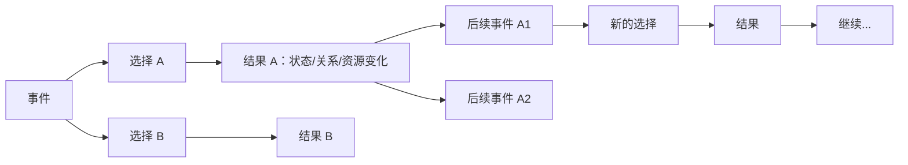
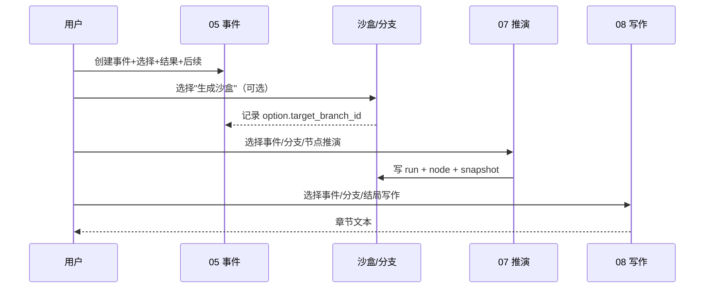
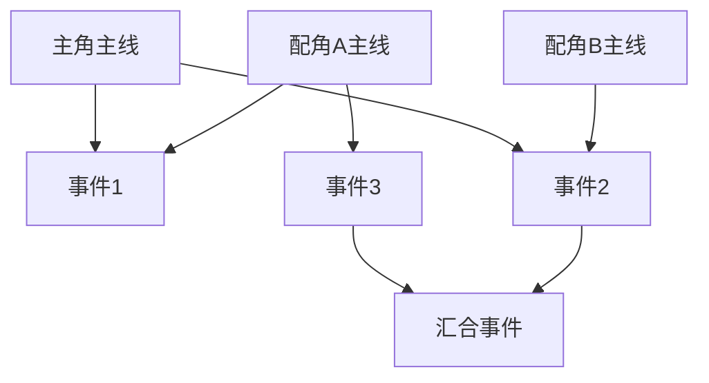

# 05 多剧情事件与故事线架构设计

日期：2026-11-11  
原则：05 创建可能性，07 探索可能性，08 表达可能性；故事线只组织引用，不复制事件。

---

## 1. 现状审查

### 1.1 05 当前数据结构

`events`（单事件）：

| 字段 | 含义 | 与多剧情的关系 |
| --- | --- | --- |
| `name/description` | 事件名/描述 | 单一叙事，不是结局字段 |
| `parent_event_id` | 父事件 | 只有单亲，不能表达多结果 |
| `caused_by` | 原因（JSON） | 记录因果，不是选择 |
| `participants/affected` | 参与者/影响对象 | 人物进入推演的入口 |
| `polarity/intensity/domain` | 极性/强度/领域 | 事件扰动参数 |
| `branch_id` | 所属分支 | 分支事件与主线隔离 |
| `story_time/location/organization` | 时空/地点/组织 | 上下文 |

关联表：

- `event_entities`：人物/地点/组织/物品与事件的多对多；
- `event_relations`：事件→事件的有向关系（`relation_type/description/confidence/evidence`），**已具备 DAG 基础**；
- `simulation_branches/nodes/runs`：分支状态与历史；
- `story_choices/options`：故事线层的选择与选项（锚定事件、选项后果、目标空间）。

### 1.2 关键结论

1. **事件本身没有"选择/结果/后续事件"三元结构**；事件页只能编辑单事件。
2. 选择出现在**故事线页**，且选项只存 `consequence` 文本，不直接指向后续事件。
3. 后续事件靠"空间 + 单元 + 事件挂载"间接表达，05 单独使用时无法表达。
4. `event_relations` 可承载事件间因果/DAG，但未与选择项绑定。
5. 分支/快照能力已存在，可作为"平行沙盒"的状态底座。

---

## 2. 目标模型：选择 / 结果 / 后续事件

### 2.1 三层语义



- **选择**：谁在什么条件下做了什么决定；
- **结果**：决定的直接后果（文本 + 结构化状态变化）；
- **后续事件**：结果触发的新事件（可继续有选择）。

三者必须分表/分字段，不能合并成结局文本。

### 2.2 建议表（新增，不改 `events` 既有列）

| 表 | 关键字段 | 说明 |
| --- | --- | --- |
| `event_choices` | `id, world_id, event_id, title, description, precondition(JSON), status` | 一个事件可有多个选择点 |
| `event_choice_options` | `id, choice_id, label, action, consequence, outcome_event_id?, target_branch_id?, source, confirmed, order_index` | 选项=决策；结果文本+后续事件 |
| `event_outcomes`（可选） | `id, option_id, state_delta(JSON), relation_delta(JSON), resource_delta(JSON), world_delta(JSON)` | 需要结构化结算时使用；第一版可先存 JSON 在 option |
| `event_relations`（复用） | `source_event_id, target_event_id, relation_type` | `triggers/follows/blocked_by` 表达后续事件 |

> 以上为**建议方案**，本轮未建表、未迁移。

### 2.3 与现有 `story_choices` 的兼容

两条路线：

| 路线 | 做法 | 优点 | 风险 |
| --- | --- | --- | --- |
| A（推荐） | 05 新建 `event_choices/options`；故事线通过 `anchor_event_id` 引用；旧 `story_choices` 保留只读/迁移 | 05 独立可用，职责清晰 | 两套选择短期并存 |
| B | 扩展现有 `story_choices/options`，允许 `space_id` 为空 | 迁移少 | 05 被故事线绑架；独立事件仍不可用 |

推荐 A；迁移时把旧 `story_choices` 逐条映射到 `event_choices`（保留 ID 映射表），确认后再下线旧写入口。

### 2.4 事件页交互（建议）

```
[事件基本信息]
[参与人/地点/时间/极性/强度]
────────────────────────
选择点 1：是否接受条件？
  选项 A：接受
    结果：获得资源，失去自主权（结构化 delta）
    后续事件：入黄枫谷（可新建/选已有）
    生成沙盒：[是/否]
  选项 B：拒绝
    结果：关系恶化
    后续事件：被逐出（可新建/选已有）
[+ 选择点]
```

规则：

- 选项必须至少有一个"结果文本"；后续事件可选；
- 后续事件必须同世界；跨分支需显式选择目标分支；
- AI 建议的选项默认 `confirmed=false`，确认后才可生成沙盒；
- 事件保存不自动运行推演；生成沙盒是显式动作。

---

## 3. 平行沙盒复用分析

### 3.1 现有多路径能力

| 能力 | 现状 | 证据 |
| --- | --- | --- |
| 方向 CRUD/排序/AI 建议 | ✅ | `multipath.py` directions |
| 从方向建分支 | ✅ | `POST /api/branches` |
| 分支独立快照 | ✅ | `base_snapshot/current_snapshot` |
| 节点历史 | ✅ | `simulation_branch_nodes` |
| 单事件推演 | ✅ | `POST /api/branches/{id}/simulate` |
| 回溯到节点 | ✅ | `POST /api/branches/{id}/rollback` |
| 继续推演 | ✅ | 分支继续 simulate |
| 分支比较 | ✅ | `POST /api/branches/compare` |
| 结局保存 | ✅ | `simulation_endings` |
| 分支汇合 | ◐ | `story_rejoins` 仅记录，不合并状态 |
| 故事线空间绑定分支 | ✅ | `story_spaces.branch_id/base_node_id` |

### 3.2 复用结论

- **独立状态、历史回溯、继续推演**可直接复用 `simulation_branches`；
- 05 的每个选项可在"生成沙盒"时创建分支，根事件=选择锚定事件；
- 故事线空间只是分支的叙事包装（已有 `space.branch_id`），不另建状态引擎；
- 汇合仍是"记录 + 人工处理"，不能自动合并两套人物/关系状态。

### 3.3 需要补的字段（建议）

- `simulation_branches.origin_choice_option_id`：标明从哪个选项生成；
- `simulation_branches.scope`：`event` / `story_space`，区分独立沙盒与故事线空间；
- 05 页面直接展示分支比较/回溯，不要求先建故事。

---

## 4. 05 / 07 / 08 职责与调用关系



| 模块 | 可以写 | 不得写 |
| --- | --- | --- |
| 05 | 事件、选择、选项、后续关系 | 分支快照、推演结果、章节 |
| 07 | 推演运行、分支节点、快照、结局 | 事件定义、选择、章节 |
| 08 | 章节、草稿、版本 | 事件定义、分支、选择 |

**现状核对**：

- 07 已支持 `branch_id` 推演；08 生成支持 `branch_id` 过滤事件与推演记录；
- 08 不会自动创建分支；
- 05 目前不能创建选择 → 这是核心缺口。

---

## 5. 故事线管理设计

### 5.1 当前实现

- 故事 → 空间（正史/分叉）→ 单元树（主线/支线/阶段）→ 事件挂载（多对多）；
- 选择/选项/结局；
- 章节关联（G6）；
- 空间绑定分支，可回溯/比较；
- 树状页面已可用。

### 5.2 与目标的差距

| 目标 | 现状 | 差距 |
| --- | --- | --- |
| 主角主线/支线 | ◐ 单元 kind | 无人物归属 |
| 配角独立主线 | ○ | 单元不能绑定人物 |
| 配角自己的支线 | ○ | 同上 |
| 多人物共同事件线 | ◐ 事件多对多 | 无"人物线"视图 |
| 副本/影线/暗线 | ◐ kind 可填 | 无独立视图/权限 |
| 事件内部多结局 | ✅ 选择/空间 | 选项不直连后续事件 |
| 事件被多条线引用 | ✅ 多对多 | 无 DAG 校验/可视化 |
| 调整顺序不改事件 | ✅ 只改挂载 | — |

### 5.3 建议：人物故事线 + DAG

新增（建议，未实施）：

| 表 | 字段 | 作用 |
| --- | --- | --- |
| `story_threads` | `id, story_id, world_id, character_id?, parent_thread_id?, kind(main/side/copy/shadow), title, order_index, status` | 人物主线/支线；character 为空=群像线 |
| `story_thread_events` | `thread_id, event_id, order_index, role, is_shared, note` | 事件在一条线中的位置；可多线引用 |
| `story_thread_edges` | `from_thread_id/from_event_id, to_thread_id/to_event_id, edge_type, note` | 汇合/分叉/影响；DAG |



设计规则：

1. **树是阅读视图，图是真实关系**：默认树，允许"多父/汇合"时显示为 DAG；
2. 事件只存一份，线程只存引用与顺序；
3. 调整线程/顺序不修改 `events`、不重跑推演；
4. 分支空间仍是状态隔离单位；线程是叙事组织单位，二者不混；
5. 汇合只记录 `story_rejoins`，状态合并需单独设计。

### 5.4 页面原型（文字）

```
故事线
├ 空间切换：正史 | 出逃线 | ...
├ 视图：结构树 | 人物线 | 时间顺序 | DAG
├ 左：人物线列表（主角/配角A/配角B/群像）
├ 中：树/图（事件节点，点击展开选择/结果/后续）
└ 右：事件详情（引用，不复制）+ 关联章节
```

---

## 6. 数据库与迁移建议

| 迁移 | 内容 | 兼容性 |
| --- | --- | --- |
| M021 | `app_users`、`worlds.owner_id/product_scene` | 加列可空；旧数据默认 owner |
| M022 | `event_choices/options` | 新表；不改 `events` |
| M023 | `story_threads/thread_events/edges` | 新表；旧单元保留 |
| M024 | 日记/传记表 | 新表；不依赖世界 |
| M025 | `simulation_branches.origin_choice_option_id/scope` | 加列可空 |

原则：只加列/加表，不删不改现有字段；迁移前副本演练；故事线/聊天/日记表不进入世界快照。

---

## 7. 风险与待确认

1. 两套选择并存（旧 story_choices / 新 event_choices）→ 需确认迁移窗口；
2. 一个选项生成多个后续事件 → 需定义"结果"是单事件还是事件集合；
3. 后续事件跨分支 → 需确认是复制事件还是引用；
4. DAG 汇合的状态语义 → 本轮不自动合并；
5. 05 独立使用是否要求先有故事线 → 建议不要求；
6. AI 生成选项的确认与审计 → 沿用 `confirmed + source`。

---

## 8. 结论

- 现有分支/快照/回溯/比较**足以承接平行沙盒**；
- 缺的是 05 事件层的"选择/结果/后续事件"三张表与编辑交互；
- 故事线缺的是"人物线 + DAG"，不是重写；
- 05/07/08 边界可以靠现有 `branch_id` 与页面职责直接落地，不需要新推演引擎。
