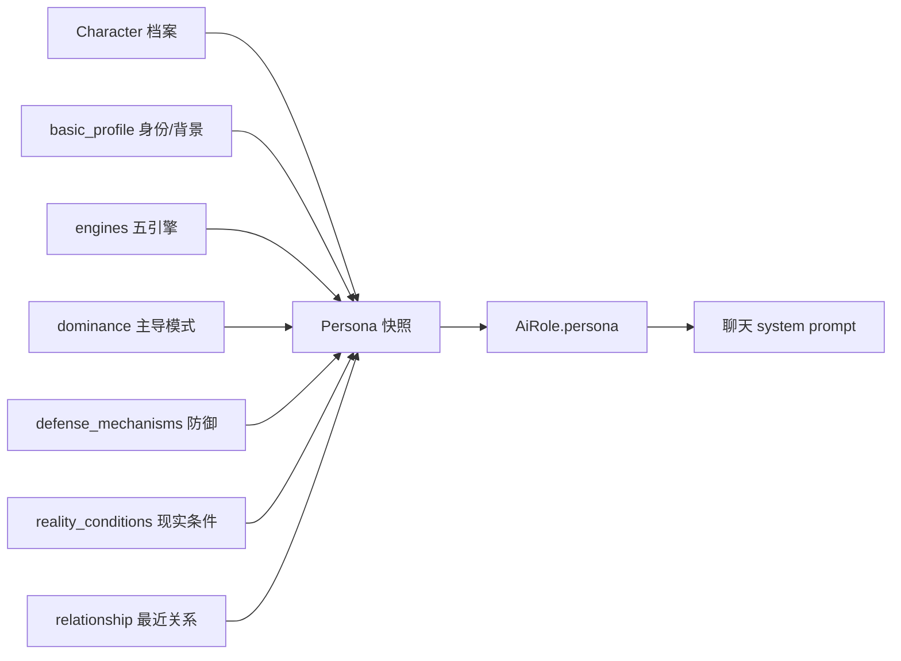
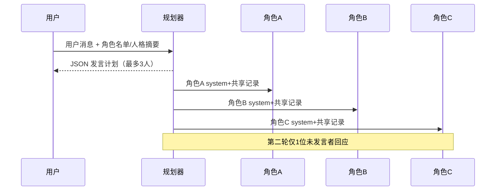
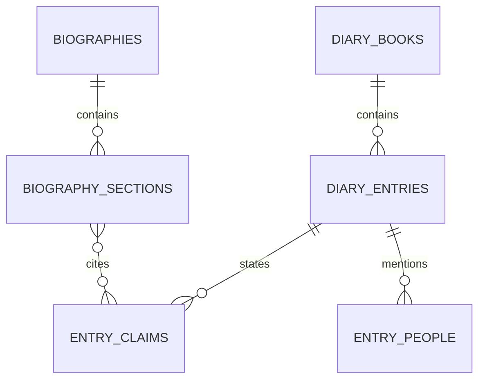

# AI 角色聊天室与日记/传记架构设计

日期：2026-11-11  
原则：聊天是角色运行时，不是人物档案；日记是私人事实空间，不是世界事件。

---

## 1. AI 角色聊天：现状

### 1.1 已实现能力

| 能力 | 现状 | 证据 |
| --- | --- | --- |
| 人物→AI 角色 | ✅ 确定性转换，不调用 AI 生成人格 | `chat.build_persona` |
| 角色配置编辑/版本 | ✅ `ai_roles` | F4 |
| 私聊 | ✅ 单角色、长期记忆 | F4 |
| 群聊 | ✅ 最多 6 人，规划+发言调度 | F5 |
| 独立记忆 | ✅ 每人 `character_memories` | F4/F5 |
| 共享上下文 | ✅ 会话消息序列 | F5 |
| 聊天→事件/经历 | ✅ 显式按钮 | F6 |
| 影响建议（关系/六轴） | ✅ 预览→确认→应用/驳回 | F7 |
| 用户身份 | ◐ 会话设置 `user_identity` | G16 |
| 自我人物（03） | ○ | 未实现 |
| 用户级隔离 | ○ | 无账号 |

### 1.2 角色转换保留的字段



- 转换是**规则映射**，不是 AI 生成；
- `AiRole.persona` 是快照，可手动修订并升版本；
- 聊天只写 `ChatMessage / CharacterMemory / ChatImpact`，不改 `Character` 档案；
- 角色被删除/归档时，聊天线程保留但拒绝新发言（现有校验）。

### 1.3 缺口

1. 用户身份只存在 `chat_threads.settings`，不是 03 人物；
2. 不能从 03 选一个"我自己"作为对话身份；
3. 不能快捷创建自我人物；
4. 聊天 AI 入口未纳入个人 Key 白名单（见验收报告 G-02）；
5. 无账号，无法证明"我的聊天别人看不到"。

---

## 2. 目标：03 自我人物 + 快捷创建

### 2.1 建议模型

- `characters.is_user_avatar`（布尔，默认 false）：标记"我在这个世界中的身份"；
- `chat_threads.user_character_id`（可空）：会话绑定自我人物；
- 兼容：未绑定则继续读 `settings.user_identity`；
- 一个世界可有多个自我人物（不同剧本/身份），但一个会话只绑一个。

### 2.2 流程

```mermaid
flowchart TB
  A[03 人物管理] -->|标记为"我的身份"| U[自我人物]
  B[聊天页] -->|选择已有| U
  B -->|快捷创建| Q[最小档案：称呼/身份/背景]
  Q --> U
  U --> T[会话 user_character_id]
  T --> P[system prompt 注入身份]
```

规则：

- 快捷创建仍写入 03（不是影子档案），可在 03 继续完善；
- 自我人物不进入"可聊天角色"列表，避免自己和自己对话；
- 自我人物的关系仍可用于角色态度（只读）；
- 删除自我人物前要求解绑会话或转移。

### 2.3 页面改动（建议）

- 聊天右栏"我的身份"改为：
  - 下拉：选择 03 中的自我人物；
  - 按钮：`+ 快捷创建`（称呼/身份/背景）；
  - 保留"临时身份"作为未建人物时的兼容；
- 人物列表增加"设为我的身份"（additive，不改布局）。

---

## 3. 多人聊天室：上下文与调度

### 3.1 当前调度



- 每角色独立 persona、独立记忆、独立 `speak_policy`；
- 共享上下文：会话消息（有上限）；
- 计划失败→规则兜底（按策略/顺序）；
- 调用预算：1 规划 + ≤3 首轮 + ≤1 二轮 = ≤5；
- 群聊人数上限 6。

### 3.2 独立记忆

| 记忆类型 | 写入 | 读取 |
| --- | --- | --- |
| 情景记忆 | 每次角色回复后，规则截取用户+角色内容 | 该角色在该会话 |
| 摘要记忆 | 显式"AI 摘要"，≥6 条 | 该角色在该会话 |
| 群聊共享 | 消息本身 | 所有参与者 |

隔离规则：

- 查询必须同时限定 `thread_id + character_id`；
- 不跨会话、不跨世界检索；
- 记忆不自动写入人物档案/事件；
- 影响建议需要用户确认。

### 3.3 缺口

- 无"被点名才发言"的完整 @ 机制（当前策略有 `when_mentioned`，按名字匹配）；
- 无话题/房间分层；
- 无用户级权限；
- 无成本预算可视化（调用次数只在小字提示）。

---

## 4. 日记与传记：现状与目标

### 4.1 现状

| 能力 | 状态 | 说明 |
| --- | --- | --- |
| 日记 | ○ | 无表、无页面 |
| 人物档案 | ✅ | 03 |
| 经历/时间线 | ◐ | 事件/传记时间线，非私人经历 |
| 传记生成 | ◐ | `biography.py` 聚合事件/推演/成长，AI/本地兜底 |
| 来源标记 | ○ | 未区分事实/回忆/他人/AI |
| 隐私空间 | ○ | 无账号/无独立空间 |

### 4.2 目标数据模型（建议，未实施）



| 表 | 关键字段 |
| --- | --- |
| `diary_books` | `id, owner_id, title, description, visibility, created_at` |
| `diary_entries` | `id, book_id, entry_date, title, content, mood, location_text, world_id?, character_id?, privacy, status` |
| `entry_claims` | `id, entry_id, claim_text, source_type, subject_name, confidence, status, confirmed_at, evidence_ids(JSON)` |
| `entry_people` | `id, entry_id, character_id?, name_text, relation, role` |
| `biographies` | `id, owner_id, subject_character_id?, subject_name, title, status, model, generated_from(JSON)` |
| `biography_sections` | `id, biography_id, heading, content, claim_ids(JSON), order_index` |

`source_type` 枚举：

- `fact`：用户明确记录的事实；
- `memory`：本人回忆（可能失真）；
- `hearsay`：他人叙述；
- `inference`：AI 推断；
- `unknown`：尚未确认。

`status`：`pending / confirmed / rejected`。

### 4.3 真实性规则（硬约束）

1. AI 只能创建 `inference + pending`，**不得**自动写 `fact`；
2. 用户确认后才可升级为 `fact`，并记录确认时间与来源；
3. 传记生成默认只引用 `confirmed`；引用推断时必须显式标注"AI 推断"；
4. 回忆与他叙不得静默合并为事实；
5. 日记默认 `private`，不进入聊天/世界检索；
6. 任何跨场景使用（例如把日记片段转为角色记忆）必须逐条确认。

### 4.4 页面方案

```
日记与传记
├ 日记本列表
├ 日记编辑（日期/正文/心情/地点/人物）
│   └ 标记：事实 / 我的回忆 / 他人说 / AI 推断
├ 人生时间线（按年/月）
├ 人物档案（读 03 摘要）
└ 传记
    ├ 生成（选择范围/口吻/长度）
    ├ 章节（带引用）
    └ 来源检查（哪些是推断/未确认）
```

### 4.5 与现有模块关系

| 对象 | 关系 | 规则 |
| --- | --- | --- |
| 03 人物 | 日记可引用 | 只读摘要；不自动写档案 |
| 05 事件 | 可选关联 | 不复制事件；引用 ID |
| 07 推演 | 不使用 | 日记不参与世界状态 |
| 08 写作 | 可导出素材 | 需用户选择，不自动 |
| 聊天 | 不自动共享 | 只能显式引用日记片段 |

---

## 5. 数据隔离与隐私

### 5.1 需要的隔离层

1. **账号**：`owner_id` 必须由服务端会话决定；
2. **场景**：伴侣/日记默认私密，不进入创作世界；
3. **对象**：日记本、会话、世界均校验归属；
4. **检索**：记忆/日记检索分别限定作用域；
5. **转化**：显式 + 审计；
6. **导出/删除**：用户可导出/删除自己的日记，不影响人物档案。

### 5.2 现状差距

| 规则 | 现状 |
| --- | --- |
| 聊天记忆按会话+角色 | ✅ |
| 聊天不自动写档案 | ✅ |
| 影响需确认 | ✅ |
| 日记独立 | ○ |
| 账号/owner | ○ |
| 日记不进聊天检索 | ○（无日记） |

---

## 6. 实施顺序（建议）

| 阶段 | 内容 | 依赖 |
| --- | --- | --- |
| K1 | 账号/owner + 会话绑定 | 架构基础 |
| K2 | 自我人物标记 + 快捷创建 | 03/聊天 |
| K3 | 伴侣场景角色卡/简化配置 | K1/K2 |
| K4 | 日记本/条目/来源标记 | K1 |
| K5 | 传记引用与来源检查 | K4、现有 biography |
| K6 | 隐私导出/删除/审计 | K4/K5 |

---

## 7. 风险

1. **把 AI 推断写成事实**：会污染传记与档案；必须用 `pending` 强约束。
2. **自我人物与 AI 角色混用**：会导致"自己和自己聊天"；列表与校验需分开。
3. **日记绑世界**：普通用户被复杂配置劝退；允许 world_id 为空。
4. **聊天记忆跨会话**：会破坏角色一致性；查询必须双限定。
5. **无账号上线伴侣/日记**：隐私承诺无法成立。

---

## 8. 结论

- 聊天核心能力已实现，缺的是"自我人物 + 账号隔离 + 伴侣化入口"；
- 日记完全未实现，需要独立数据空间与来源标记；
- 传记已有聚合与生成，但缺"事实/回忆/他人/AI 推断"的引用体系；
- 不建议把日记塞进 `events` 或世界快照，否则隐私与语义都会失控。
