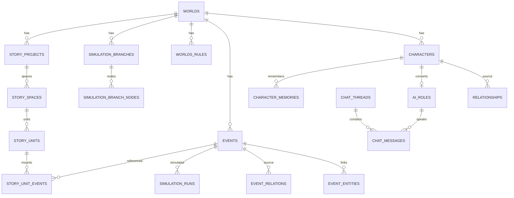
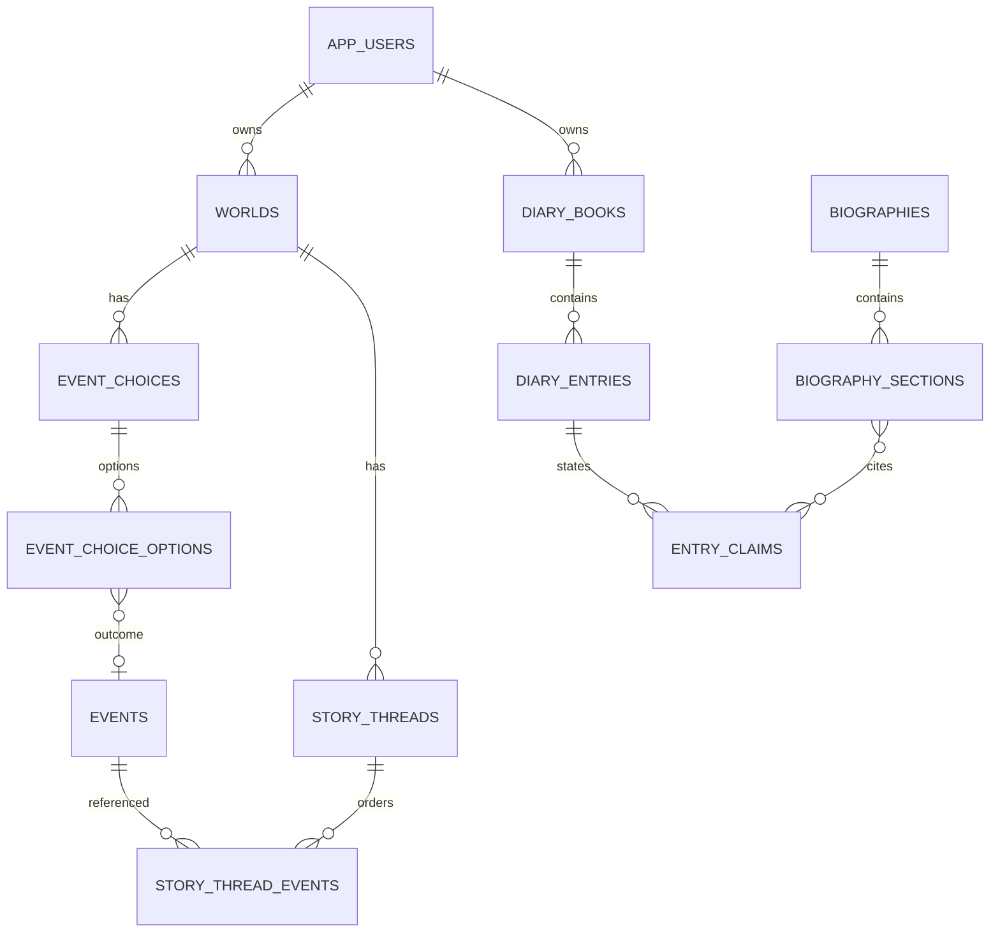

# 理论接口、迁移兼容与实施计划

日期：2026-11-11  
范围：ESA / BMOS / A–E 规范与现有系统接口；数据库迁移建议；开发顺序与验收标准。  
说明：任务书提到的 **WEP / ABCDE** 文档未随附件提供（附件仅有 A–E、BMOS、ESA），因此 WEP/ABCDE 只能标"待确认"，不做臆测。

---

## 1. 理论层与现有模块对照

### 1.1 A–E 规范

| 理论层 | 核心内容 | 现有落点 | 状态 |
| --- | --- | --- | --- |
| A 文明/社会/世界 | 硬件、制度、时代、环境、六轴 | `WorldBuilding` 配置、`world.settings`、`WorldRule` | ◐ 只有零散配置，无 A.1–A.4 完整字段 |
| B 文化软件 | 价值观、耻感、可说域、名誉、亲密、冲突 | 无 `culture_profile`；聊天/写作无文化拦截 | ○ |
| C 人格谱系 | 阈值、调节、策略、关系、修辞、成长 | `basic_profile.c_profile`、`engines`、`runtime_state` | ◐ API 可存，页面无完整 C.1–C.7 编辑 |
| D 存在体验 | 六轴→五维→负载→PAL→行为→沉积 | 六轴、engines、runtime_state、推演 | ◐ 六轴/引擎有；负载/PAL 未建模 |
| E 叙事渲染 | 输入包、PAL、禁词、三段式 | 聊天/写作提示词有"不要旁白"等 | ◐ 无结构化 PAL/禁词闸门 |

### 1.2 BMOS

| BMOS 概念 | 现有落点 | 状态 |
| --- | --- | --- |
| L0–L4 层链 | `WorldRule`、人物状态、推演提示 | ○ 无显式状态机 |
| S0/S1/S2、D0–D2、Dec0–Dec2 | 无 | ○ |
| HWSE、Need O/V/D/E/T、Budget/Mode | `engines`、`runtime_state` 部分相似 | ◐ 字段相似但无语义绑定 |
| Exchange_Packet / Narrative_Record | 无 | ○ |
| L6 裁决 / L∞ 止模 | 聊天影响确认是人工闸门 | ◐ 仅人工确认 |

聊天明确**不接入** BMOS 状态机（既有决策 G32）；本轮设计保持：聊天只消费角色 persona 与记忆，不读 BMOS 阈值/否决。

### 1.3 ESA

| ESA 层 | 现有落点 | 状态 |
| --- | --- | --- |
| L0 规则压强 | 世界规则/六轴 | ◐ |
| L1 单一燃料 | 人物 `runtime_state` 能量类字段 | ◐ |
| L2 硬件极限 | 无睡眠/痛觉/清理模型 | ○ |
| L2.5 预渲染 | `defense_mechanisms` 部分 | ◐ |
| L3 快慢路径 | 无显式认知路径 | ○ |
| L4 唯一接口 | 聊天/写作输出 | ◐ 有输出，无"未过 L4 即未发生"判据 |
| L5 只存不做功 | 事件/记忆/章节 | ◐ |
| L6 裁决 | 无 | ○ |
| L7 断连接 | 无 | ○ |
| L∞ 止模 | 无 | ○ |

### 1.4 接口原则（本轮建议）

1. **A/B 是世界级慢变量**：每日/纪元 Tick 更新，事件后结算；不进入每条聊天 prompt 的全文。
2. **C 是人物档案慢变量**：转换 AI 角色时做只读快照。
3. **D 是运行态**：事件/对话后更新，负载不可瞬清。
4. **E 是输出闸门**：聊天/写作/日记都必须过同一套"禁词 + 折损 + 不写回"规则。
5. **BMOS/ESA 不做全量接入**：先用最小接口（state_sig、trigger、distortion_meta、budget）做审计字段，不改变现有业务流。
6. **未过 L4 即未发生**：事件正式成立需有输出/记录；草稿/推断不算事实。

---

## 2. 现有数据模型与目标差距

### 2.1 核心 ER（现状）

### 2.2 目标新增（建议，未实施）

---

## 3. 迁移与兼容性分析

| 迁移 | 内容 | 风险 | 兼容策略 |
| --- | --- | --- | --- |
| M021 用户与场景 | `app_users`；`worlds.owner_id/product_scene`；`chat_threads.user_character_id` | 旧数据无 owner | 本地先建 `local` 用户；旧世界归属它；字段可空 |
| M022 事件选择 | `event_choices/options`；分支 `origin_choice_option_id` | 与旧 `story_choices` 并存 | 新表；旧表只读；提供映射脚本后再下线 |
| M023 故事线人物线 | `story_threads/thread_events/edges` | 与 unit 树重叠 | 新表；unit 保留；页面逐步切换 |
| M024 日记 | `diary_books/entries/claims/people`、`biographies/sections` | 无 | 全新表；不依赖 world；不进快照 |
| M025 E 层审计 | 可选 `narrative_audit`（禁词/PAL 标记） | 增加写入 | 先只记录，不拦截 |

原则：

- 只加表/加可空列，不删列、不改既有语义；
- 迁移前 `migrations/rehearse.py` 副本演练；
- 故事线/聊天/日记/审计表**排除**世界快照与导出（现有 `_CHAT_TABLES/_STORY_TABLES` 机制可扩展）；
- 旧 `story_choices` 迁移需用户确认，不做自动双写；
- 官方演示世界归属 `local`，避免演示数据丢失。

---

## 4. 开发顺序与验收

### 4.1 阶段

| 阶段 | 内容 | 验收 |
| --- | --- | --- |
| H0 收尾 | G-01/G-02/G-03、CI、部署复测 | 两模型 07/08 通过；生产 URL 记录 |
| I1 账号/场景 | users、owner、product_scene、四宫格壳 | 两个账号数据互不可见；场景侧栏正确 |
| J1 05 选择 | 事件选择/结果/后续事件 + 沙盒生成 | 一事件三选项、各自分支、回溯不串 |
| J2 故事线 | 人物线、DAG、引用校验 | 配角独立主线；事件多线引用不改事件 |
| K1 伴侣 | 自我人物、快捷创建、伴侣入口 | 03 创建→聊天绑定→刷新仍在 |
| K2 日记 | 日记本/条目/来源标记 | AI 推断必须 pending；传记只引 confirmed |
| K3 传记 | 引用/来源检查/导出 | 每段可追溯；无来源不生成事实 |

### 4.2 验收标准（摘要）

- 账号：A 用户无法通过任何 API 读取 B 的世界/日记/聊天；越权返回 404/403。
- 场景：伴侣入口看不到世界建设/事件/推演；文学入口看不到日记。
- 05：选择/结果/后续事件可独立于故事线保存；生成沙盒后原事件不变。
- 07：分支推演不修改主线；回溯后状态与节点一致。
- 08：只读事件/分支，不创建分支/选择。
- 故事线：事件只有一份；删除线程不删事件。
- 日记：AI 推断默认 pending；确认后才可进事实；传记引用可点回来源。
- 兼容：旧世界、旧故事线、旧聊天全部可读；迁移可重复执行。

---

## 5. 风险、边界与待确认

### 5.1 风险

1. 无账号先做四宫格 → 隐私承诺失效。
2. 两套选择并存过久 → 数据分叉。
3. 故事线 DAG 与 unit 树双结构 → 用户认知负担。
4. 日记与事件混用 → 事实/虚构边界崩塌。
5. 理论全量接入 → 过度设计、性能与提示词膨胀。
6. 分支快照过大 → 推演变慢；需节点上限/增量策略。
7. 供应商波动 → 真实调用偶发 502。

### 5.2 边界

- 本轮不建表、不迁移、不改 07/08/05 业务逻辑。
- 不重构 ESA/BMOS；只做最小审计字段设计。
- 不把聊天内容自动写入档案/事件。
- 不把日记放进世界快照。
- 不声称 WEP/ABCDE 已对接（文档未提供）。

### 5.3 需要产品负责人确认

1. 是否批准"账号/owner + product_scene"作为下一阶段第一优先？
2. 05 选择模型选 A（新 event_choices）还是 B（扩展 story_choices）？
3. 故事线是否引入"人物线 + DAG"，还是先只做人物筛选？
4. 日记是否允许完全独立于世界（推荐允许）？
5. 自我人物是否写入 03 正式人物（推荐是）？
6. 是否接受"AI 推断默认 pending、确认后转事实"的强约束？
7. WEP/ABCDE 规范是否补充提供？
8. 部署地址与验收环境何时提供？

---

## 6. 任务书 12 问：基于代码/数据的回答

### Q1 第一阶段还有哪些未实际验收？08 是否完整接入统一客户端？

- 08 调用层已完整接入：生成/辅助/解析/抽取/传记均经统一头与 `ai_engine`；未发现自建模型客户端。
- 未验收：生产部署复测；共享 Key 下仅传模型头不生效（G-01）；08 归档有一处硬编码（G-03）。
- 结论：**有条件通过**，不是无条件完成。

### Q2 07 是否完整使用统一客户端？

是。`/api/simulate`、`/api/branches/{id}/simulate`、方向建议均走统一配置；真实两模型调用通过。

### Q3 多路径已实现什么？哪些可直接用于 05？

已实现：方向 CRUD/AI 建议、从方向建分支、分支快照、节点、单事件推演、回溯、继续、比较、结局、六轴、故事线空间绑定。
可直接用：分支=平行沙盒；节点=历史；回溯/比较=多结局探索；`story_spaces.branch_id` 已打通。
不可直接用：选择→结果→后续事件的显式图；分支汇合的状态合并。

### Q4 05 当前事件结构？如何扩展？

当前：`events` 单事件 + `event_entities` + `event_relations`；无选择/结果/后续事件字段。
扩展：新增 `event_choices/event_choice_options`，选项含 `consequence` 与 `outcome_event_id`，后续事件用 `event_relations` 串联；沙盒复用 `simulation_branches`。详见 PHASE-J。

### Q5 分支/沙盒是否支持独立状态、回溯、继续？

支持：`simulation_branches.base_snapshot/current_snapshot`、`simulation_branch_nodes`、`rollback`、`continue`、`compare`。
不支持：自动汇合（`story_rejoins` 仅记录）。

### Q6 故事线如何引用事件避免复制/污染？

现用 `story_unit_events(event_id)` 引用，不复制；调整单元/顺序只改挂载。
建议：人物线 `story_threads` 也只存 event_id；DAG 边单独存；任何叙事调整不写 `events`；分支状态只在显式生成沙盒时创建。

### Q7 03 如何转 AI 角色并保留设定？

`chat.build_persona` 确定性读取 `basic_profile/engines/dominance/defense_mechanisms/reality_conditions/relationship`，生成 `AiRole.persona` 快照；聊天不写档案；版本可修订。
缺口：无自我人物；身份只在会话 settings。

### Q8 群聊如何做独立记忆/共享上下文/调度？

独立：每角色 `persona` + `character_memories(thread_id, character_id)`；
共享：会话消息序列；
调度：1 次 JSON 规划 + ≤3 首轮 + ≤1 二轮，失败规则兜底；最多 6 人。
证据：`smoke_chat` 64 项。

### Q9 四宫格如何复用而不是四套？

同一 App 壳 + 场景过滤：游戏/文学复用 02–08；伴侣复用 03+聊天；日记新页面但复用人物摘要/传记。
入口只决定默认模块、术语、权限；不复制页面与数据层。

### Q10 日记/传记如何区分事实、回忆、他人、AI 推断？

`entry_claims.source_type` 五值（fact/memory/hearsay/inference/unknown）+ `status`（pending/confirmed/rejected）；AI 只能写 inference+pending；传记只引 confirmed，引用推断必须标注并可回溯来源。
现状：未实现；现有传记无来源标记。

---

## 7. 结论

- 本轮完成审查与设计，未创建/修改任何业务表；
- 现有 07/08/分支/聊天/故事线可复用度高，不需要重写；
- 最大阻塞是账号/归属与产品场景，其次是 05 选择与日记来源模型；
- 等待产品负责人确认第 5.3 节后，再进入开发。
