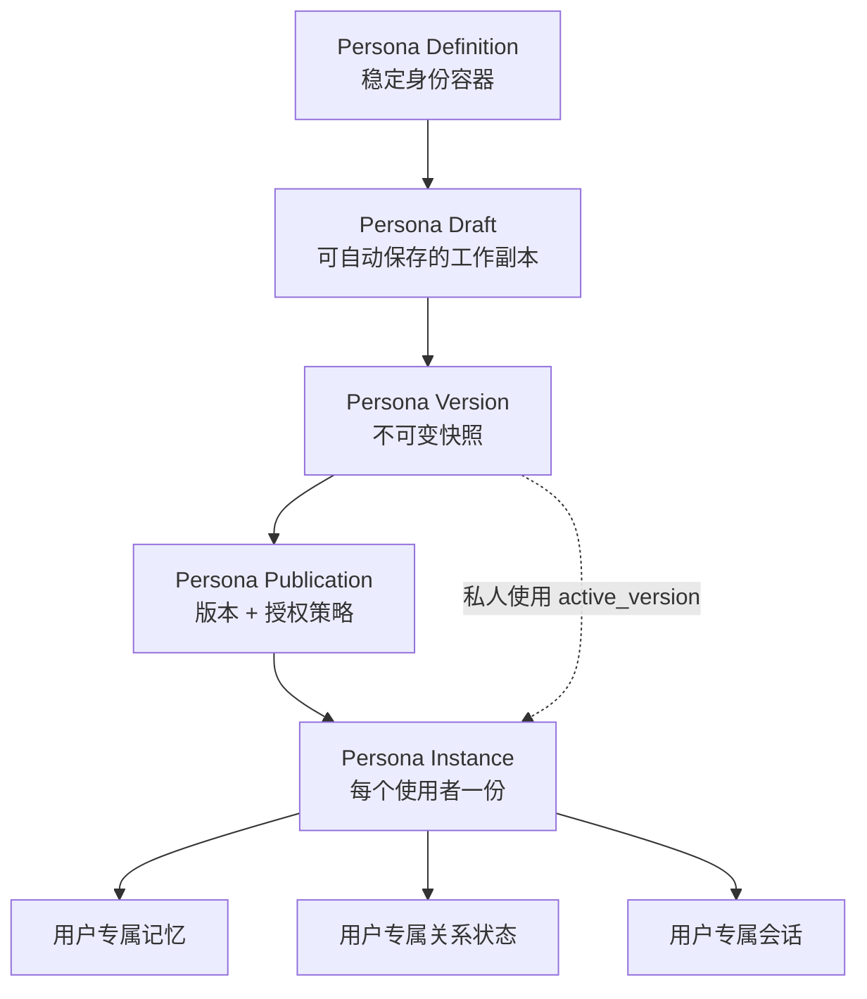
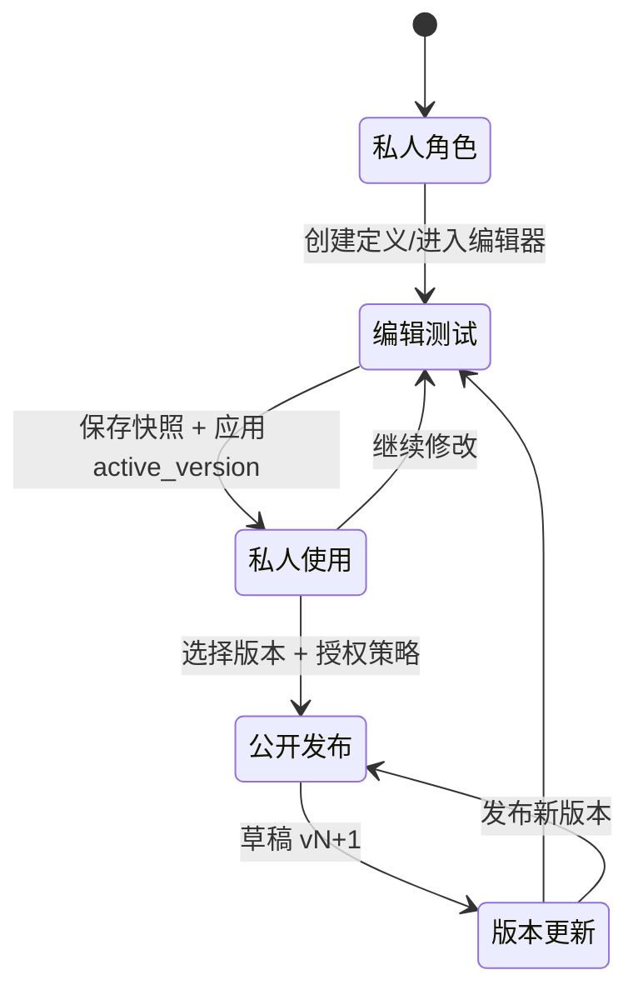

# PHASE-N 统一人格编辑器集成方案

> 状态：**设计稿 / 本轮不落库、不改后端、不重写现有功能**
>
> 审计范围：人物管理、云宝人格配置、AI 伴侣创建流程、聊天角色配置、人格会话与记忆。
>
> 目标：用**一个共享人格编辑器组件**承接两类编辑上下文，并为后续 NPC / 游戏角色人格复用留出边界。

---

## 1. 结论摘要

1. **当前没有“统一人格”这一层。** 人物档案（`Character`）、聊天角色配置（`AiRole`）、个人 AI 人格（`PersonalPersona`）是三套并行数据；云宝只是 `PersonalPersona` 的一个固定 `system_key`，AI 伴侣角色则仍走世界人物档案。
2. **AI 伴侣角色没有独立创建流程。** 伴侣空间里的“创建新人物”实际打开的是世界人物编辑器（`CharacterBuildingPage`），它偏向世界模拟 NPC 的八层档案，不是伴侣产品所需的“人格 / 语言 / 语音 / 行为 / 关系 / 记忆 / 测试”编辑器。
3. **旧人格编辑器是孤儿代码。** `PersonaManager.tsx` 没有任何路由或组件引用；`PersonaPage.tsx` 只渲染云宝。数据库里仍有 6 条 `product_key=companion` 的旧 `PersonalPersona` 记录，但没有对应产品入口。不能把它直接复活成第三套编辑器。
4. **保存、版本、发布能力均缺失。** 人物保存是全量 `PUT`，云宝保存是直接 `PATCH`，聊天角色保存是直接覆盖 `AiRole.persona`；没有自动保存、没有独立草稿、没有不可变版本、没有发布版本指针。`AiRole.version` 只是自增计数，不是版本历史。
5. **多用户隔离尚未成立。** `persona_memories`、`character_memories`、`chat_threads` 都没有 `owner_user_id`；`AiRole` 每个角色只有一条，所有用户共享同一份 `relation_to_user`。在“公开发布角色”之前，必须先完成版本层、实例层和记忆/关系归属层，否则公开角色一定会串记忆、串关系。

**推荐总路线：**

```text
角色定义（稳定容器）
  └── 工作草稿（可自动保存、可冲突检测）
        └── 不可变版本（保存/发布快照）
              ├── 私人使用：绑定 active_version
              └── 公开发布：publication + license
                    └── 每个使用者各自一个 instance
                          ├── 用户专属记忆
                          ├── 用户专属关系状态
                          └── 用户专属会话
```

发布授予的是**某个版本的使用权**，不是把创建者的源人格交给使用者直接修改。

---

## 2. 现状审计

### 2.1 人物管理

**入口与流程**

- 伴侣空间导航：`03 人物管理 · 轻量` → `CharacterListPage`。
- 列表页“创建新人物” / “编辑档案” → `CharacterBuildingPage`。
- 03 AI 互动中心的“创建角色”也走 `onOpenCharacters`，最终进入同一人物编辑器。
- `CharacterListPage` 同时挂载云宝卡片和 `YunbaoProfilePanel`，所以人物列表既管世界人物，也管云宝入口。

**现有编辑器结构**

`CharacterBuildingPage.tsx` 的八个模块：

| 模块 | 内容 | 主要字段 |
|---|---|---|
| 01 基础档案 | 身份、社会坐标、外在、简介 | `name/avatar/age/gender/species/nation/org/socialClass/profession/role/appearance/intro/background` |
| 02 人格动力结构 | OVTDE 五引擎与主导关系 | `engines.ovtde/dominance` |
| 03 人格运行与防御机制 | L0-L6、防御、主权边界 | `defense_mechanisms` |
| 04 现实承载条件 | 资源、能力、关系、社会位置 | `reality_conditions` |
| 05 个体特征与思想钢印 | 生活方式、价值、审美、评价标准 | `thought_imprints` |
| 06 生命经历与历史沉积 | 事件、历史沉积 | `life_history` |
| 07 人物初始状态 | 初始数据、目标、关系、资源 | `initial_state` |
| 08 运行态与成长 | 种子 / 运行态双层的成长校准 | `runtime_state` + runtime API |

**保存行为**

- `handleSave` 是全量保存：新建 `POST /api/characters`，编辑 `PUT /api/characters/{id}`。
- 没有自动保存；切换“种子设定 / 运行态”时用 `window.confirm` 提示会丢失未保存修改。
- 没有草稿版本；没有乐观锁；两个标签页同时编辑会最后写入者覆盖前者。
- 前端仍有硬编码 `http://127.0.0.1:8000` 的请求，与其他模块的 API 封装不一致。
- 人物档案本身是“世界 NPC 的完整模拟档案”，不是“面向聊天的角色人格配置”。它没有语音、称呼、关系阶段、记忆策略、互动测试等伴侣需要的字段。

**聊天里的角色配置**

- `AiRole` 是每个 `Character` 一条的聊天运行配置：
  - `display_name`
  - `persona` JSON：`identity/engines/dominance/defenses/imprints/life/reality/voice/relation_to_user/boundaries/source`
  - `source`：`auto/manual`
  - `version`：整数
- `POST /api/characters/{id}/ai-role/build` 会用人物档案重新生成整个 `persona`，**直接覆盖手改内容**，且不会增加 `version`。
- `PUT /api/characters/{id}/ai-role` 手改时 `version += 1`，但没有保存历史快照；旧版本不可见、不可恢复。
- `ChatPage` 的角色配置面板只暴露三个字段：对外称呼、说话方式（`voice.tone`）、对用户的态度（`relation_to_user.stance`）。保存时把当前 `persona` 展开后覆盖三个字段，属于直接生效，不是草稿。
- `relation_to_user` 是从该人物在世界里的第一条 `Relationship` 自动推导的；所有用户共用同一条 `AiRole`，所以也共用同一个初始态度。

**结论：** 世界人物档案可以继续作为 NPC / 游戏角色的深度档案来源，但不能直接充当 AI 伴侣人格编辑器；聊天角色配置是一个合适的“运行时投影”，不是版本化人格源。

### 2.2 云宝人格配置

**入口**

- 伴侣空间 `personas` 模块 → `PersonaPage` → `YunbaoProfilePanel embedded`。
- 人物列表云宝卡片 → `YunbaoProfilePanel` 弹窗。
- 07 人格运行页的“查看云宝人格” → 同一页面。
- 助手面板等入口也可能定位到云宝。

**数据**

- `PersonalPersona`，`system_key=yunbao`，`product_key=global`，全库唯一。
- 字段：`name/identity/description/avatar/maturity/biography/growth_experience/states/active_state/esa/traits/cognition/expression/interaction/memory_policy/public_profile/tools/status`。
- 云宝有三种固定常态：`rational / withdrawn / tsundere`，共享同一个 `persona_id`，切换只更新 `active_state`。
- `name` 固定；`states/active_state/system_key/owner_user_id/product_key` 不允许通过人格编辑接口修改。
- 所有者为 `AppUser.is_owner=True` 的账号；`PATCH /api/yunbao` 服务端强制 owner-only。
- `MemoryPage` 允许 owner 写/删云宝记忆；普通用户可读，不能写/删。
- `CompanionRuntimePage` 允许 `can_edit` 用户暂停/恢复运行标记。

**编辑器行为**

- 阅读态 + 内联编辑态。
- 基础字段直接输入；`esa/cognition/expression/interaction/memory_policy/public_profile` 使用 **原始 JSON 文本框**，保存时 `JSON.parse`。
- 成长经历是结构化数组编辑。
- 保存直接 `PATCH /api/yunbao`，立即生效，没有草稿/版本/预览/发布。
- “取消”丢弃本地修改；没有未保存提示、没有自动保存。
- 状态切换明确放在对话框，不在人格编辑器；这是正确的边界，应保留。

**结论：** 云宝是“全局单例 + 所有者编辑”的形态，适合作为统一编辑器的**平台上下文**首个接入对象；但必须补草稿/版本/预览，不能继续用直接 PATCH 承担编辑过程。

### 2.3 AI 伴侣创建流程

**实际流程**

```text
伴侣空间
  → 03 人物管理
    → 创建新人物
      → CharacterBuildingPage（八层世界人物档案）
        → 保存 Character
          → 聊天时按需生成 AiRole
            → ChatPage 可改三个字段
```

**关键事实**

- 没有“AI 伴侣角色创建向导”；没有“角色基础 / 人格 / 语言 / 语音 / 行为 / 关系 / 记忆 / 背景 / 测试”的伴侣专用分步流程。
- `persona_type` 只有 `npc / self` 两种：
  - `npc`：AI 角色。
  - `self`：用户在伴侣世界中的“我”，每个世界一个。
- “AI 伴侣角色”本质上是伴侣工作空间里的 `Character`，不是 `PersonalPersona`。
- 旧 `PersonaManager` 提供 `PersonalPersona` 的创建、模板、会话、记忆，但**没有任何页面引用它**；`PersonaPage` 已被云宝占用。数据库里 6 条 companion 旧人格是历史遗留。
- 03 AI 互动中心的“创建角色”没有独立角色类型选择，直接复用人物管理。

**结论：** 不能把旧 `PersonaManager` 当成伴侣角色编辑器直接接回来；它应该只作为字段语义和模板参考。统一编辑器需要新增“伴侣角色”这一产品对象，并在过渡期把 `Character + AiRole` 适配成统一文档。

### 2.4 现有能力矩阵

| 能力 | 人物管理 | 云宝 | 聊天角色配置 | 旧 PersonaManager | 统一编辑器要求 |
|---|---|---|---|---|---|
| 独立草稿 | 无 | 无 | 无 | 无 | 必须有 |
| 自动保存 | 无 | 无 | 无 | 无 | 必须有 |
| 版本历史 | 仅运行态成长计数 | 无 | `version` 整数，无快照 | 无 | 必须有 |
| 版本恢复 | 无 | 无 | 无 | 无 | 必须有 |
| 发布前预览 | 无 | 无 | 无 | 无 | 必须有 |
| 互动测试 | 只能真实聊天 | 只能真实聊天 | 只能真实聊天 | 只能真实会话 | 独立测试会话 |
| 权限保护 | 前端隐藏为主 | 服务端 owner-only | 无角色级 ACL | 硬编码 `local` | 服务端 ACL |
| 独立草稿 vs 已发布 | 无 | 无 | 无 | 无 | 必须有 |
| 语音配置 | 无 | 无 | 仅 `voice.tone/address/taboos` 文本 | 无 | 结构化 + 可测试 |
| 用户专属记忆 | `CharacterMemory` 无 owner | `PersonaMemory` 无 owner | 无 | `PersonaMemory` 无 owner | 按用户/实例隔离 |
| 用户专属关系 | 世界 `Relationship` 共享 | `interaction` 配置 | `relation_to_user` 共享 | `interaction` 配置 | 关系状态独立 |
| 公开发布/授权 | 无 | 无 | 无 | 无 | 版本授权 |

**关键代码锚点（审计证据）：**

| 位置 | 说明 |
|---|---|
| `src/pages/CharacterBuildingPage.tsx:82-91` | 八层世界人物模块定义 |
| `src/pages/CharacterBuildingPage.tsx:1019-1110` | 全量 `POST/PUT` 保存，无草稿/乐观锁 |
| `backend/models.py:1003-1018` | `AiRole` 每人一条、`version` 整数、无历史表 |
| `backend/chat.py:316-345` | `build` 覆盖 persona；`PUT` 仅自增 version |
| `src/pages/ChatPage.tsx:513-547` | 聊天角色配置只暴露三个字段 |
| `src/components/YunbaoProfile.tsx:141-219` | 云宝内联编辑与直接 `PATCH` |
| `backend/yunbao.py:276-317` | 云宝 owner-only、固定字段保护 |
| `src/components/PersonaManager.tsx:65` | 旧人格编辑器入口，无路由/组件引用 |
| `src/pages/PersonaPage.tsx` | 只渲染云宝，不渲染旧人格列表 |
| `backend/personas.py:22` | `OWNER = "local"` 硬编码 |
| `backend/models.py:1062-1077` | `CharacterMemory` 无 owner |
| `backend/models.py:1305-1315` | `PersonaMemory` 只有 `persona_id` |
| `backend/models.py:1021-1034` | `ChatThread` 无 owner |

---

## 3. 关键差距与设计约束

### P0：不解决就不能做“公开角色”

1. **没有版本层。** 发布必须绑定不可变版本；当前所有保存都是就地覆盖。
2. **没有实例层。** 同一公开角色被多个用户使用时，必须有各自的 `instance`；否则记忆、关系、会话必然共享。
3. **记忆没有用户归属。** `persona_memories` 只有 `persona_id`；`character_memories` 只有 `character_id/thread_id`；`chat_threads` 没有 `owner_user_id`。
4. **关系状态混在角色配置里。** `AiRole.relation_to_user` 是角色级字段，不是用户级状态；公开角色不能把它当运行时关系。
5. **权限只覆盖云宝。** `personas.py` 把 `OWNER = "local"` 写死；`characters.py` 也把 `owner_user_id` 写死为 `local`。角色级 ACL 不存在。

### P1：影响编辑体验与数据安全

1. 没有乐观锁，两个窗口会静默覆盖。
2. 没有自动保存，长表单切换模块/关闭页面容易丢内容。
3. 云宝用原始 JSON 编辑复杂对象，容易格式错误，也不适合非技术用户。
4. `AiRole.build` 会覆盖手改人格，缺少“自动生成 / 手动编辑”的合并策略。
5. 没有预览，用户只能拿真实会话试错，测试内容会进入真实记忆。
6. 旧 companion 人格数据没有归属说明，不能直接迁移或删除。

### P2：本轮不解决

1. 世界人物、事件、关系的逐用户授权。
2. 公开角色广场、关注、评论、支付、订单、结算。
3. 语音合成服务接入与音频存储。
4. 多租户账号运营后台。

---

## 4. 目标架构

### 4.1 四层分离



**四层职责：**

| 层 | 负责 | 不负责 |
|---|---|---|
| Definition | 这是谁、属于谁、用于什么场景、当前草稿/活跃/发布指针 | 不存具体字段快照 |
| Draft | 编辑中的完整字段、修订号、自动保存 | 不影响线上行为 |
| Version | 某个时刻的完整字段快照、内容哈希、作者、说明 | 不可修改 |
| Publication | 把某个版本公开、授权范围、上架状态 | 不复制源人格 |
| Instance | 某个使用者对某个版本的使用绑定、局部覆盖 | 不修改版本，不共享记忆 |

### 4.2 生命周期



**语义：**

- “保存快照”不等于“发布”。私人使用绑定 `active_version`。
- “发布”把某个 `version` 写入 `publication`，同时记录许可证。
- 新版本发布后，已有使用者默认继续固定在原版本（`pinned`）；只有明确选择“跟随更新”且许可证允许时才切换。
- 创建者继续编辑源角色，不会改变已发布版本，也不会改变他人的实例。

### 4.3 统一编辑器文档

统一文档只保存**角色配置**，绝不保存用户数据。

```json
{
  "schema_version": 1,
  "basic": {
    "name": "",
    "avatar": "",
    "identity": "",
    "tagline": "",
    "description": "",
    "maturity": "",
    "language": "zh-CN",
    "tags": []
  },
  "personality": {
    "engines": {},
    "dominance": {},
    "traits": [],
    "cognition": {},
    "defense": {},
    "values": []
  },
  "language": {
    "tone": "",
    "length": "",
    "format": "",
    "address": "",
    "vocabulary": [],
    "catchphrases": [],
    "taboos": []
  },
  "voice": {
    "enabled": false,
    "provider": "",
    "voice_id": "",
    "speed": 1.0,
    "pitch": 0,
    "emotion": "",
    "fallback": "text"
  },
  "behavior": {
    "initiative": "balanced",
    "boundaries": [],
    "refuse_style": "",
    "ooc_policy": "deny",
    "safety_rules": [],
    "tool_policy": {}
  },
  "relationship": {
    "role": "companion",
    "initial_stance": "",
    "pace": "slow",
    "stages": [],
    "intimacy_limits": [],
    "user_address": ""
  },
  "memory": {
    "auto_capture": false,
    "scope": "per_user",
    "retention_days": null,
    "summary_style": "",
    "share_public_profile": false
  },
  "background": {
    "biography": "",
    "world_ref": null,
    "life_events": [],
    "knowledge_scope": [],
    "secrets": []
  }
}
```

**强约束：**

- `relationship` 只描述“关系如何发展”的模板，不包含任何具体用户当前处于哪个阶段。
- `memory` 只描述策略，不包含任何记忆条目。
- `background.secrets` 是角色设定中的秘密，不是用户隐私。
- `voice` 只描述音色参数，不包含音频二进制；音频资源单独存储。
- 测试场景、测试记录不进入版本文档。

### 4.4 建议数据表（仅设计，不在本轮执行）

> 以下表名/字段是后续迁移设计，当前仓库不新增、不修改任何表。

#### `persona_definitions`

稳定身份容器，兼容旧数据通过 `legacy_ref` 指向。

| 字段 | 说明 |
|---|---|
| `id` | 主键 |
| `owner_user_id` | 创建者/归属者 |
| `scope` | `global / user / world` |
| `subject_type` | `yunbao / companion / npc / game_character / personal_ai` |
| `legacy_ref_type` | `personal_persona / character / ai_role / null` |
| `legacy_ref_id` | 旧对象 ID，用于适配器 |
| `name` | 展示名（可随版本变，但定义层保留当前名） |
| `status` | `active / paused / archived` |
| `active_version_id` | 私人使用中的版本 |
| `published_version_id` | 当前公开发布版本 |
| `created_by / created_at / updated_at` | 审计 |

唯一索引建议：`(legacy_ref_type, legacy_ref_id)`；新角色允许为空。

#### `persona_drafts`

每个定义最多一条工作草稿。

| 字段 | 说明 |
|---|---|
| `id / persona_id` | 主键 / 归属定义 |
| `base_version_id` | 从哪个版本开始编辑；用于“放弃更改” |
| `revision` | 递增修订号，自动保存冲突检测 |
| `payload` | 统一文档 JSON |
| `updated_by / updated_at` | 最后编辑者/时间 |

#### `persona_versions`

不可变快照。

| 字段 | 说明 |
|---|---|
| `id / persona_id` | 主键 / 归属定义 |
| `version_no` | 从 1 递增 |
| `status` | `snapshot / published / archived` |
| `payload` | 统一文档 JSON |
| `content_hash` | 规范化 JSON 的 SHA-256 |
| `change_summary` | 用户填写的变更说明 |
| `based_on_version_id` | 恢复/派生来源 |
| `created_by / created_at / published_at` | 审计 |

唯一索引：`(persona_id, version_no)`。服务端不提供修改版本的接口。

#### `persona_publications`

| 字段 | 说明 |
|---|---|
| `id / persona_id / version_id` | 主键 / 源定义 / 被授权版本 |
| `publisher_user_id` | 发布者 |
| `visibility` | `public / unlisted` |
| `title / summary / tags` | 公开目录展示信息 |
| `license` | 授权策略 JSON |
| `status` | `active / revoked` |
| `published_at / revoked_at` | 时间 |

**同一版本可以只有一条 active publication；发布新版本创建新 publication，不覆盖旧记录。**

#### `persona_instances`

| 字段 | 说明 |
|---|---|
| `id` | 主键 |
| `owner_user_id` | 使用者 |
| `publication_id` | 公开来源；私人使用可为空 |
| `version_id` | 绑定的版本 |
| `source_persona_id` | 源定义，仅用于追溯 |
| `mode` | `pinned / follow` |
| `overrides` | 仅允许的局部覆盖（如称呼） |
| `status` | `active / archived` |
| `created_at / updated_at` | 审计 |

唯一索引：`(owner_user_id, publication_id)`（私人实例可另建唯一约束）。

#### `persona_relation_states`

| 字段 | 说明 |
|---|---|
| `id / instance_id / owner_user_id` | 主键 / 实例 / 使用者 |
| `stage` | 关系阶段 |
| `trust / intimacy` | 数值 |
| `flags` | 关系事件标记 |
| `updated_at` | 更新时间 |

唯一索引：`(instance_id)`。**关系状态永远不进入 `persona_versions.payload`。**

#### `persona_editor_grants`

| 字段 | 说明 |
|---|---|
| `persona_id / user_id` | 被授权定义 / 用户 |
| `role` | `owner / editor / tester / viewer` |
| `granted_by / created_at` | 审计 |

#### `persona_test_sessions`

| 字段 | 说明 |
|---|---|
| `id / persona_id` | 主键 / 定义 |
| `draft_revision` 或 `version_id` | 测试对象 |
| `actor_user_id` | 测试者 |
| `scenario` | 测试场景 JSON |
| `transcript` | 测试消息 JSON |
| `created_at` | 时间 |

测试会话不写生产记忆、不写关系状态、不进入正式会话列表。

#### `persona_audit_events`

记录 `create_draft / save_draft / create_version / apply_version / publish / revoke / restore / grant / revoke_grant / test`，包含 actor、target、摘要、时间。用于编辑保护和发布追责。

#### 4.4.1 现有表需要补的归属字段（后续迁移，不在本轮执行）

| 表 | 需要补/调整 | 原因 |
|---|---|---|
| `persona_memories` | `owner_user_id`、`instance_id`、`scope`、`source_thread_id`、`deleted_at` | 公开角色同一版本的记忆必须区分使用者 |
| `character_memories` | `owner_user_id`、`instance_id`；后续可并入统一记忆表 | 当前只有 `character_id/thread_id`，无法区分用户 |
| `persona_threads` | `instance_id`、`version_id`、`kind=chat/test` | 区分正式会话与测试会话 |
| `chat_threads` | `owner_user_id`、`persona_instance_id`（可空） | 普通聊天也需要归属校验 |
| `chat_participants` | 通过 thread 继承 owner，不单独加 | 参与者归属于会话 |
| `persona_messages` / `chat_messages` | 通过 thread 校验，不单独加 owner | 消息归属于会话 |
| `ai_roles` | 保留为投影；不再作为用户关系状态来源 | 避免角色级 `relation_to_user` 被当成用户状态 |

**回填原则：** 能从 `personal_personas.owner_user_id` 或所属 thread 推导的，迁移时回填；无法推导的旧数据默认归 `local` 并标记 `legacy_unowned`，不猜测、不自动公开。

### 4.5 现有数据如何映射

**过渡原则：不重写旧表，用适配器读旧写新；双读/双写受 feature flag 控制。**

| 统一模块 | 云宝现有来源 | 伴侣角色现有来源 | 适配建议 |
|---|---|---|---|
| 基础 | `PersonalPersona.identity/description/avatar/maturity` | `Character.basic_profile` + `AiRole.identity/display_name` | 云宝直接映射；角色以 Character 为主，AiRole 覆盖展示名 |
| 人格设计 | `esa/traits/cognition` | `Character.engines/thought_imprints` + `AiRole.engines/defenses/imprints` | 统一为 engines/traits/cognition/defense；保留原始 JSON 供高级编辑 |
| 语言风格 | `expression` | `AiRole.voice.tone/address/taboos` | 文字语言字段归并；不要把 `voice` 全部塞进语言 |
| 语音设计 | 无 | `AiRole.voice` 仅文本 | 新增结构化字段；未接入 TTS 时仅保存参数并明确“未接入语音服务” |
| 行为规则 | `interaction` + `memory_policy` | `AiRole.boundaries` | 边界/拒绝方式/主动性归行为；记忆策略单独拆出 |
| 关系设定 | `interaction.relation` | `AiRole.relation_to_user` + `Relationship` | 只取“关系模板/初始立场”，不取具体世界关系记录 |
| 记忆系统 | `memory_policy` | `CharacterMemory` 行为 + `PersonaMemory` | 只编辑策略；记忆内容在独立页面/运行时管理 |
| 背景设定 | `biography/growth_experience` | `Character.life_history` + `AiRole.life` | 云宝用自传/成长；角色用生命经历/世界背景 |
| 互动测试 | 无 | 真实 ChatPage | 新增草稿测试，不写生产记忆 |

**建议的源真相：**

- 伴侣角色：`Character` 是“世界档案源”，`PersonaVersion.payload` 是“AI 人格源”。`AiRole` 是运行时投影，不再作为独立编辑源。
- 云宝：`PersonaVersion.payload` 是人格源；`PersonalPersona` 保留为运行时投影/兼容读模型。
- NPC / 游戏角色：`Character` 仍是深度档案源，统一编辑器只编辑 AI 人格层，不替代八层世界档案编辑器。

---

## 5. 前端统一编辑器

### 5.1 组件树

```text
src/components/persona-editor/
  PersonaEditor.tsx                 # 唯一壳层：上下文、布局、动作
  PersonaEditorHeader.tsx           # 名称、状态、保存状态、预览/版本/发布
  PersonaEditorNav.tsx              # 九个模块导航
  PersonaEditorSidebar.tsx          # 完成度、权限、版本摘要、测试入口
  modules/
    BasicModule.tsx
    PersonalityModule.tsx
    LanguageModule.tsx
    VoiceModule.tsx
    BehaviorModule.tsx
    RelationshipModule.tsx
    MemoryModule.tsx
    BackgroundModule.tsx
    TestModule.tsx
  panels/
    VersionDrawer.tsx
    PublishDialog.tsx
    PreviewDrawer.tsx
    ConflictDialog.tsx
    ReadinessChecklist.tsx
  usePersonaDraft.ts                # 自动保存、修订号、离开提醒
  personaDocument.ts                # 统一文档类型、默认值、规范化
  adapters/
    yunbaoAdapter.ts
    companionAdapter.ts
    legacyPersonaAdapter.ts         # 只读/迁移参考，不直接接路由
```

### 5.2 一个组件，两个上下文

不要用大量 `if (context === 'yunbao')` 分叉。用**适配器 + 能力声明**：

```ts
type PersonaEditorContext = 'platform-yunbao' | 'companion-role'

type EditorCapabilities = {
  autosave: boolean
  versions: boolean
  publish: boolean
  voiceTest: boolean
  relationTemplate: boolean
  permissions: 'platform-owner' | 'owner' | 'editor' | 'tester' | 'readonly'
}

type PersonaEditorAdapter = {
  load(definitionId: string): Promise<PersonaEditorDocument>
  saveDraft(payload: PersonaDocument, revision: number): Promise<SaveResult>
  createVersion(summary: string): Promise<PersonaVersion>
  listVersions(): Promise<PersonaVersion[]>
  restore(versionId: string): Promise<PersonaDocument>
  test(payload: PersonaDocument, scenario: TestScenario): Promise<TestTranscript>
  publish(versionId: string, input: PublishInput): Promise<PersonaPublication>
}
```

- `yunbaoAdapter`：上下文 `platform-yunbao`，权限 `platform-owner`，导航固定显示九个模块，但“发布”能力关闭；动作是“应用到云宝”。
- `companionAdapter`：上下文 `companion-role`，权限来自服务端，支持版本/发布/测试/授权。
- `legacyPersonaAdapter`：只用于一次性数据盘点或迁移预览，不接产品入口。

**同一组件在两个上下文中的差异只允许出现在：**

1. 面包屑/标题。
2. 可用动作（应用 vs 发布）。
3. 不可编辑字段清单。
4. 能力不可用时的诚实空状态。
5. 权限徽标。

### 5.3 入口设计

| 入口 | 现状 | 目标 |
|---|---|---|
| 平台管理 → 云宝人格设计 | `?product=companion&page=personas` → `PersonaPage` | 保留兼容路由，页面改为统一编辑器 `platform-yunbao` 上下文；面包屑明确“平台级 AI” |
| 伴侣空间 → AI 伴侣角色 | `personas` 实际是云宝 | 新增伴侣角色列表页；`personas` 保留云宝，新增角色列表 route，避免破坏旧链接 |
| AI 互动中心 → 角色卡片 | 聊天/角色管理 | 角色详情增加“人格设计”；有编辑权进编辑器，无编辑权进只读预览 |
| 人物管理 → 编辑档案 | 八层人物编辑器 | 增加“AI 人格设计”次级入口；不替换八层编辑器 |
| 聊天页 → 角色配置 | 三个字段直接保存 | 保留快捷字段；增加“打开完整人格编辑器” |
| 游戏/NPC（未来） | 人物档案 | 同一编辑器 `npc` 上下文，只开放 AI 人格层 |

**路由建议（设计，不实施）：**

- `/?page=yunbao-persona`：平台云宝编辑。
- `/?product=companion&page=roles`：伴侣角色列表。
- `/?product=companion&page=persona-editor&id=...`：伴侣角色编辑。
- `/?product=companion&page=persona-preview&id=...`：只读预览/使用。
- 现有 `?product=companion&page=personas` 保持指向云宝，避免旧链接失效。

### 5.4 九个模块的字段与边界

| 模块 | 必填核心 | 可选/高级 | 明确不在这里 |
|---|---|---|---|
| 01 角色基础 | 名称、头像、身份、一句话简介 | 成熟度、语言、标签、世界绑定 | 用户与角色的关系状态 |
| 02 人格设计 | 五引擎/主导关系、3-5 个特征、认知倾向 | 防御机制、价值观、原始 JSON | 用户记忆、会话 |
| 03 语言风格 | 语气、长度、格式、称呼 | 词汇偏好、口头禅、禁忌 | 音频本身 |
| 04 语音设计 | 是否启用、provider、voice_id | 语速、音调、情绪、fallback | 音频文件、TTS 账单 |
| 05 行为规则 | 主动性、边界、拒绝方式、OOC | 安全规则、工具策略 | 具体某次对话 |
| 06 关系设定 | 关系模板、初始立场、推进节奏 | 阶段定义、亲密边界、称呼 | 当前关系阶段/信任值 |
| 07 记忆系统 | 自动捕获、隔离范围、保留期 | 摘要风格、公共资料授权 | 任何记忆条目 |
| 08 背景设定 | 自传/背景、知识范围 | 生命事件、世界引用、秘密 | 用户隐私 |
| 09 互动测试 | 场景、测试轮次 | 对比已发布版本 | 正式会话/正式记忆 |

**云宝特例：**

- `states/active_state` 不进入编辑器字段，保持“状态切换在对话框”的现有决定。
- 编辑器右侧只读展示三种常态摘要和当前状态。
- 名称固定，服务端和 UI 双重只读。

### 5.5 自动保存与冲突

**状态机：**

```text
idle → dirty → saving → saved
                  ↘ conflict
                  ↘ offline
```

- 首次进入编辑不立即创建草稿；用户第一次修改后才创建。
- 防抖 1000ms，最大等待 5s；保存中不重复提交。
- 每次保存携带 `base_revision`；服务端返回新 `revision`。
- 409 时进入冲突对话框：保留本地、查看服务端、选择覆盖/合并；**绝不静默覆盖**。
- 本地 `localStorage` 只做崩溃缓冲（`ws.personaDraft.<id>`），服务端保存成功后清除。
- `beforeunload` 仅在 `dirty/saving` 时提示。
- 只读用户不触发自动保存。

**“保存草稿”与“应用”：**

- 自动保存只写 `persona_drafts`。
- “保存版本”创建 `persona_versions` 快照。
- “应用到云宝 / 私人使用”把 `active_version_id` 指向快照。
- “发布”另建 `publication`，不影响私人使用，也不影响他人实例。

### 5.6 版本历史与恢复

- 右侧抽屉时间线：`v3 已发布`、`v2 快照`、`v1 已归档`。
- 展示：版本号、状态、作者、时间、变更说明、基于哪个版本。
- 操作：查看、字段级对比、恢复。
- “恢复”语义：把旧版本 payload 复制成**新的工作草稿**，不删除中间版本；用户确认后再保存为新版本。
- 已发布版本只读；任何修改都产生新草稿。
- 版本数量建议上限（如 100/角色），超出时归档最旧快照，不静默删除已发布记录。

### 5.7 预览与互动测试

**预览（不调用模型）：**

- 角色卡：头像、名称、身份、语言风格、关系模板、记忆策略。
- 示例对话：用固定样例展示“第一次见面 / 日常 / 冲突 / 边界拒绝”四种语气。
- 完成度检查：缺哪些字段、哪些字段会使用默认值。
- 发布前检查：见第 7 节。

**互动测试（调用模型）：**

- 独立 `test` 会话，不进入 `persona_threads` 正式列表，不写 `persona_memories`，不写 `persona_relation_states`。
- 测试使用当前草稿 payload；可选择“对比已发布版本”。
- 场景模板：初次见面、日常陪伴、冲突分歧、边界试探、长期记忆召回。
- 测试结果可保存为 `persona_test_sessions`，供作者复盘；不向使用者公开。
- 无 AI Key 时明确显示“未配置模型”，不伪造回复。
- 无 TTS provider 时语音模块只显示参数与“未接入语音服务”，不生成假音频。

---

## 6. 权限、记忆与关系隔离

### 6.1 权限矩阵

| 角色 | 云宝 | 伴侣角色 | 公开角色使用者 |
|---|---|---|---|
| 平台所有者 | 编辑、应用、查看版本 | 可管理全部 | 可创建实例 |
| 角色创建者 | — | 编辑、测试、发布、授权 | 自己的实例 |
| 被授权编辑者 | — | 编辑草稿；发布需 owner 或额外权限 | 自己的实例 |
| 测试者 | — | 只测试，不改配置 | — |
| 普通用户 | 只读 | 只读预览 | 使用已发布版本，创建自己的实例 |
| 未登录 | 拒绝 | 拒绝 | 拒绝 |

**服务端必须逐请求校验，不能只靠 UI 隐藏。**

- 云宝：继续 `is_owner` 校验；新增 `platform-owner` 能力。
- 伴侣角色：`persona_editor_grants` + `owner_user_id`。
- 公开角色：只允许 `instantiate`，不允许 `PATCH definition/version`。
- 版本：只允许读；发布/撤回是 publication 操作。

### 6.2 运行时组装顺序

```text
平台安全约束
  + 版本化人格 payload（published 或 private active）
  + 实例允许的局部覆盖（称呼等）
  + 当前用户的关系状态
  + 当前用户/实例的记忆检索
  + 当前会话历史
```

禁止：

- 从创建者的 `PersonalPersona` 直接读记忆。
- 从 `AiRole.relation_to_user` 直接读“当前关系”。
- 从其他用户的 `instance` 读任何内容。
- 把 `Relationship` 世界记录直接当伴侣关系状态。

### 6.3 隔离不变量

1. `persona_versions.payload` 中不得出现 `memory` 条目、`relationship_state`、`thread_id`、`user_id`。
2. 记忆键：`(owner_user_id, instance_id, scope, thread_id?)`。
3. 关系键：`(instance_id, owner_user_id)`，每个实例唯一。
4. 会话键：`(owner_user_id, instance_id)`；群聊通过参与者校验。
5. 同一公开版本被 A/B 使用时，必须生成两个不同 `instance_id`。
6. 创建者只能看到聚合使用统计，不能读取使用者记忆内容。
7. 删除实例/用户导出时，记忆、关系、会话按实例级联，不触碰源版本。
8. 云宝也按用户实例隔离会话与记忆；平台所有者维护版本，但不读取普通用户私密记忆。

**当前代码的具体风险点：**

- `PersonaMemory` 只有 `persona_id`，`list_memories` 和 `_prompt` 都按人格取全部记忆。
- `CharacterMemory` 只有 `character_id/thread_id`，没有 owner。
- `ChatThread` 没有 owner；`ChatPage` 通过 thread id 读取。
- `AiRole` 每个角色唯一，`relation_to_user` 共享。
- `personas.py` 硬编码 `OWNER = "local"`，与云宝真实 owner 不一致。

这些必须在公开角色之前修，不能靠前端过滤。

---

## 7. 发布与授权

### 7.1 发布语义

“发布”不是复制角色，也不是把源配置交给所有人，而是：

```text
publication = (persona_id, version_id, license, visibility, publisher)
```

- 使用者拿到的是 `instance`，绑定 `version_id`。
- 使用者不能修改 `persona_version`，只能按许可证做允许的局部覆盖。
- 创建者后续编辑只影响新草稿/新版本，不影响已发布版本。
- 新版本发布后，旧实例默认 `pinned`；用户可主动选择 `follow`，前提是许可证允许且新版本兼容。

### 7.2 许可证 JSON

```json
{
  "allow_use": true,
  "allow_copy": false,
  "allow_modify": false,
  "allow_redistribute": false,
  "allow_commercial": false,
  "require_attribution": true,
  "derivative_policy": "none",
  "revocable": false
}
```

建议默认值：**可使用、不可复制、不可修改、不可再分发、不可商用、需署名、不可撤回**。

- `derivative_policy`：`none / allowed_with_credit / allowed_same_license`。
- 派生角色必须新建 `persona_definition`，记录 `derived_from_version_id`，不能修改原定义。
- 公开目录只展示 `publication.status=active` 且许可证允许展示的条目。
- 撤回发布只停止新实例；已有实例是否继续使用由许可证 `revocable` 决定，UI 必须说清楚。
- 授权校验在服务端；前端只展示结果，不伪造“已授权”。

### 7.3 发布前检查

| 检查 | 阻断级别 |
|---|---|
| 名称/身份/简介完整 | 阻断 |
| 至少一个有效人格特征/引擎 | 阻断 |
| 语言风格有语气 | 阻断 |
| 行为边界至少一条 | 阻断 |
| 记忆策略 `scope=per_user` | 阻断 |
| voice 启用时 provider/voice 完整或有 fallback | 阻断 |
| 许可证已选择 | 阻断 |
| 公开目录标题/简介 | 警告 |
| 未填写背景/关系阶段 | 警告 |
| 测试会话至少一次 | 警告 |
| 版本说明 | 警告 |

阻断项未通过时，发布按钮禁用并说明原因；不生成“假发布成功”。

---

## 8. API 设计建议

> 仅接口草案，本轮不实现。

| 方法 | 路径 | 用途 |
|---|---|---|
| `GET` | `/api/persona-editor/{subject}/{id}` | 读取定义、草稿、活跃/发布版本、权限、完成度 |
| `POST` | `/api/persona-definitions` | 创建角色定义（伴侣创建向导） |
| `POST` | `/api/persona-definitions/{id}/draft` | 确保工作草稿存在 |
| `PATCH` | `/api/persona-drafts/{id}` | 自动保存；body 带 `base_revision` |
| `POST` | `/api/persona-drafts/{id}/validate` | 字段 + 发布前检查 |
| `POST` | `/api/persona-drafts/{id}/test` | 草稿互动测试，不写生产数据 |
| `POST` | `/api/persona-drafts/{id}/commit` | 创建不可变版本 |
| `GET` | `/api/persona-definitions/{id}/versions` | 版本历史 |
| `POST` | `/api/persona-versions/{id}/restore` | 恢复为新草稿 |
| `POST` | `/api/persona-versions/{id}/apply` | 设为私人 active 版本 |
| `POST` | `/api/persona-versions/{id}/publish` | 创建 publication |
| `POST` | `/api/persona-publications/{id}/revoke` | 撤回发布 |
| `POST` | `/api/persona-publications/{id}/instantiate` | 为当前用户创建实例 |
| `GET` | `/api/persona-instances/{id}` | 读取实例、关系状态、允许的覆盖 |
| `PATCH` | `/api/persona-instances/{id}/overrides` | 仅修改许可证允许的局部字段 |
| `GET/POST` | `/api/persona-definitions/{id}/grants` | 编辑授权 |

**兼容策略：**

- 保留现有 `GET/PATCH /api/yunbao`、`/api/personas`、`/api/characters/{id}/ai-role` 不破坏。
- 新编辑器通过适配器调用新接口；旧页面继续走旧接口，直到对应入口切换。
- 服务端旧接口在过渡期写入“兼容版本”，但不能绕过权限和版本不可变约束。
- 所有写接口返回 `revision/version_id`，前端据此更新状态。

---

## 9. 分批落地计划

### Phase 0：审计与设计（本轮）

- 只读审计 + 本设计文档。
- 不改数据库、不改 API、不改现有页面。
- 产出：现状清单、字段映射、数据模型、权限矩阵、验收标准。

### Phase 1：前端壳层与只读适配

- 新建 `persona-editor` 目录和统一文档类型。
- 云宝进入统一壳层，先接现有 `GET/PATCH /api/yunbao`。
- 保留手动保存；自动保存/版本/发布显示“未接入”，不伪造。
- 人物/伴侣入口只加“人格设计”跳转，不替换八层编辑器。
- 验收：现有云宝编辑、人物保存、聊天角色配置不回归。

### Phase 2：草稿 / 版本 / 权限后端

- 新增 `persona_definitions/drafts/versions/grants/audit`。
- 为云宝建立初始版本与草稿，适配器切换到新接口。
- 实现乐观锁、版本恢复、应用到云宝。
- 迁移演练：只读比对旧字段与新 payload，不正式迁移。
- 验收：自动保存、冲突、恢复、权限、审计全部通过。

### Phase 3：伴侣角色编辑器与测试

- 新增伴侣角色列表/创建向导。
- `Character + AiRole` 适配为统一文档；明确“档案源 / 人格源”分工。
- 九个模块完整可编辑；JSON 高级模式保留。
- 独立测试会话；不写生产记忆/关系。
- 验收：创建、编辑、测试、私人使用闭环。

### Phase 4：发布 / 授权 / 实例

- `publications/instances/relation_states`。
- 公开目录、发布检查、许可证、固定/跟随更新。
- 使用者实例隔离；创建者不可读使用者记忆。
- 验收：A/B 两用户同角色不同记忆/关系/会话；发布新版本不影响旧实例。

### Phase 5：多用户硬化与 NPC / 游戏复用

- 给记忆、关系、会话补 owner/instance；旧数据回填。
- 废弃 `PersonaManager` 入口；旧 companion 人格做只读归档或用户确认迁移。
- 游戏/NPC 接入 `npc` 上下文，复用同一编辑器。
- 验收：跨用户越权测试、旧数据兼容、NPC 编辑器不破坏世界档案。

**每阶段必须有 feature flag 和回滚路径；未通过隔离测试不得进入发布阶段。**

---

## 10. 验收标准

### 功能

- 同一 `PersonaEditor` 在云宝和伴侣角色两个入口渲染，布局/模块一致，仅动作与权限不同。
- 修改后 1s 内自动保存；刷新页面恢复草稿；显示“已保存/保存中/冲突”。
- 版本历史可查看、对比、恢复；恢复生成新草稿而非覆盖历史。
- 已发布版本不可编辑；修改必须产生新草稿。
- 预览不调用模型、不写数据；测试不写正式记忆/关系/会话。
- 发布前检查阻断项生效，不生成假发布。
- 公开角色使用者获得独立实例；A/B 的记忆、关系、会话互不可见。
- 创建者发布新版本后，旧实例默认仍固定在旧版本。

### 安全

- 非 owner 直接 `PATCH /api/yunbao` 返回 403。
- 非 editor 直接保存他人草稿返回 403。
- 直接修改已发布版本返回 409/403。
- 跨用户读取记忆/关系/会话返回 404/403，且不泄露存在性。
- 草稿 payload 含记忆/关系/用户字段时服务端拒绝。
- 旧接口不能绕过新权限。

### 回归

- `CharacterBuildingPage` 八层编辑器保存仍正常。
- 云宝现有阅读/编辑/状态切换/记忆管理仍正常。
- 聊天角色配置三个快捷字段仍可保存。
- 现有 `tsc --noEmit`、`npm run build`、`npm run lint` 通过。

---

## 11. 风险与待确认

| 风险/决策 | 说明 | 建议 |
|---|---|---|
| 伴侣角色源真相 | Character 档案 vs AiRole persona 谁为准 | Character 为档案源，PersonaVersion 为 AI 人格源；AiRole 只做投影 |
| 云宝记忆是否按用户隔离 | 当前普通用户可读 owner 记忆 | 长期按实例隔离；管理员只维护版本 |
| 6 条旧 companion 人格 | 无入口、无归属说明 | 先只读盘点；不自动迁移/删除，等产品确认 |
| `AiRole.build` 覆盖手改 | 自动生成会冲掉人工配置 | 增加“自动生成 / 合并 / 保留手改”三选一，并记录版本 |
| 语音 provider | 当前无 TTS | 先做 provider-neutral 参数与诚实空状态，后接服务 |
| 公开目录/支付 | 当前 0 商品/0 授权 | 不在本方案内；发布只做版本授权，不接订单 |
| 许可证法律含义 | JSON 策略不是法律文本 | 产品/法务确认默认条款；UI 明确“授权范围” |
| 大 payload/版本数量 | JSON 快照增长 | 规范化 + 压缩 + 版本上限/归档策略 |
| 多用户基础薄弱 | 不只是人格表 | 先补 owner/instance，再做公开角色 |
| 旧页面兼容 | 直接改路由会断链接 | 保留 `personas` 云宝路由，新增角色路由 |

---

## 12. 本轮明确不做

- 不新增/修改数据库表、迁移、模型。
- 不新增/修改后端 API。
- 不替换 `CharacterBuildingPage` 八层编辑器。
- 不删除 `PersonaManager` 或旧 companion 人格数据。
- 不实现发布、授权、公开目录、支付、语音服务。
- 不把云宝状态切换搬进人格编辑器。
- 不伪造版本、授权、发布、测试或语音结果。

**下一步：确认第 11 节中的源真相、云宝记忆隔离和旧数据处置三项决策后，再进入 Phase 1。**
