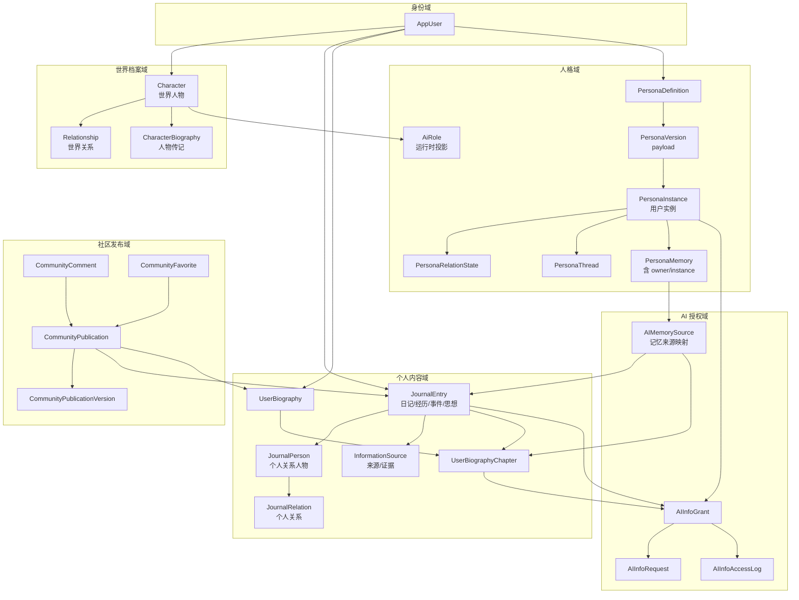
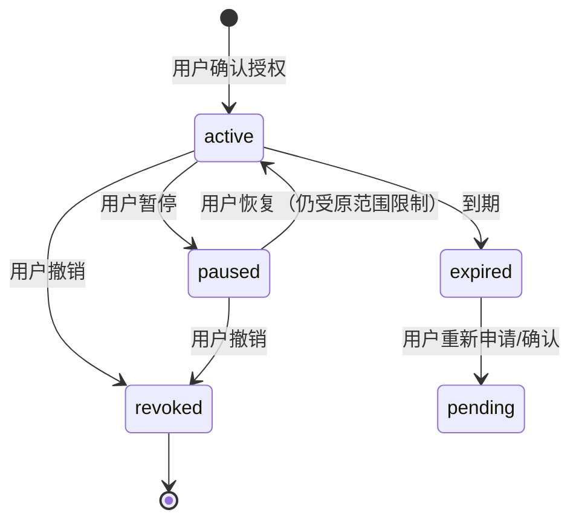

# PHASE-N1 用户个人信息源与 AI 分级授权架构

> 状态：**架构方案已确认 / M1–M6 已实施**
>
> 配套文档：`docs/PHASE-N-统一人格编辑器集成方案.md`；M1 记录：`docs/PHASE-N1-M1-实施报告.md`；M2 记录：`docs/PHASE-N1-M2-实施报告.md`；M3–M6 记录：`docs/PHASE-N1-M3-M6-实施报告.md`；编辑器阻塞修复：`docs/PHASE-N1-云宝人格编辑器阻塞修复报告.md`；独立工作台迁移：`docs/PHASE-N1-云宝独立工作台迁移报告.md`
>
> 审计范围：`Character`、`PersonaVersion`（M2 已落库，编辑器版本流尚未启用）、`AiRole`、companion、用户记忆、日记与传记、内容社区及调用链。
>
> 本文件保留架构审查与设计结论；M1–M6 已按第 10 节完成，后续只做产品打磨与多用户权限收紧。

---

## 1. 结论摘要

1. **必须把“用户个人信息源”提升为独立数据域。** 现有日记 `DiaryEntry` 已有 `owner_user_id`，但 API 把 owner 写死为 `local`；现有“传记”是 `CharacterBiography`（世界人物传记），不是用户自己的传记。两者不能混为一谈。
2. **AI 授权必须是独立授权层，不能依附于人格配置或社区发布。** 人格版本描述“AI 是谁”，授权描述“这个用户允许这个 AI 实例读什么”。授权对象应是 **PersonaInstance**，而不是角色定义或全局角色。
3. **AI 记忆必须可追溯、可撤销、可重算。** 记忆不能只存一段摘要；必须保存 `instance_id + owner_user_id + source_grant_id + source_refs`，撤销授权后能定位所有派生记忆并停止召回。
4. **云宝也必须实例化。** 人格版本可以全局唯一，但每个用户应有独立的 `PersonaInstance`、会话、关系状态和记忆。管理员维护版本，不读取普通用户私人记忆。
5. **社区发布必须创建独立公开版本。** 私人日记/传记原稿不被改写；发布的是经过选择的、可匿名的、不可变的内容快照。公开编辑产生新版本，不反向修改私人原稿。
6. **三种权限彻底独立。** 私人内容权限、AI 信息授权、社区发布权限之间没有自动继承关系；发布不等于授权 AI，授权 AI 不等于公开，撤销其中一个不影响另外两个。
7. **当前多用户基础仍薄弱。** `diary.py`、`information_sources.py`、`biography.py`、`writing.py` 都没有按当前登录用户过滤；`CharacterBiography`、`Story`、`ChatThread` 没有 owner。公开角色和私人内容上线前必须补归属。
8. **迁移应先加列、后建表、再切读。** 不移动旧数据、不删除旧数据、不迁移 6 条旧 companion 人格；用适配器和 feature flag 双读，确认后再切正式路径。

---

## 2. 现有架构审计

### 2.1 数据域与归属现状

| 数据域 | 现有对象 | owner 字段 | 当前问题 |
|---|---|---|---|
| 世界档案 | `Character` | 有 `owner_user_id`，但写死 `local` | 世界 NPC 与 AI 伴侣共用同一表 |
| 聊天运行配置 | `AiRole` | 无 owner | 每个角色一条，所有用户共享 `relation_to_user` |
| 个人 AI 人格 | `PersonalPersona` | 有 `owner_user_id` | 云宝与 6 条旧 companion 人格混在同一表 |
| 人格会话 | `PersonaThread` | 有 `owner_user_id` | 有 owner，但 memory 不按用户过滤 |
| 人格记忆 | `PersonaMemory` | **无 owner** | 只按 `persona_id` 查询，公开角色会串记忆 |
| 角色聊天记忆 | `CharacterMemory` | **无 owner** | 只按 `character_id/thread_id` 查询 |
| 聊天会话 | `ChatThread` | **无 owner** | 按 thread id 读取，多用户下无法校验 |
| 日记 | `DiaryEntry` | 有 `owner_user_id` | API 固定 `local`；没有 AI 授权与类别 |
| 信息来源 | `InformationSource` | 有 `owner_user_id` | API 固定 `local`；没有关联到日记条目 |
| 人物传记 | `CharacterBiography` | **无 owner** | 是世界人物资产，不是用户传记 |
| 写作章节 | `Story` | **无 owner** | 社区页面直接读取全部本地章节 |
| 世界关系 | `Relationship` | 无 owner，按 `world_id` | 是世界关系，不是用户个人关系 |
| 社区互动 | 无 | — | 没有评论、收藏、关注、发布版本表 |

**审计时实际数据量：**

- 1 个本地账号。
- 6 个 `Character`。
- 7 个 `PersonalPersona`：6 条 `companion` 旧人格 + 1 条云宝。
- 4 条 `AiRole`。
- 8 个 `chat_threads`、2 个 `persona_threads`。
- 10 条 `character_memories`、1 条 `persona_memories`。
- 1 条日记、1 条信息来源、3 条人物传记、3 个 `Story`。
- 51 条世界关系记录（中心页按可见性过滤后约 15 条）。

这些数据都还在单用户 `local` 语境下；架构必须先支持多用户归属，再做公开角色与社区。

### 2.2 人物 / 人格 / AiRole 的调用链

```text
CharacterListPage
  → CharacterBuildingPage
    → POST/PUT /api/characters
      → Character（世界档案）

ChatPage
  → GET/POST /api/characters/{id}/ai-role
    → AiRole（自动/手动聊天投影）
      → persona JSON（identity/engines/voice/relation_to_user/boundaries）
      → CharacterMemory / ChatThread

YunbaoProfilePanel / PersonaPage
  → GET/PATCH /api/yunbao
    → PersonalPersona（system_key=yunbao）
      → PersonaThread / PersonaMemory

PersonaManager（无路由引用）
  → /api/personas
    → PersonalPersona（product_key=companion，历史遗留）
```

**结论：** `Character` 是世界档案源，`PersonaVersion.payload` 是 AI 人格源，`AiRole` 只做运行时投影。这个分工与 PHASE-N 一致，本方案不改变。

### 2.3 日记 / 传记调用链

```text
DiaryPage
  → GET/POST/PATCH/DELETE /api/diary/entries
    → DiaryEntry
      owner_user_id = "local"（硬编码）
      world_id / character_id 可选
      source_type / source_ref
      visibility = private

InformationSourcesPage
  → GET/POST/PATCH /api/information-sources
    → InformationSource
      owner_user_id = "local"（硬编码）
      character_id / event_id
      source_type / status / confidence
      visibility = private

CharacterBiographyModal
  → GET /api/characters/{id}/biography
  → POST /api/characters/{id}/biography/generate
    → CharacterBiography
      world_id / character_id
      无 owner_user_id
      citations 可含 diary 引用

WritingPage（biography 模式）
  → /api/writings
    → Story
      无 owner_user_id
      status = draft / published
```

**关键问题：**

1. `DiaryPage` 的“日记”已经是独立于世界的个人记录，但后端 owner 写死，不能支持多用户。
2. `CharacterBiography` 是“南宫婉/韩立”的人物自传，不是用户本人传记；当前 3 条记录都属于世界人物资产，不能重新归类为用户传记。
3. `_citations` 查询 `DiaryEntry.character_id == character.id` 时不带 owner；多用户下可能把别人的日记引用进人物传记。
4. `WritingPage` 的“传记写作”仍是通用 `Story` 编辑器，没有“用户传记章节”实体，也没有 owner。
5. `InformationSource` 有 owner，但没有“这条来源服务于哪篇日记/哪章传记”的结构化关联，无法做来源追溯。

### 2.4 内容社区调用链

```text
CommunityPage
  → GET /api/writings                （全部 Story，含草稿）
  → POST /api/writings               （社区发布直接创建 Story）
  → GET /api/worlds?include_workspace=false
  → GET /api/characters
  → GET /api/worlds/{id}/stories
  → 客户端搜索 / 筛选 / 阅读 / 复制链接

现状：
  - 没有 owner 过滤。
  - 没有“公开版本”表；发布就是创建/修改 Story。
  - 没有评论、收藏、关注、分享计数后端。
  - 草稿也会进入社区推荐与搜索。
  - 删除/归档章节会影响社区可见性。
```

**结论：** 当前社区是“本地写作库的展示层”，不是真正的公开发布层。日记/传记转社区不能复用“直接创建 Story”的方式，否则私人原稿与公开内容会混在一起。

### 2.5 记忆 / 会话归属

| 表 | 现有隔离键 | 缺失 |
|---|---|---|
| `persona_memories` | `persona_id` | `owner_user_id`、`instance_id`、`source_grant_id`、`source_refs` |
| `character_memories` | `character_id`、`thread_id` | `owner_user_id`、`instance_id` |
| `persona_threads` | `persona_id`、`owner_user_id` | `instance_id`、`kind=chat/test` |
| `chat_threads` | `world_id`、`kind` | `owner_user_id`、`persona_instance_id` |
| `persona_messages` | `thread_id` | 通过 thread 校验即可 |
| `chat_messages` | `thread_id` | 通过 thread 校验即可 |
| `persona_relation_states` | 目标表，未落库 | 按 instance 唯一 |

**结论：** 当前 `PersonaThread` 有 owner 是进步，但 memory 与 chat thread 没有 owner，仍不能支撑“同一公开角色、不同用户互不可见”。

### 2.6 现有能力矩阵

| 能力 | 日记 | 传记 | 社区 | AI 授权 | 记忆来源 | 结论 |
|---|---|---|---|---|---|---|
| 用户归属 | 有字段，API 写死 | 无 | 无 | 无 | 部分 | 需补 |
| 私人默认 | 是 | 人物资产 | 否，草稿也展示 | 无 | 无 | 需重构 |
| 分级授权 | 无 | 无 | 无 | 无 | 无 | 新建 |
| 按条目/章节授权 | 无 | 无 | 无 | 无 | 无 | 新建 |
| 读取审计 | 无 | 无 | 无 | 无 | 无 | 新建 |
| 撤销传播 | 无 | 无 | 无 | 无 | 无 | 新建 |
| 公开版本 | 无 | 无 | 无 | — | — | 新建 |
| 匿名发布 | 无 | 无 | 无 | — | — | 新建 |
| 评论/收藏/分享 | 无 | 无 | 仅复制链接 | — | — | 新建 |
| 管理员不可读私人内容 | 未定义 | 未定义 | 未定义 | 未定义 | 未定义 | 必须写死 |

**关键代码锚点（审计证据）：**

| 位置 | 说明 |
|---|---|
| `backend/diary.py:52,94,116,147` | 日记 owner 固定 `local` |
| `backend/information_sources.py:19` | `OWNER = "local"` |
| `backend/information_sources.py:110,159` | 信息来源查询/创建固定 owner |
| `backend/biography.py:262-303` | 人物传记聚合；`DiaryEntry.character_id` 过滤不带 owner |
| `backend/writing.py:152-229` | 章节列表/创建/更新均无 owner 过滤 |
| `backend/models.py:821-834` | `CharacterBiography` 无 owner |
| `backend/models.py:1339-1358` | `DiaryEntry` 有 owner 字段 |
| `backend/models.py:1360-1383` | `InformationSource` 有 owner 字段 |
| `backend/models.py:701-723` | `Story` 无 owner |
| `backend/models.py:1021-1034` | `ChatThread` 无 owner |
| `backend/models.py:1062-1077` | `CharacterMemory` 无 owner |
| `src/pages/CommunityPage.tsx:397,545-568` | 社区读取全部 Story，发布直接创建 Story |
| `src/components/CharacterBiographyModal.tsx:33,63` | 人物传记固定 API，无用户传记入口 |

---

## 3. 数据源与实体关系图

### 3.1 五个数据域



### 3.2 关键关系约束

| 关系 | 约束 |
|---|---|
| `AppUser → JournalEntry` | 每个条目只有一个 owner；owner 删除时按策略导出/删除，不自动归他人 |
| `JournalEntry → Character` | 可选弱引用，只表示“与某世界人物有关”，不转移所有权 |
| `JournalEntry → UserBiographyChapter` | 章节引用条目，但章节内容独立；删除条目不能静默删章节 |
| `UserBiographyChapter → CommunityPublicationVersion` | 只通过内容快照引用，不保持可变外键 |
| `PersonaDefinition → PersonaVersion` | 版本不可变；一个定义可有多个版本 |
| `PersonaVersion → PersonaInstance` | 实例绑定版本；公开使用默认 pinned |
| `PersonaInstance → PersonaMemory` | 记忆按实例隔离；不跨实例召回 |
| `AIInfoGrant → PersonaInstance` | 授权对象是实例，不是定义 |
| `AIInfoGrant → JournalEntry/Chapter` | 授权范围是具体条目/章节或类别 |
| `PersonaMemory → AIMemorySource` | 每条派生记忆必须能列出源内容与授权 |
| `CommunityPublication → CommunityPublicationVersion` | 公开内容不可变；编辑产生新版本 |

---

## 4. 用户个人信息源的数据归属设计

### 4.1 逻辑域：User Journal / Biography

建议在概念上建立独立域 **User Journal / Biography**，包含：

- 人生经历与成长记录；
- 个人日记；
- 家庭及社会关系；
- 重要人生事件；
- 思想、价值观与认知变化；
- 用户主动记录的个人信息；
- 用户自己的传记与章节。

**实现策略：不复制现有日记表。** 以现有 `diary_entries` 为基底扩展为 `JournalEntry`，保留 ID 与 API 兼容；新增用户传记、个人关系、授权、来源映射表。

### 4.2 个人内容归属原则

1. **单一 owner。** 所有个人内容必须有 `owner_user_id`，且只能由 owner 或 owner 明确授权的编辑者读写。
2. **默认私密。** `visibility=private` 是默认值；AI 与社区都不得默认读取。
3. **世界只是上下文。** `world_id` / `character_id` 是可空关联，不是所有权；删除世界不删除日记，删除人物不删除日记。
4. **不进入世界快照。** 个人内容不参与世界时光机、世界归档、世界导出。
5. **AI 生成内容不自动成为事实。** `source_type=ai_inference` 默认 `unconfirmed`，必须用户确认后才能作为事实进入传记。
6. **不因创建 AI 伴侣或使用云宝自动开放。** 新用户、新伴侣、新云宝实例的默认授权集为空。

### 4.3 建议实体

#### `journal_entries`（由 `diary_entries` 扩展）

| 字段 | 说明 |
|---|---|
| `id` | 主键 |
| `owner_user_id` | 所有者，必填 |
| `entry_type` | `diary / life_experience / important_event / relationship_note / reflection / personal_note` |
| `info_class` | `basic / experience / relationship / thought / event`，用于类别授权 |
| `sensitivity` | `normal / sensitive / deep`，用于默认等级建议 |
| `title / content` | 标题与正文 |
| `entry_date / date_end` | 记录日期/时间范围 |
| `mood / tags` | 情绪与标签 |
| `world_id / character_id` | 可选上下文，弱引用，不转移所有权 |
| `source_type / source_ref` | 手写、聊天、事件、导入、AI 草案等来源 |
| `visibility` | 默认 `private`；个人内容不直接公开 |
| `status` | `active / archived / deleted` |
| `created_at / updated_at` | 审计 |

**兼容：** 现有 1 条日记回填 `entry_type=diary`、`info_class=basic`、`sensitivity=normal`；不移动数据。

#### `journal_people`

个人关系中的“人”，不是世界 `Character`。

| 字段 | 说明 |
|---|---|
| `id / owner_user_id` | 主键 / 所有者 |
| `display_name` | 用户自己的称呼 |
| `relation_label` | 家人、朋友、同事等 |
| `notes` | 私人备注 |
| `linked_character_id` | 可选，指向世界人物；仅作关联 |
| `sensitivity` | 默认 `sensitive` |

#### `journal_relations`

| 字段 | 说明 |
|---|---|
| `id / owner_user_id` | 主键 / 所有者 |
| `from_person_id` | 可为空，表示“我” |
| `to_person_id` | 对方 |
| `relation_type` | 关系类型 |
| `description` | 关系描述 |
| `sensitivity` | 默认 `deep` |
| `status` | active / archived |

**注意：** 不要复用世界 `Relationship`。世界关系属于角色/世界，个人关系属于用户；两者可以互相引用，但不能共享权限。

#### `user_biographies`

| 字段 | 说明 |
|---|---|
| `id / owner_user_id` | 主键 / 所有者 |
| `title / subtitle` | 标题/副标题 |
| `status` | `draft / private / archived` |
| `cover` | 可选封面 |
| `source_entry_ids` | 建议来源条目 |
| `created_at / updated_at` | 审计 |

**与 `CharacterBiography` 的区别：**

- `CharacterBiography`：世界人物传记，属于世界档案域，可被世界模拟/写作使用。
- `UserBiography`：用户本人传记，属于个人内容域，默认私密，不能被世界模拟自动读取。

#### `user_biography_chapters`

| 字段 | 说明 |
|---|---|
| `id / owner_user_id / biography_id` | 主键 / 所有者 / 归属传记 |
| `title / content` | 章节标题/正文 |
| `order_index` | 顺序 |
| `source_entry_ids` | 本章引用的日记/经历 |
| `sensitivity` | 建议授权等级依据 |
| `status` | `draft / final` |
| `created_at / updated_at` | 审计 |

#### `journal_citations`

把现有 `InformationSource` 与日记/传记章节连接起来。

| 字段 | 说明 |
|---|---|
| `id / owner_user_id` | 主键 / 所有者 |
| `source_id` | `InformationSource.id` |
| `target_type` | `journal_entry / biography_chapter` |
| `target_id` | 目标 ID |
| `excerpt` | 引用片段，可选 |
| `created_at` | 审计 |

### 4.4 私人内容权限

- 只有 owner 可读写。
- 默认不提供“分享给其他用户”的入口；未来如需人类共享，另建 `journal_human_grants`，不与 AI 授权、社区发布共用一张表。
- 管理员没有读取正文的 API；只可看到聚合计数、存储用量、违规举报的处理状态。
- 私人内容删除采用软删除 + 可恢复窗口；真正清除时同步撤销所有 AI 授权与公开来源链接。

---

## 5. AI 分级信息授权模型

### 5.1 授权对象

**授权对象 = `PersonaInstance`，不是 `PersonaDefinition`。**

理由：

- 云宝虽然是全局人格，但每个用户有独立实例。
- 公开伴侣角色可能有很多使用者实例；授权必须精确到“我的这个 AI 实例”。
- 同一角色的不同实例可以有不同的关系阶段、记忆和授权。

约束：

- `instance.owner_user_id` 必须等于授权人。
- 不允许把授权授予其他用户的实例。
- 删除实例时级联撤销授权、失效记忆、保留审计元数据。

### 5.2 五级开放模型

| 等级 | 名称 | 可读范围 | 默认用途 | 默认长期记忆 | 默认有效期 |
|---|---|---|---|---|---|
| 0 | 完全私密 | 无 | — | 禁止 | — |
| 1 | 基础个人信息 | 明确列出的基础类别 | 对话个性化、称呼 | 不开启 | 单次会话 |
| 2 | 用户选择开放的个人经历 | 指定日记/经历条目 | 对话上下文 | 需单独勾选 | 7 天或单次 |
| 3 | 深度经历、关系、思想 | 指定条目/章节/关系 | 深度对话、传记辅助 | 需单独勾选 | 7 天，逐次确认 |
| 4 | 持续读取指定范围 | 指定类别/集合/章节集合 | 长期陪伴、连续创作 | 可开启 | 30 天，到期复核 |

**关键：等级不是“内容敏感度”本身，而是“用户授予的访问能力”。**

- 等级 2/3 仍然只作用于用户选中的具体内容，不是整个日记库。
- 等级 4 也不是“全库授权”，必须指定类别、集合或章节集合。
- 无论等级，`allow_memory` 都是独立开关；读取授权不等于允许形成长期记忆。
- 关系阶段只影响 AI **提出请求的时机/措辞**，不影响授权是否生效。

### 5.3 授权范围

`scope_type` 支持：

- `category`：按信息类别，如 `basic_profile`、`life_experience`、`relationship`、`thought`、`important_event`。
- `entry`：具体 `journal_entries`。
- `biography`：整本用户传记。
- `biography_chapter`：具体章节。
- `collection`：用户自定义集合/专题（如“大学时期”“家人”）。

`scope_id` 存对应 ID；`scope_key` 存类别键。一条授权可以包含多个 scope 行，或用 JSON 数组，但建议拆成 `ai_info_grant_scopes` 便于撤销和审计。

### 5.4 授权实体

#### `ai_info_grants`

| 字段 | 说明 |
|---|---|
| `id` | 主键 |
| `owner_user_id` | 授权人 |
| `grantee_instance_id` | 被授权的 AI 实例 |
| `access_level` | 0–4 |
| `allowed_purposes` | `chat_context / memory_capture / profile_summary / biography_draft / test` |
| `allow_memory` | 是否允许派生长期记忆 |
| `redaction` | `none / names / dates / sensitive` |
| `status` | `pending / active / paused / revoked / expired` |
| `expires_at` | 到期时间，可空 |
| `request_id` | 来源请求，可空 |
| `consent_version` | 用户确认的条款版本 |
| `grant_version` | 每次扩大范围递增 |
| `created_at / confirmed_at / revoked_at` | 审计 |

#### `ai_info_grant_scopes`

| 字段 | 说明 |
|---|---|
| `id / grant_id` | 主键 / 授权 |
| `scope_type` | category / entry / biography / biography_chapter / collection |
| `scope_id` | 对象 ID，可空 |
| `scope_key` | 类别键，可空 |
| `scope_label` | 展示用快照标签 |
| `created_at` | 审计 |

#### `ai_info_requests`

AI 可以提出“我想了解你”的请求，但不能直接读取。

| 字段 | 说明 |
|---|---|
| `id` | 主键 |
| `owner_user_id` | 用户 |
| `requester_instance_id` | 发起请求的 AI 实例 |
| `requested_scopes` | JSON 或关联 scope 行 |
| `requested_level` | 建议等级 |
| `reason` | AI 给出的理由 |
| `relationship_context` | 当时关系阶段快照 |
| `status` | `pending / approved / denied / deferred / expired` |
| `responded_at` | 用户响应时间 |
| `created_at` | 请求时间 |

**流程：**

```text
AI 判断关系阶段适合提出请求
  → 创建 pending 请求（不读取任何内容）
  → 用户在授权中心看到请求
  → 批准：创建/扩展 grant，记录 consent
  → 拒绝：记录 denied，不创建 grant
  → 延迟：记录 deferred，可在之后重新询问
```

### 5.5 授权中心能力

用户应能：

1. 按 AI 对象查看授权：云宝、每个伴侣实例分开。
2. 按日记条目/传记章节查看授权。
3. 按信息类别查看授权。
4. 查看每个授权的等级、用途、有效期、是否允许记忆。
5. 查看 AI 读取记录：时间、对象、范围、用途、是否产生记忆。
6. 随时暂停/撤销；撤销立即生效。
7. 查看 AI 的待处理请求，并批准/拒绝/延迟。

**每次扩大范围都必须显式确认：**

- 增加 scope、提升 level、增加 purpose、开启 memory、延长有效期，都创建新的 `pending` 扩展请求。
- 用户确认后才更新 `grant_version`；不静默继承旧授权。
- 缩小范围/撤销不需要 AI 同意，立即生效。

### 5.6 关系等级的作用

建议默认映射（产品可调，不能自动授权）：

| 关系阶段 | AI 可提出的请求 | 不能做 |
|---|---|---|
| 初识 | 等级 1 基础信息 | 不请求日记正文、不请求深度关系 |
| 熟悉 | 等级 2 具体经历 | 不请求思想/家庭关系 |
| 信任 | 等级 3 深度内容 | 不请求全库、不自动续期 |
| 长期 | 等级 4 续期/范围扩展 | 不绕过用户确认 |

**关系阶段只决定“什么时候适合问”，不决定“能不能读”。**

---

## 6. AI 记忆来源追溯与撤销机制

### 6.1 记忆模型调整

在现有 `persona_memories` 上扩展：

| 字段 | 说明 |
|---|---|
| `owner_user_id` | 记忆所属用户 |
| `persona_instance_id` | 所属 AI 实例 |
| `source_grant_id` | 产生该记忆的授权，可空（对话记忆可空） |
| `source_kind` | `conversation / journal_entry / biography_chapter / user_note` |
| `status` | `active / invalidated / needs_recompute / deleted` |
| `invalidated_at / deleted_at` | 失效/删除时间 |
| `content_hash` | 内容哈希，便于审计与去重 |

新增 `ai_memory_sources`：

| 字段 | 说明 |
|---|---|
| `id` | 主键 |
| `memory_id` | 派生记忆 |
| `source_type` | `journal_entry / biography_chapter / information_source` |
| `source_id` | 源对象 ID |
| `grant_id` | 当时使用的授权 |
| `excerpt_hash` | 引用片段哈希，不存全文 |
| `created_at` | 审计 |

**为什么需要映射表：**

- 一条记忆可能来自多篇日记/章节。
- 撤销一篇日记时，能定位所有受影响记忆。
- 删除记忆时，能清理来源映射。
- 重算时，能按来源重新生成，而不是猜。

### 6.2 读取与记忆写入流程

```text
1. AI 实例请求读取
2. 服务端校验：
   - instance.owner_user_id == 当前用户
   - grant.status == active
   - grant 未过期
   - scope 命中
   - purpose 命中
3. 返回授权内容（按 redaction 处理）
4. 写 ai_info_access_logs（只记元数据，不记正文）
5. 若 allow_memory：
   - 生成 memory（owner + instance + grant）
   - 写 ai_memory_sources（源条目/章节 + grant）
6. 若未授权：返回 403，并记录 denied 访问日志
```

**访问日志 `ai_info_access_logs`：**

| 字段 | 说明 |
|---|---|
| `id` | 主键 |
| `owner_user_id` | 用户 |
| `instance_id` | AI 实例 |
| `grant_id` | 使用的授权，可空 |
| `request_id` | AI 请求，可空 |
| `scope_type / scope_id` | 读取范围 |
| `purpose` | 用途 |
| `action` | `read / summarize / memory_write / denied` |
| `memory_ids` | 关联记忆 ID，可空 |
| `created_at` | 时间 |

**不存正文**，避免日志成为第二份私人内容。用户查询时看的是“读了什么范围”，不是“又复制了一份正文”。

### 6.3 撤销流程



**撤销时事务内执行：**

1. `grant.status=revoked`，写 `revoked_at`。
2. 立即停止后续读取：所有读取接口实时校验 grant。
3. 查询 `ai_memory_sources` 找到受影响记忆。
4. 对每条记忆：
   - 若所有来源都已失效：`status=invalidated`，清除正文/摘要，保留元数据用于审计。
   - 若仍有其他有效来源：`status=needs_recompute`，暂时不参与召回；用户可选择重算或删除。
5. 写审计事件：`grant_revoked`、`memory_invalidated`、`memory_needs_recompute`。
6. 用户可在“授权中心 → 已授权内容”看到撤销结果与受影响记忆数量。

**用户选择：**

- **删除**：物理删除记忆正文与映射；保留最小审计元数据。
- **重算**：仅使用仍有效的来源重新生成；不恢复已撤销来源。
- **保留但不召回**：仅限用户明确选择，默认不保留正文。

### 6.4 记忆召回约束

每次 prompt 组装时：

```text
WHERE owner_user_id = current_user
  AND persona_instance_id = current_instance
  AND status = 'active'
  AND 所有 source 对应 grant 仍 active
```

- 云宝与伴侣实例不交叉召回。
- 同一角色的 A/B 用户不交叉召回。
- 管理员后台不提供记忆正文查询；只提供聚合计数与失效任务状态。

### 6.5 管理员边界

| 能力 | 管理员 | 普通用户 |
|---|---|---|
| 查看人格版本 | 是 | 只读当前可用版本 |
| 编辑人格版本 | 云宝 owner | 角色 owner/授权编辑者 |
| 查看实例数量 | 聚合 | 仅自己的 |
| 查看记忆正文 | **否** | 仅自己的 |
| 查看授权明细 | **否**（仅聚合） | 仅自己的 |
| 查看访问日志 | **否**（仅聚合） | 仅自己的 |
| 处理违规公开内容 | 可下架公开版本 | 可举报 |

---

## 7. 云宝与 AI 伴侣的用户实例隔离方案

### 7.1 实例类型

| 类型 | Definition | Version | Instance | 说明 |
|---|---|---|---|---|
| 云宝 | 全局唯一 `scope=global` | 管理员维护 | 每个用户一个 | 人格共享，会话/记忆/关系隔离 |
| 私人伴侣 | 用户创建 | 用户维护 | 创建者一个 | 私人使用 |
| 公开伴侣 | 用户创建 | 发布版本 | 每个使用者一个 | 绑定 publication/version |
| 世界 NPC | 世界角色 | 可选投影 | 每个使用者/世界一个 | 游戏/文学复用，不公开 |

### 7.2 云宝隔离

```text
Yunbao PersonaDefinition（全局）
  └── PersonaVersion vN（管理员维护）
        └── PersonaInstance(user A) → thread A / memory A / relation A
        └── PersonaInstance(user B) → thread B / memory B / relation B
```

- 管理员编辑版本，不进入任何用户实例。
- 用户切换云宝三种常态只影响自己的实例状态（或按产品定义保留全局状态，但记忆/会话仍按实例）。
- 云宝的“全局”只表示人格定义唯一，不表示记忆全局共享。

### 7.3 伴侣隔离

```text
Companion Definition（创建者）
  ├── Draft / Version v1
  │     ├── Publication P1 → Instance A(user A) / Instance B(user B)
  │     └── Publication P2(v2) → 新实例默认 v2；旧实例默认 pinned v1
  └── 创建者私人 Instance → 绑定 active_version
```

- 每个实例独立 `persona_relation_states`。
- 每个实例独立 `persona_memories`。
- 每个实例独立 `persona_threads` / `chat_threads`。
- 创建者不能读取使用者实例的记忆或关系；只能看到聚合使用数据。

### 7.4 隔离键

| 对象 | 隔离键 |
|---|---|
| 实例 | `(owner_user_id, publication_id)` 唯一；私人实例另约束 |
| 关系 | `(instance_id, owner_user_id)` |
| 记忆 | `(owner_user_id, instance_id, source_kind)` |
| 会话 | `(owner_user_id, instance_id)` |
| 消息 | 通过 thread 校验 |
| 授权 | `(owner_user_id, grantee_instance_id)` |

### 7.5 运行时组装

```text
平台安全约束
  + 版本化人格 payload
  + 实例允许的局部覆盖
  + 当前实例关系状态
  + 当前实例记忆（已校验来源授权）
  + 当前会话历史
```

**禁止：**

- 从 `AiRole.relation_to_user` 读“当前关系”。
- 从源 `PersonalPersona` 读创建者记忆。
- 从另一个实例按 `persona_id` 查记忆。
- 管理员按 `persona_id` 查用户记忆。

---

## 8. 日记与传记转社区作品的发布机制

### 8.1 公开版本与私人原稿分离

```text
私人 JournalEntry / UserBiographyChapter（可编辑）
  → 用户选择片段/章节
    → 创建 CommunityPublicationVersion（不可变快照）
      → CommunityPublication（公开元数据）
        → 公开阅读 / 评论 / 收藏 / 分享
```

**原则：**

- 发布时复制内容快照，不建立可变外键。
- 私人原稿后续编辑不会自动改变公开版本。
- 公开版本编辑产生新 `CommunityPublicationVersion`，旧版本归档。
- 公开版本不暴露 `owner_user_id`、私人条目 ID、来源路径。
- 私人原稿删除后，已发布版本按用户选择“保留/撤回”；默认提示用户同步撤回。

### 8.2 发布实体

#### `community_publications`

| 字段 | 说明 |
|---|---|
| `id` | 主键 |
| `owner_user_id` | 真实作者，仅服务端/作者可见 |
| `public_id` | 对外公开 ID，随机、不可反推 |
| `work_type` | `diary_essay / biography / biography_serial / story` |
| `title / summary` | 公开标题/摘要 |
| `anonymous` | 是否匿名 |
| `author_display` | 公开显示名；匿名为“匿名用户” |
| `cover` | 可选 |
| `status` | `draft / published / withdrawn / removed` |
| `current_version_id` | 当前公开版本 |
| `published_at / withdrawn_at` | 时间 |
| `created_at / updated_at` | 审计 |

#### `community_publication_versions`

| 字段 | 说明 |
|---|---|
| `id / publication_id` | 主键 / 归属作品 |
| `version_no` | 递增 |
| `title / summary` | 版本标题/摘要 |
| `content_snapshot` | 正文快照；传记可为章节数组 |
| `source_refs` | 仅作者可见的来源引用，不公开 |
| `content_hash` | 内容哈希 |
| `change_summary` | 修改说明 |
| `status` | `published / superseded / withdrawn` |
| `published_at` | 发布时间 |

#### `community_publication_chapters`（可选，若需要按章节评论/阅读）

| 字段 | 说明 |
|---|---|
| `id / version_id` | 主键 / 公开版本 |
| `title / content` | 章节快照 |
| `order_index` | 顺序 |

如果不需要章节级互动，可把章节数组放进 `content_snapshot`，减少表数量；但“按章节发布”要求至少保留章节顺序与选择快照。

#### `community_comments`

| 字段 | 说明 |
|---|---|
| `id / publication_id` | 主键 / 作品 |
| `version_id` | 评论时看到的版本，可空 |
| `owner_user_id` | 评论者 |
| `body` | 内容 |
| `reply_to_id` | 回复 |
| `status` | `visible / hidden / deleted` |
| `created_at` | 时间 |

#### `community_favorites`

| 字段 | 说明 |
|---|---|
| `id / publication_id / owner_user_id` | 主键 / 作品 / 用户 |
| `created_at` | 收藏时间 |

唯一索引：`(publication_id, owner_user_id)`。

#### `community_share_events`（可选）

分享链接本身不需要后端；若要统计，可记录 `publication_id / user_id / channel / created_at`，不记录接收者隐私。

### 8.3 发布流程

**日记 → 公开作品：**

1. 用户在日记中选择一篇或多篇，点击“转为社区作品”。
2. 进入公开编辑器：选择片段、改写标题/摘要、设置匿名、选择许可证/评论开关。
3. 预览公开效果：确认没有真实姓名、私人关系、来源 ID 泄露。
4. 发布：创建 publication + version 快照。
5. 私人日记不变；公开作品独立编辑。

**传记 → 按章节发布：**

1. 选择整本或部分章节。
2. 生成章节快照，保留顺序。
3. 可设置“连载中/已完成”。
4. 后续新增章节 = 新公开版本；旧版本仍可审计。
5. 私人章节修改不影响已发布快照，除非用户主动“发布新版本”。

### 8.4 公开编辑与撤回

- 公开编辑只改 `community_publication_versions`，不写回 `journal_entries` / `user_biography_chapters`。
- 撤回：`status=withdrawn`；公开链接返回不可见；评论/收藏保留但不再展示，或按产品策略隐藏。
- 删除公开作品：软删除 + 保留审计；私人原稿不动。
- 匿名：公开 DTO 不含 owner id；作者本人可在“我的发布”看到真实身份。
- 分享：使用 `public_id` 生成稳定链接；不暴露内部 ID。

### 8.5 社区互动边界

- 评论、收藏、分享是公开作品上的社交数据，不属于私人内容。
- 评论者不能通过评论 API 获取作者私人日记。
- 作者不能因为有人收藏就获得对方的私人信息。
- 社区内容审核只处理公开版本，不进入私人原稿。

---

## 9. 三种权限的独立性

| 权限 | 授予对象 | 默认 | 作用 | 撤销影响 |
|---|---|---|---|---|
| 私人内容权限 | 用户本人 | 仅本人 | 读写日记/传记原稿 | 删除/隐藏私人内容 |
| AI 信息授权 | 指定 PersonaInstance | 无 | AI 读取指定范围并可用于记忆 | 停止读取、失效派生记忆 |
| 社区发布权限 | 公开作品 | 无 | 公开版本展示/传播 | 下架公开版本，不影响原稿/AI 授权 |

**禁止的自动继承：**

- 发布到社区 ≠ 允许云宝/伴侣读取私人原稿。
- 允许 AI 读取 ≠ 允许公开。
- 允许公开 ≠ 允许 AI 把公开内容当私人记忆（公开内容可按公开规则使用，但不能反推私人内容）。
- 撤销 AI 授权 ≠ 自动撤回社区作品。
- 撤回社区作品 ≠ 自动撤销 AI 授权。
- 删除私人原稿 ≠ 自动删除公开版本；必须提示用户选择。

**建议 UI 用三个独立标签页：**

```text
我的内容 / 私人
AI 授权 / 按 AI 对象
我的发布 / 社区
```

不要用一个“公开/私密”开关同时控制三者。

---

## 10. 与现有数据结构的兼容性和迁移方案

### 10.1 表级兼容策略

| 现有表/对象 | 处理 | 迁移动作 |
|---|---|---|
| `diary_entries` | 保留并扩展为 JournalEntry | 加 `entry_type/info_class/sensitivity/status/date_end`；回填 `entry_type=diary`；owner 改为当前用户 |
| `information_sources` | 保留为来源/证据 | 加 `journal_citations` 映射；不移动现有行；owner 改为当前用户 |
| `character_biographies` | **保持世界人物资产** | 不迁移、不改语义；不当作 UserBiography |
| `stories` | 保留为写作库 | 加 `owner_user_id`（可空回填 local）；不自动发布；社区新表独立 |
| `personal_personas` | 云宝适配为 Definition/Version；6 条旧 companion 只读 | 不迁移 6 条；云宝先建初始版本 |
| `persona_memories` | 扩展 | 加 owner/instance/source/status；回填 owner；旧行标记 `legacy_unscoped` |
| `character_memories` | 扩展 | 加 owner/instance；回填 local；旧行标记 legacy |
| `persona_threads` | 扩展 | 加 instance_id/version_id/kind；已有 owner 保留 |
| `chat_threads` | 扩展 | 加 owner_user_id/persona_instance_id；回填 local |
| `ai_roles` | 保留为投影 | 不迁移为版本；加可选 `persona_instance_id`，不改变现有聊天 |
| `relationships` | 保留世界关系 | 不改；个人关系另建 JournalPerson/Relation |
| `app_users` | 保留 | 当前只有 local；多用户创建能力另立项目 |

### 10.2 不迁移 / 不删除清单

- 6 条旧 `product_key=companion` 的 `PersonalPersona`：只读保留，不自动迁移、不删除。
- 3 条 `CharacterBiography`：保留为世界人物传记。
- 3 个 `Story`：保留为写作库；不自动转公开作品。
- 现有 1 条日记、1 条信息来源：保留；只回填类别/关联，不重写正文。
- 51 条世界 `Relationship`：保留；不转成个人关系。
- 现有聊天/人格会话：保留；只补 owner/instance 映射，不删消息。

### 10.3 分阶段迁移

#### Phase M0：只读审计（本轮）

- 不执行 SQL、不建表、不改 API。
- 产出表级映射、字段清单、回填规则、风险。

#### Phase M1：加法列 + 回填

- 只加 nullable 列与索引；不改变旧接口行为。
- 回填 `owner_user_id=local`、`instance_id=NULL`、`status=legacy_unscoped`。
- 旧查询继续可用，但新代码必须显式处理 legacy。
- 回滚：删除新增列即可，旧数据不动。

#### Phase M2：实例引导与隔离

- 为云宝创建全局 Definition/Version；为当前 `local` 创建第一个 Instance。
- `PersonaThread`/`PersonaMemory` 只对当前实例可见。
- 旧 `AiRole` 继续服务世界 NPC 聊天，不改。
- 验收：云宝会话/记忆只出现在 `local` 实例；管理员 API 不返回记忆正文。

#### Phase M3：个人内容域

- 扩展 `diary_entries`；新增 `journal_people/journal_relations/user_biographies/user_biography_chapters/journal_citations`。
- `DiaryPage` 增加类别/传记入口；旧日记自动归类。
- 不迁移 `CharacterBiography`。
- 验收：用户日记独立于世界删除；人物传记不读取他人日记。

#### Phase M4：AI 授权与记忆追溯

- 新增 `ai_info_grants/ai_info_grant_scopes/ai_info_requests/ai_info_access_logs/ai_memory_sources`。
- 扩展 `persona_memories`。
- 先只接云宝实例，再接伴侣实例。
- 默认所有授权为空；用户主动创建后才生效。
- 验收：撤销后记忆失效、召回为空、日志可查。

#### Phase M5：社区公开层

- 新增 `community_publications/community_publication_versions/community_comments/community_favorites`。
- `CommunityPage` 双读：新公开作品 + 旧本地作品（feature flag）。
- 日记/传记发布走新表，不再直接创建 `Story`。
- 验收：公开版本与私人原稿分离；匿名不泄露 owner；撤回不影响原稿。

#### Phase M6：切换与清理

- 新 API 成为默认；旧接口保留兼容。
- 旧 `Story` 社区展示降级为“我的写作库”，不再冒充公开社区。
- 视产品确认处理 6 条旧 companion；不删除。
- 保留导出/回滚工具。

### 10.4 双读 / 双写策略

- **双读**：新页面优先读新表；无新数据时回退旧表，显示“本地/未迁移”标签。
- **双写**：仅过渡期；例如社区发布同时创建 `Story` 镜像，必须标记 `legacy_mirror`，不得让镜像反向成为公开源。
- **禁止**：新公开版本直接更新旧 `Story` 作为唯一存储；旧 `Story` 不得成为 AI 授权来源。

### 10.5 回滚

- 每个阶段 feature flag 独立。
- 新表只增不删；旧表不重命名。
- 迁移脚本必须可重跑；回填以 owner 可推导为限，无法推导标 `legacy_unowned`，不猜测。
- 发布/授权功能可整体关闭，私人日记与旧社区仍可用。

---

## 11. API 设计建议

> 仅草案，本轮不实现。

### 11.1 个人内容

| 方法 | 路径 | 说明 |
|---|---|---|
| `GET` | `/api/journal/entries` | 当前用户日记/经历；支持类别/类型/日期过滤 |
| `POST` | `/api/journal/entries` | 创建；owner 取当前用户 |
| `PATCH` | `/api/journal/entries/{id}` | 仅 owner |
| `DELETE` | `/api/journal/entries/{id}` | 软删除；同步撤销授权/标记公开来源 |
| `GET/POST` | `/api/journal/people` | 个人关系人物 |
| `GET/POST` | `/api/journal/relations` | 个人关系 |
| `GET/POST` | `/api/user-biographies` | 用户传记 |
| `GET/POST` | `/api/user-biographies/{id}/chapters` | 传记章节 |
| `GET/POST` | `/api/journal/citations` | 来源关联 |

### 11.2 AI 授权

| 方法 | 路径 | 说明 |
|---|---|---|
| `GET` | `/api/ai-grants?instance_id=` | 当前用户对指定实例的授权 |
| `POST` | `/api/ai-grants` | 创建授权（用户确认） |
| `PATCH` | `/api/ai-grants/{id}` | 扩大/缩小范围；扩大需 pending 确认 |
| `POST` | `/api/ai-grants/{id}/revoke` | 立即撤销 |
| `GET` | `/api/ai-grants/{id}/access-log` | 读取记录 |
| `GET` | `/api/ai-info-requests?instance_id=` | AI 请求列表 |
| `POST` | `/api/ai-info-requests/{id}/respond` | approve/deny/defer |
| `GET` | `/api/persona-instances/{id}/memories` | 仅实例 owner |
| `DELETE` | `/api/persona-instances/{id}/memories/{memory_id}` | 删除记忆 |

### 11.3 社区发布

| 方法 | 路径 | 说明 |
|---|---|---|
| `POST` | `/api/community/publications` | 从日记/传记创建公开作品 |
| `PATCH` | `/api/community/publications/{id}` | 改元数据/匿名 |
| `POST` | `/api/community/publications/{id}/versions` | 发布新公开版本 |
| `POST` | `/api/community/publications/{id}/withdraw` | 撤回 |
| `GET` | `/api/community/publications` | 公开列表（只返回 published） |
| `GET` | `/api/community/publications/{public_id}` | 公开阅读；不泄露 owner/source |
| `GET/POST` | `/api/community/publications/{id}/comments` | 评论 |
| `POST` | `/api/community/publications/{id}/favorite` | 收藏 |
| `DELETE` | `/api/community/publications/{id}/favorite` | 取消收藏 |

**权限规则：**

- 所有 `/api/journal/*`、`/api/user-biographies/*`、`/api/ai-grants/*` 默认要求登录，并按当前用户过滤。
- 公开社区读取不需要登录（若产品允许游客）；但评论/收藏需要登录。
- 公开 DTO 永不包含 `owner_user_id`、私人 source ID、内部路径。
- 管理员 API 不提供私人记忆/授权正文。

---

## 12. UI / 产品落点

### 12.1 日记与传记

```text
日记与传记
├── 我的日记 / 经历（私人）
├── 我的人物关系（私人）
├── 我的传记（章节）
├── 来源与证据
├── AI 授权中心
└── 我的社区发布
```

- 现有 `DiaryPage` 保留，增加类别、人生经历、关系、传记章节入口。
- `CharacterBiographyModal` 仍归人物页，标注“人物传记”，不与“我的传记”混用。
- `InformationSourcesPage` 保留，增加“被哪些日记/章节引用”。

### 12.2 AI 授权中心

- 顶部按 AI 对象分组：云宝、每个伴侣实例。
- 每个 AI 显示：当前授权等级、范围、用途、到期、记忆开关、读取次数。
- “授权内容”列表可点回日记/章节。
- “读取记录”按时间倒序，展示范围与是否产生记忆。
- “待处理请求”显示 AI 的请求理由与关系阶段。
- 撤销按钮二次确认，说明会失效哪些记忆。

### 12.3 社区发布

- 从日记/章节选择“转为社区作品”。
- 公开编辑器与私人编辑器分离，明确“修改不会影响原稿”。
- 发布预览显示匿名效果、公开标题、章节选择、评论开关。
- “我的发布”支持编辑公开版本、撤回、查看评论/收藏。
- 社区阅读页只显示公开版本；草稿不出现在公开列表。

---

## 13. 验收与安全测试

### 13.1 归属与隔离

- A 用户的日记列表不包含 B 的条目。
- A 的云宝实例不召回 B 的记忆。
- A/B 使用同一公开伴侣版本，记忆、关系、会话互不可见。
- 创建者查看使用者实例仅能看到聚合计数，不能读记忆正文。
- 管理员 API 无法读取用户记忆/授权正文。

### 13.2 授权

- 默认无授权时，AI 读取返回 403。
- 按条目授权只返回该条目，不返回同类别其他条目。
- 按类别授权只返回该类别，不越界。
- 扩大范围必须新建 pending 请求；未确认不生效。
- 拒绝/延迟/撤销均记录；撤销后立即不可读。
- 关系阶段提升不会自动产生 grant。
- 到期后自动失效；续期需确认。

### 13.3 记忆追溯

- AI 读取授权日记后，记忆可通过 `ai_memory_sources` 定位到源条目与 grant。
- 撤销该 grant 后，记忆不再被召回；状态变为 invalidated/needs_recompute。
- 删除记忆后，来源映射清理；访问日志保留元数据。
- 重算只使用仍有效来源。
- 访问日志不含正文。

### 13.4 社区发布

- 日记发布后，私人原稿内容不变。
- 公开 API 不返回 owner_user_id、私人 source ID。
- 匿名作品不泄露作者显示名。
- 公开编辑生成新版本，旧版本可审计。
- 撤回后公开链接不可见；私人原稿与 AI 授权不受影响。
- 发布不自动创建 AI 授权；AI 授权不自动公开。
- 评论/收藏不暴露作者私人内容。

### 13.5 兼容回归

- 现有日记页面读写正常。
- `CharacterBiography` 仍按人物页工作。
- 现有 3 个 `Story` 仍在写作库可见，不被自动公开。
- 旧 `PersonaManager` 不被重新接路由。
- 6 条旧 companion 人格不被迁移/删除。
- `tsc --noEmit`、`npm run build`、`npm run lint` 通过（实施阶段）。

---

## 14. 风险与待确认

| 风险/决策 | 说明 | 建议 |
|---|---|---|
| 用户传记是否独立表 | 现有 `CharacterBiography` 是世界人物资产 | 新建 `user_biographies`；不要复用 |
| 日记扩展 vs 新表 | 现有 `diary_entries` 有 owner、数据少 | 扩展旧表，避免复制；新增传记/关系表 |
| 授权对象 | 定义 vs 实例 | 以 `PersonaInstance` 为准 |
| 云宝记忆是否共享 | 当前普通用户可读 owner 记忆 | 按实例隔离；管理员只维护版本 |
| 等级 1 是否默认开放 | 可能影响体验 | 默认不开放；首次使用显式选择 |
| 记忆捕获 | 读取不等于允许记忆 | `allow_memory` 独立开关，默认关 |
| 等级 4 有效期 | 持续读取风险 | 默认 30 天，到期复核 |
| 撤销后记忆 | 删除/重算/保留 | 默认失效并清除正文；用户可选重算 |
| 公开作品删除原稿 | 公开快照是否保留 | 默认提示同步撤回；不静默删公开 |
| 匿名与审核 | 匿名仍可在服务端识别 | 公开 DTO 脱敏；审核仅用公开版本 |
| 社区互动 | 评论/收藏需要新表与审核 | 先只读/收藏/评论基础，后做榜单 |
| 多用户账号 | 当前只有 local 账号 | 先补 owner 过滤；账号运营另立项目 |
| AI 供应商日志 | 外部模型可能留存内容 | 选择可关闭日志的供应商；隐私说明 |
| 加密与导出 | 私人内容敏感 | 建议静态加密、用户导出、删除审计 |
| 旧 `Story` 社区展示 | 当前草稿也展示 | 公开层只读 publications；旧作品降级为本地库 |
| 6 条旧 companion | 无入口 | 只读保留，等产品确认 |

---

## 15. 边界与实施状态

### 15.1 架构阶段边界（已完成）

- 当时未新增/修改数据库表、迁移、模型。
- 当时未新增/修改后端 API。
- 不删除旧数据、不迁移 6 条旧 companion 人格。
- 不把 `CharacterBiography` 改成用户传记。
- 不把现有 `Story` 直接当公开版本。
- 不实现真实社区评论/收藏/关注/支付。
- 不接入语音、审核或加密服务。
- 不伪造授权、读取记录、公开版本或匿名结果。

### 15.2 M1–M6 实施状态

四项决策已确认，并已按建议实施：

- 用户传记使用独立 `user_biographies`（M1 尚未建表，M3 实施）。
- 授权对象固定为 `PersonaInstance`；等级 1 默认不开放。
- 撤销授权后派生记忆默认失效并清除正文；用户可选重算或彻底删除。
- 等级 4 持续读取默认 30 天到期复核。

M1 只做加法列、owner 回填、`legacy_unscoped` 标记与默认关闭的 feature flags，详见 `docs/PHASE-N1-M1-实施报告.md`。

M2 已建立 `persona_definitions/persona_versions/persona_instances`，完成云宝定义/版本/所有者实例引导，并把云宝会话、记忆、助手聊天按 `owner_user_id + persona_instance_id` 隔离；旧 companion 人格、会话、记忆不迁移。详见 `docs/PHASE-N1-M2-实施报告.md`。

M3–M6 已建立 Journal 个人人物/个人关系/用户传记/引用、AI 分级授权/访问审计/记忆来源、社区公开作品/版本/评论/收藏，并把 Journal、AI 授权、社区公开接入前端；旧 Story 保留为写作库，不自动发布。详见 `docs/PHASE-N1-M3-M6-实施报告.md`。
