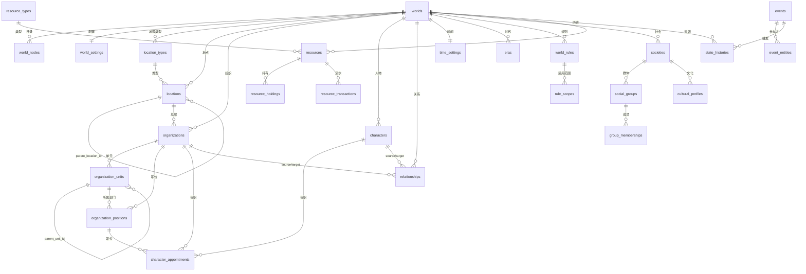

# 世界模拟器 V1.0 数据模型与数据库设计规范

| 项目 | 内容 |
|---|---|
| 文档版本 | V1.0 |
| 状态 | 设计定稿，待评审后进入实施 |
| 适用代码库 | `world-simulator`（`backend/` FastAPI + SQLite，`src/` React + Dexie） |
| 上游设计稿 | `碳基生命模拟器”/世界树开发进度.md`（世界结构模型 V1.0） |
| 对应任务 | T064（已完成）→ T065–T080 的实施依据 |
| 编写原则 | 先审计现有代码，再定目标结构；已有理论定义不改写，新增结构明确标注为工程设计 |

**摘要（五条）：**

1. 现有库有 8 张表，人物/事件/关系能跑通；但**地理无父节点、组织只有名字、关系无类型、历史只是 JSON**，设计稿第三、四、五章无法落地。
2. 有一个已坏掉的功能：**地点编辑请求打到不存在的 `PUT /api/locations/{id}`**，静默失败；世界建设配置只存浏览器 IndexedDB，换设备即丢。
3. 目标结构 28 张表（新增 21 张），五层：世界 / 结构 / 实体 / 关系 / 历史；人物五引擎、事件分类等既有定义原样保留。
4. 无迁移工具是最大工程风险：本文给出 `M001–M010` 增量迁移 + SQLite 表重建流程，全程不删人物数据。
5. 实施按六个"纵切"推进，每个纵切都能独立演示（附录 C），不按 T065–T080 平铺。

---

## 0. 依据边界

**属于既有理论定义，本文只做引用与承载，不做改写：**

- 人物五引擎 V / O / D / E / T（`characters.engines`，默认 `{"V":50,"O":50,"D":50,"E":50,"T":50}`）。
- 人物认知与思想钢印（`characters.thought_imprints`）、防御机制（`defense_mechanisms`）、现实条件（`reality_conditions`）、长期轨迹（`characters.life_history`）。
- 事件分类与事件链（`events.domain` / `polarity` / `intensity` / `parent_event_id` / `caused_by`）。
- 人物关系的四象限与强弱/权力/价值描述（`relationships.source_quadrant` 等）。

**属于本文新增的工程设计，不冒充原有理论：**

- 世界树 `world_nodes`、地理树 `locations`、组织树 `organization_units` / `organization_positions`。
- 跨实体关系表 `relationships` 的类型化改造、状态历史 `state_histories`。
- 规则、时空、社会、资源四组实体表。

检索到的资料中，地理树、组织树、世界实体数据库没有既有规范；本文是这些结构的第一份正式定义。人物五引擎、认知、事件分类的语义一律以上游文档为准，本文只管如何存储与校验。

---

## 1. 现状审计（T064 结果）

### 1.1 技术栈事实

| 层 | 技术事实 | 代码位置 |
|---|---|---|
| 前端 | React 19 + TS + Vite 8，无路由库，页面切换靠 `activePage` 状态 | `src/App.tsx` |
| 前端持久化 | Dexie（IndexedDB），库名 `WorldSimulatorDB`，已到 version 3 | `src/db/database.ts` |
| 后端 | FastAPI + SQLAlchemy 2.x + SQLite | `backend/main.py`、`backend/database.py` |
| 数据库文件 | `backend/world_simulator.db`（约 876 KB） | — |
| 建表方式 | `Base.metadata.create_all(bind=engine)`，**只建不改** | `backend/main.py:15` |
| 迁移工具 | **无**（无 Alembic，无 migrations 目录，无 requirements.txt） | — |
| API 前缀 | 全部为 `/api/...`；前端硬编码 `http://127.0.0.1:8000` | `src/api/client.ts`、各页面 |

**关键结论：系统当前是"双持久化"结构。**

- 实体数据（世界、人物、事件、地点、组织、关系）只存在 SQLite。
- 世界建设配置（八个分支的选项与参数）只存在浏览器 IndexedDB，后端完全不知道它的存在。

### 1.2 实际表结构（以 `sqlite3 .schema` 为准，非 models.py 推导）

| 表 | 实际字段 | 行数 | 与设计稿的关系 |
|---|---|---|---|
| `worlds` | id, name, description, type, background, createdAt, updatedAt, map_image_url | 1 | 需扩展 |
| `characters` | id, world_id, name, basic_profile JSON, engines JSON, defense_mechanisms JSON, reality_conditions JSON, thought_imprints JSON, life_history JSON, initial_state JSON, created_at | 3 | 保留，小幅扩展 |
| `relationships` | id, world_id, source_id, target_id, relation_type, description, is_bidirectional, source_quadrant/strength/power/value, target_quadrant/strength/power/value, history JSON, created_at | 5 | 需类型化改造 |
| `events` | id, world_id, name, domain JSON, polarity, intensity, description, participants JSON, affected JSON, story_time, location_id, organization_id, storyline, scale, parent_event_id, caused_by JSON, created_at | 7 | 保留，扩展多角色关联 |
| `simulation_runs` | id, event_id, world_changes, character_actions JSON, created_at | 7 | 保留，补 world_id |
| `stories` | id, world_id, content, created_at | 1 | 保留不动 |
| `locations` | id, world_id, name, description, x, y, terrain, climate, nation, geo_type, created_at | 5 | **无父节点，无法成树** |
| `organizations` | id, world_id, name, description, created_at | 2 | 只有壳，无结构 |

### 1.3 差距矩阵

| 设计稿要求 | 现状 | 结论 |
|---|---|---|
| `worlds` 含 world_type / world_scale / status / settings | 只有 `type`，无状态与配置 | 扩展 |
| `world_nodes` 八分支目录 | 不存在；八分支硬编码在前端字典里 | 新增 |
| `locations.parent_location_id` 单一父节点 | 不存在；地点是平表 | 新增列 + 迁移 |
| `location_types` 自定义层级 | 不存在；`geo_type` 是自由文本，5 条数据里"中国""湖南"也被写成"城市" | 新增 |
| `organizations` 类型/使命/总部/存续 | 只有 name/description | 扩展 |
| `organization_units` / `organization_positions` | 不存在 | 新增 |
| `character_appointments` | 不存在；人物与组织无任何结构关联 | 新增 |
| `relationships` 支持跨实体（人物/组织/地点/资源） | 只有 `source_id`/`target_id`，无类型列，语义上只能是人物 | 扩展 + 类型白名单 |
| 关系生效/终止时间 | 不存在；只有 `history` JSON 数组 | 扩展 + 历史表 |
| `state_histories` 统一历史 | 不存在；实体只能看到最终值 | 新增 |
| 规则 + 适用范围 | 不存在 | 新增 |
| 时空设置 / 时代 | 不存在；世界无当前时间 | 新增 |
| 社会 / 群体 / 成员 | 不存在 | 新增 |
| 资源 / 持有 / 交易 | 不存在 | 新增 |
| 事件参与方结构化 | `participants` / `affected` 是 ID 字符串数组，无类型、无角色 | 新增 `event_entities`，JSON 迁移后保留只读 |

### 1.4 已确认缺陷（按严重度）

**P0 — 功能已经坏了：**

1. **地点编辑必然失败。** 前端 `src/pages/WorldDataPage.tsx:98` 对 `PUT /api/locations/{id}` 发起请求，但 `backend/world_data.py` 只实现了 POST/GET/DELETE。返回 405，`if (res.ok)` 分支不执行，界面无任何提示，用户以为保存成功。
2. **地理无法成树。** 没有 `parent_location_id`，所谓"世界树"里的地点只能是平铺列表，设计稿第三章的整棵树无法落地。
3. **组织只有名字。** 无部门、无职位、无任职，第四章无法开始。

**P1 — 数据完整性缺口：**

4. `relationships.world_id` 可为 NULL，且库中已存在 1 条实际脏数据（`fdfaa4c2…`）：`world_id` 指向一个不存在的世界（`7fd50148…`），`source_id` / `target_id` 都不是人物，`relation_type` 为空。成因是 `POST /api/relationships` 直接 `models.Relationship(**dict)`，任意字段可写、无任何校验。
5. 所有写入接口都不校验"引用对象是否存在、是否属于同一世界"。删除世界时也不级联，会留下孤儿人物/事件/地点。
6. `relationships.history` 是非结构化 JSON 数组，无法按时间查询、无法关联事件、无法回放。
7. 世界切换与刷新：`currentWorldId` 只是 `useState`（`src/App.tsx:65`），刷新即回世界列表；切换世界时页面状态不重置，存在串世界显示的风险。

**P2 — 工程债：**

8. 无迁移机制。`create_all` 不会给已有表加列，本次要加的十几列必须走手工迁移脚本。
9. `Column(JSON, default={})` 使用可变默认值（`backend/models.py`），多个实例可能共享同一个 dict；`datetime.utcnow` 在 3.12+ 已弃用。
10. 世界建设配置只存 IndexedDB：换设备、清缓存、换浏览器即丢失，且后端无法据此做推演。
11. `worlds.createdAt` / `updatedAt` 用字符串驼峰，其余表用 `created_at` 蛇形，命名不统一。
12. 八个分支的选项字典内联在 `WorldBuildingPage.tsx`（957 行）里，与"节点编辑器按分支动态加载表单"的目标结构冲突。

### 1.5 结论

**V1.0 走"扩展 + 新增"，不重建数据库。**

- 保留并扩展：`worlds`、`characters`、`events`、`relationships`、`locations`、`organizations`、`simulation_runs`、`stories`。
- 新增 21 张表（见 §2.2）。
- 所有结构性变更通过**建新表 → 拷数据 → 校验 → 切换**完成，禁止 `DROP TABLE` 后重建（除纯临时表）。

---

## 2. 目标架构

### 2.1 五层职责

| 层 | 表 | 回答的问题 |
|---|---|---|
| 世界 | `worlds`、`world_settings` | 这是哪个模拟世界？它的全局配置是什么？ |
| 结构 | `world_nodes`、`location_types`、`time_settings`、`eras` | 世界由哪些分类、层级、时间基准组成？ |
| 实体 | `locations`、`organizations`、`organization_units`、`organization_positions`、`characters`、`societies`、`social_groups`、`resources` 等 | 具体对象是什么？ |
| 关系 | `relationships`、`character_appointments`、`group_memberships`、`resource_holdings`、`event_entities` | 对象之间有什么联系？ |
| 历史 | `state_histories`、`resource_transactions`、`events`、`simulation_runs` | 什么时候发生了什么变化？ |

三条硬边界（来自设计稿，不可违背）：

1. 地理树只表达空间归属；组织树只表达正式结构；人物关系网络只表达实际关系。三者互不替代、互不推导。
2. `world_nodes` 只是目录与展示层级，不是实体总表；它通过 `ref_type` + `ref_id` 指向真实实体。
3. 任何"为了显示方便"而复制实体字段的做法都被禁止。

### 2.2 表清单（28 张，其中新增 21 张）

| # | 表 | 状态 | 归属 |
|---|---|---|---|
| 1 | `worlds` | 扩展 | 世界 |
| 2 | `world_settings` | 新增 | 世界 |
| 3 | `schema_migrations` | 新增 | 运维 |
| 4 | `world_nodes` | 新增 | 结构 |
| 5 | `location_types` | 新增 | 结构 |
| 6 | `time_settings` | 新增 | 结构 |
| 7 | `eras` | 新增 | 结构 |
| 8 | `locations` | 扩展 | 实体 |
| 9 | `organizations` | 扩展 | 实体 |
| 10 | `organization_units` | 新增 | 实体 |
| 11 | `organization_positions` | 新增 | 实体 |
| 12 | `characters` | 保留（结构不动，人物模块管辖） | 实体 |
| 13 | `societies` | 新增 | 实体 |
| 14 | `social_groups` | 新增 | 实体 |
| 15 | `cultural_profiles` | 新增 | 实体 |
| 16 | `resource_types` | 新增 | 实体 |
| 17 | `resources` | 新增 | 实体 |
| 18 | `relationships` | 扩展 | 关系 |
| 19 | `character_appointments` | 新增 | 关系 |
| 20 | `group_memberships` | 新增 | 关系 |
| 21 | `resource_holdings` | 新增 | 关系 |
| 22 | `event_entities` | 新增 | 关系 |
| 23 | `world_rules` | 新增 | 规则 |
| 24 | `rule_scopes` | 新增 | 规则 |
| 25 | `state_histories` | 新增 | 历史 |
| 26 | `events` | 扩展 | 历史 |
| 27 | `resource_transactions` | 新增 | 历史 |
| 28 | `simulation_runs` / `stories` | 保留（simulation_runs 补 world_id） | 历史 |

### 2.3 关系图（主键引用，省略审计字段）



---

## 3. 通用约定

| 约定 | 规则 |
|---|---|
| 主键 | `TEXT`，UUID v4 字符串（与现有 `str(uuid.uuid4())` 一致） |
| 世界隔离 | 除 `schema_migrations` 外，所有实体表 `world_id TEXT NOT NULL` + 索引 |
| 时间 | 一律 UTC。`created_at` / `updated_at` 用 `DATETIME`，UTC 存储，前端负责本地化 |
| 世界时间 | 模拟内时间存 `state_histories.occurred_at` / `time_settings.current_time`，与真实时间列分离 |
| 布尔 | `BOOLEAN`（SQLite 存 0/1） |
| 枚举 | 用 `TEXT` + `CHECK` 白名单约束，不用数据库 ENUM（SQLite 无原生枚举） |
| JSON | 仅用于开放型扩展（`settings`、`attributes`、`environment`）。可查询、可校验的字段一律独立列 |
| 软删除 | 实体表加 `status`（含 `archived`），默认物理删除只允许"无子节点、无引用、无历史"的对象 |
| 命名 | 新表蛇形；`worlds.createdAt/updatedAt` 是历史例外，本次不改（改列名会波及前端类型与 3 处读取） |
| 外键 | 声明 FK 并在连接层 `PRAGMA foreign_keys=ON`；跨世界一致性靠服务层校验（FK 管不了） |

**状态枚举（统一词表）：**

| 域 | 取值 |
|---|---|
| 世界 status | `draft` / `running` / `archived` |
| 世界 time_status | `paused` / `running` |
| 地点 status | `normal` / `locked` / `abandoned` / `destroyed` |
| 组织 status | `normal` / `expanding` / `declining` / `dissolved` |
| 任职 appointment_status | `active` / `ended` / `suspended` |
| 关系 status | `active` / `strained` / `interrupted` / `ended` |
| 规则 status | `active` / `suspended` / `repealed` |

---

## 4. 逐表规范

> 下列 DDL 为 SQLite 目标形态。SQLAlchemy 模型须与之一一对应（`__table_args__` 中声明 `Index`、`UniqueConstraint`、`CheckConstraint`）。所有 `DATETIME` 列由应用层写入 UTC。

### 4.1 世界与配置

#### 4.1.1 `worlds`（扩展）

```sql
ALTER TABLE worlds ADD COLUMN world_scale TEXT NOT NULL DEFAULT 'city';   -- city/province/nation/global/planet/galaxy
ALTER TABLE worlds ADD COLUMN status      TEXT NOT NULL DEFAULT 'draft';   -- draft/running/archived
ALTER TABLE worlds ADD COLUMN time_status TEXT NOT NULL DEFAULT 'paused';  -- paused/running
ALTER TABLE worlds ADD COLUMN settings    JSON NOT NULL DEFAULT '{}';      -- 世界级非结构化配置
```

- `type` 继续承载世界类型（前端已用 `reality/fiction/historical/experimental`），语义等同设计稿的 `world_type`，**不新增同义列**。
- 更新时间沿用现有 `updatedAt`，**不再新增 `updated_at`**，避免同一张表两份"更新时间"（附录 A 的 D-7）。
- 当前世界时间**不放在 `worlds`**，唯一来源是 `time_settings.current_time`（见 §4.4.1 与附录 A 的 D-3）。
- `settings` 只放非结构化偏好（默认历法名、默认时区、模拟步长偏好）。人物、地点、规则、资源禁止塞进 JSON。

#### 4.1.2 `world_settings`（新增）

用途：承接现在只存在 IndexedDB 的 `worldBuildingConfigs`（`selections` + `parameters`），让配置进入后端、可被模拟引擎读取。

```sql
CREATE TABLE world_settings (
  world_id    TEXT PRIMARY KEY REFERENCES worlds(id) ON DELETE CASCADE,
  selections  JSON NOT NULL DEFAULT '{}',   -- { groupKey: [optionId...] }
  parameters  JSON NOT NULL DEFAULT '{}',   -- { key: string|number|boolean }
  revision    INTEGER NOT NULL DEFAULT 1,
  updated_at  DATETIME NOT NULL
);
```

- 一个世界一条记录；`revision` 每次写入 +1，用于前端乐观并发。
- 迁移来源：`WorldSimulatorDB.worldBuildingConfigs`（见 §7.4 的一次性导入接口）。

#### 4.1.3 `schema_migrations`（新增）

```sql
CREATE TABLE schema_migrations (
  version    TEXT PRIMARY KEY,
  applied_at DATETIME NOT NULL,
  note       TEXT
);
```

### 4.2 世界目录

#### 4.2.1 `world_nodes`（新增）

```sql
CREATE TABLE world_nodes (
  id          TEXT PRIMARY KEY,
  world_id    TEXT NOT NULL REFERENCES worlds(id) ON DELETE CASCADE,
  parent_id   TEXT REFERENCES world_nodes(id) ON DELETE RESTRICT,
  branch      TEXT NOT NULL CHECK (branch IN (
                'world_profile','world_rules','space_time','geography',
                'civilization_society','organizations','people_groups','resources_economy')),
  node_type   TEXT NOT NULL,              -- folder / entity_ref / note
  name        TEXT NOT NULL,
  sort_order  INTEGER NOT NULL DEFAULT 0,
  description TEXT NOT NULL DEFAULT '',
  ref_type    TEXT CHECK (ref_type IN ('location','organization','organization_unit',
                'character','society','social_group','resource','rule','era') OR ref_type IS NULL),
  ref_id      TEXT,
  created_at  DATETIME NOT NULL,
  updated_at  DATETIME NOT NULL
);
CREATE INDEX ix_world_nodes_world_branch ON world_nodes(world_id, branch, sort_order);
CREATE INDEX ix_world_nodes_parent ON world_nodes(parent_id);
```

约束：

- `node_type = 'entity_ref'` 时 `ref_type` 与 `ref_id` 必须同时非空，且 `ref_type` 必须在当前世界内存在；`folder` / `note` 时两者必须为空。
- 同一 `parent_id` 下 `name` 唯一（同一世界内）。
- 目录树不允许跨世界父节点。

#### 4.2.2 八分支的种子数据

首次创建世界时，自动生成 8 个根节点（`parent_id = NULL`, `node_type = 'folder'`），名称与 `branch` 一一对应。前端不再硬编码分支列表，改为读 `world_nodes`。

### 4.3 地理结构

#### 4.3.1 `location_types`（新增）

```sql
CREATE TABLE location_types (
  id                       TEXT PRIMARY KEY,
  world_id                 TEXT REFERENCES worlds(id) ON DELETE CASCADE,  -- NULL = 系统默认类型
  name                     TEXT NOT NULL,
  allowed_parent_type_ids  JSON NOT NULL DEFAULT '[]',  -- 允许的上级类型 id 数组
  default_child_type_ids   JSON NOT NULL DEFAULT '[]',
  description              TEXT NOT NULL DEFAULT '',
  sort_order               INTEGER NOT NULL DEFAULT 0,
  created_at               DATETIME NOT NULL
);
CREATE UNIQUE INDEX ux_location_types_world_name ON location_types(world_id, name);
```

- 系统默认类型（`world_id IS NULL`）：大陆、国家、省/州、城市、城区、街道、建筑、房间、海域、据点。
- 校验规则：新建/移动地点时，若父节点存在且其类型定义了 `allowed_parent_type_ids`，则父节点类型必须在白名单内；`[]` 表示不限制。
- 设计稿用类型名做白名单，这里改成类型 id，避免改名后校验失效（附录 A 的 D-2）。

#### 4.3.2 `locations`（扩展）

```sql
ALTER TABLE locations ADD COLUMN parent_location_id TEXT REFERENCES locations(id) ON DELETE RESTRICT;
ALTER TABLE locations ADD COLUMN location_type_id  TEXT REFERENCES location_types(id) ON DELETE RESTRICT;
ALTER TABLE locations ADD COLUMN status            TEXT NOT NULL DEFAULT 'normal';
ALTER TABLE locations ADD COLUMN coordinates       JSON;            -- {"lat":..,"lng":..} 或世界坐标
ALTER TABLE locations ADD COLUMN environment       JSON NOT NULL DEFAULT '{}';
ALTER TABLE locations ADD COLUMN population        INTEGER;
ALTER TABLE locations ADD COLUMN sort_order        INTEGER NOT NULL DEFAULT 0;
ALTER TABLE locations ADD COLUMN updated_at        DATETIME;
CREATE INDEX ix_locations_parent ON locations(parent_location_id);
CREATE INDEX ix_locations_world_type ON locations(world_id, location_type_id);
```

保留并**停止写入**的旧列：`geo_type`（由 `location_type_id` 取代，迁移期只读）、`nation`（自由文本，语义与地理树重叠，迁移后只读）。`x` / `y`（地图百分比）保留，用于 `WorldDataPage` 地图打点，与 `coordinates` 不冲突：前者是画布坐标，后者是地理坐标。

地理树约束（服务层强制，逐条对应设计稿第三章）：

| 规则 | 实现 |
|---|---|
| 每个地点只有一个直接父节点 | 单列 `parent_location_id` |
| 不能移动到自己的后代下 | 移动前做祖先链遍历，命中即 409 `LOCATION_CYCLE` |
| 不能跨世界建立父子关系 | 校验 `parent.world_id == child.world_id`，否则 409 `WORLD_MISMATCH` |
| 根节点可无父 | `parent_location_id IS NULL` 允许 |
| 删除父节点前必须处理子节点 | `ON DELETE RESTRICT` + 服务层 409 `HAS_CHILDREN`，提示先移动或归档 |
| 组织/人物不能作为地理子节点 | 地理树只接受 `locations`，无多态 |

#### 4.3.3 地理的非层级关系

"租用/控制/位于"不进 `parent_location_id`，统一走 `relationships`：

```
organization --located_at--> location
character    --located_at--> location
organization --controls----> location
```

`located_at` 是时态关系：可带 `valid_from` / `valid_until`，历史写入 `state_histories`。

### 4.4 时空结构

#### 4.4.1 `time_settings`（新增）

```sql
CREATE TABLE time_settings (
  world_id             TEXT PRIMARY KEY REFERENCES worlds(id) ON DELETE CASCADE,
  calendar_type        TEXT NOT NULL DEFAULT 'gregorian',  -- gregorian/lunar/custom
  day_length_hours     REAL NOT NULL DEFAULT 24,
  time_unit            TEXT NOT NULL DEFAULT 'day',        -- hour/day/week/month/year
  timezone             TEXT NOT NULL DEFAULT 'UTC',
  current_time         DATETIME NOT NULL,                  -- 世界当前时间（唯一来源）
  current_era_id       TEXT REFERENCES eras(id) ON DELETE SET NULL,
  allow_regional_time  BOOLEAN NOT NULL DEFAULT 0,
  config               JSON NOT NULL DEFAULT '{}',         -- 自定义历法，V1 不做换算
  updated_at           DATETIME NOT NULL
);
```

V1 只保证"模拟引擎使用统一世界时间"，不实现多历法换算；`calendar_type='custom'` 时仅保存展示名，时间仍按格里高利语义推进。

#### 4.4.2 `eras`（新增）

```sql
CREATE TABLE eras (
  id          TEXT PRIMARY KEY,
  world_id    TEXT NOT NULL REFERENCES worlds(id) ON DELETE CASCADE,
  name        TEXT NOT NULL,
  start_time  DATETIME,
  end_time    DATETIME,
  description TEXT NOT NULL DEFAULT '',
  sort_order  INTEGER NOT NULL DEFAULT 0,
  created_at  DATETIME NOT NULL
);
CREATE INDEX ix_eras_world ON eras(world_id, sort_order);
```

### 4.5 组织结构

#### 4.5.1 `organizations`（扩展）

```sql
ALTER TABLE organizations ADD COLUMN organization_type TEXT NOT NULL DEFAULT 'company';
ALTER TABLE organizations ADD COLUMN mission         TEXT NOT NULL DEFAULT '';
ALTER TABLE organizations ADD COLUMN founded_at      DATETIME;
ALTER TABLE organizations ADD COLUMN dissolved_at    DATETIME;
ALTER TABLE organizations ADD COLUMN status          TEXT NOT NULL DEFAULT 'normal';
ALTER TABLE organizations ADD COLUMN headquarters_location_id TEXT REFERENCES locations(id) ON DELETE SET NULL;
ALTER TABLE organizations ADD COLUMN attributes      JSON NOT NULL DEFAULT '{}';
ALTER TABLE organizations ADD COLUMN updated_at      DATETIME;
CREATE INDEX ix_organizations_world ON organizations(world_id);
```

`headquarters_location_id` 只存引用，不复制地点名称/坐标。

#### 4.5.2 `organization_units`（新增）

```sql
CREATE TABLE organization_units (
  id              TEXT PRIMARY KEY,
  world_id        TEXT NOT NULL REFERENCES worlds(id) ON DELETE CASCADE,
  organization_id TEXT NOT NULL REFERENCES organizations(id) ON DELETE CASCADE,
  parent_unit_id  TEXT REFERENCES organization_units(id) ON DELETE RESTRICT,
  name            TEXT NOT NULL,
  unit_type       TEXT NOT NULL DEFAULT 'department',  -- department/committee/office/team
  description     TEXT NOT NULL DEFAULT '',
  status          TEXT NOT NULL DEFAULT 'active',
  sort_order      INTEGER NOT NULL DEFAULT 0,
  created_at      DATETIME NOT NULL,
  updated_at      DATETIME NOT NULL
);
CREATE INDEX ix_units_org ON organization_units(organization_id, parent_unit_id, sort_order);
CREATE UNIQUE INDEX ux_units_org_name ON organization_units(organization_id, parent_unit_id, name);
```

- 一个单元只能属于一个组织；父单元必须与自身同组织（服务层校验）。
- 同组织内不允许环。

#### 4.5.3 `organization_positions`（新增）

```sql
CREATE TABLE organization_positions (
  id               TEXT PRIMARY KEY,
  world_id         TEXT NOT NULL REFERENCES worlds(id) ON DELETE CASCADE,
  organization_id  TEXT NOT NULL REFERENCES organizations(id) ON DELETE CASCADE,
  unit_id          TEXT NOT NULL REFERENCES organization_units(id) ON DELETE RESTRICT,
  name             TEXT NOT NULL,
  position_level   TEXT,
  responsibilities TEXT NOT NULL DEFAULT '',
  authority_scope  JSON NOT NULL DEFAULT '{}',
  headcount        INTEGER,                -- NULL = 不限
  status           TEXT NOT NULL DEFAULT 'active',
  created_at       DATETIME NOT NULL,
  updated_at       DATETIME NOT NULL
);
CREATE INDEX ix_positions_unit ON organization_positions(unit_id);
```

职位是结构性占位，不等于人物。`unit_id` 必填（设计稿要求"职位必须属于明确的组织和部门"）。

#### 4.5.4 `character_appointments`（新增）

```sql
CREATE TABLE character_appointments (
  id                 TEXT PRIMARY KEY,
  world_id           TEXT NOT NULL REFERENCES worlds(id) ON DELETE CASCADE,
  character_id       TEXT NOT NULL REFERENCES characters(id) ON DELETE RESTRICT,
  organization_id    TEXT NOT NULL REFERENCES organizations(id) ON DELETE RESTRICT,
  unit_id            TEXT NOT NULL REFERENCES organization_units(id) ON DELETE RESTRICT,
  position_id        TEXT NOT NULL REFERENCES organization_positions(id) ON DELETE RESTRICT,
  start_time         DATETIME NOT NULL,
  end_time           DATETIME,
  appointment_status TEXT NOT NULL DEFAULT 'active',
  note               TEXT NOT NULL DEFAULT '',
  created_at         DATETIME NOT NULL,
  updated_at         DATETIME NOT NULL
);
CREATE INDEX ix_appointments_char ON character_appointments(character_id, appointment_status);
CREATE UNIQUE INDEX ux_appointments_active ON character_appointments(character_id, position_id)
  WHERE end_time IS NULL;   -- 同一人同一职位同时只能有一条在任记录
```

规则：

- 离任 = 写 `end_time` + `appointment_status='ended'`，**不删记录**。
- 同一人可有多条在任记录（多组织兼职）。
- 任职不作为 `relationships` 的一行存在；需要展示"组织关系"时，由 `character_appointments` 派生（附录 A 的 D-1）。

### 4.6 跨实体关系

#### 4.6.1 `relationships`（扩展 + 重建）

```sql
CREATE TABLE relationships_new (
  id               TEXT PRIMARY KEY,
  world_id         TEXT NOT NULL REFERENCES worlds(id) ON DELETE CASCADE,
  source_type      TEXT NOT NULL DEFAULT 'character'
                     CHECK (source_type IN ('character','organization','location','social_group','resource','event')),
  source_id        TEXT NOT NULL,
  target_type      TEXT NOT NULL DEFAULT 'character'
                     CHECK (target_type IN ('character','organization','location','social_group','resource','event')),
  target_id        TEXT NOT NULL,
  relation_type    TEXT NOT NULL,
  description      TEXT NOT NULL DEFAULT '',
  is_bidirectional BOOLEAN NOT NULL DEFAULT 0,
  source_quadrant  TEXT NOT NULL DEFAULT '漠视',
  source_strength  TEXT NOT NULL DEFAULT '中',
  source_power     TEXT NOT NULL DEFAULT '对等',
  source_value     TEXT NOT NULL DEFAULT '利己',
  target_quadrant  TEXT,
  target_strength  TEXT,
  target_power     TEXT,
  target_value     TEXT,
  status           TEXT NOT NULL DEFAULT 'active',
  strength_level   TEXT,                      -- 弱/中/强（整体强度，区别于四象限单侧描述）
  valid_from       DATETIME,
  valid_until      DATETIME,
  created_at       DATETIME NOT NULL,
  updated_at       DATETIME NOT NULL,
  CHECK (source_id <> target_id)
);
CREATE INDEX ix_rel_world_source ON relationships(world_id, source_type, source_id);
CREATE INDEX ix_rel_world_target ON relationships(world_id, target_type, target_id);
CREATE UNIQUE INDEX ux_rel_edge ON relationships(
  world_id, source_type, source_id, target_type, target_id, relation_type
) WHERE status IN ('active','strained');
```

说明：

- 四象限字段属于既有理论（关系性质描述），**保留不动**。
- `is_bidirectional` 与设计稿的 `direction` 等价，保留布尔（前端已在用），不新增同义列。
- 端点存在性与世界一致性由服务层 `assert_entity(world_id, type, id)` 校验；SQLite 无法用 FK 表达多态引用。
- 删除关系一律软删除（`status='ended'` + `valid_until`），历史保留。

#### 4.6.2 `state_histories`（新增，统一历史表）

```sql
CREATE TABLE state_histories (
  id            TEXT PRIMARY KEY,
  world_id      TEXT NOT NULL REFERENCES worlds(id) ON DELETE CASCADE,
  entity_type   TEXT NOT NULL CHECK (entity_type IN (
                  'world','location','organization','organization_unit','organization_position',
                  'character','appointment','relationship','rule','society','social_group',
                  'resource','holding','event')),
  entity_id     TEXT NOT NULL,
  field         TEXT NOT NULL,              -- 'status' / 'parent_location_id' / 'relation_type' / 'quantity' ...
  old_value     JSON,
  new_value     JSON,
  event_id      TEXT REFERENCES events(id) ON DELETE SET NULL,
  reason        TEXT NOT NULL DEFAULT '',
  source        TEXT NOT NULL DEFAULT 'user',  -- user / ai / import / system
  actor_id      TEXT,                          -- 触发操作的人物（可为空）
  occurred_at   DATETIME NOT NULL,             -- 世界时间
  created_at    DATETIME NOT NULL              -- 真实时间
);
CREATE INDEX ix_hist_entity ON state_histories(world_id, entity_type, entity_id, occurred_at);
CREATE INDEX ix_hist_event ON state_histories(event_id);
```

配套视图（满足设计稿的 `relationship_histories`，避免双写）：

```sql
CREATE VIEW relationship_histories AS
SELECT id, world_id, entity_id AS relationship_id, event_id, old_value, new_value,
       occurred_at, reason
FROM state_histories
WHERE entity_type = 'relationship';
```

写入职责：**只在服务层写**，由统一的 `record_history()` 完成；禁止路由里直接 `setattr` 状态字段而不留痕（这条要写进 Code Review 清单）。不用数据库触发器，因为触发器拿不到 `actor_id` / `reason` / `event_id`。

### 4.7 世界规则

#### 4.7.1 `world_rules`（新增）

```sql
CREATE TABLE world_rules (
  id                TEXT PRIMARY KEY,
  world_id          TEXT NOT NULL REFERENCES worlds(id) ON DELETE CASCADE,
  name              TEXT NOT NULL,
  rule_category     TEXT NOT NULL DEFAULT 'social',  -- natural/social/legal/economic/special
  description       TEXT NOT NULL DEFAULT '',
  conditions        TEXT NOT NULL DEFAULT '',        -- 生效条件（自然语言，V1 不做表达式求值）
  consequences      TEXT NOT NULL DEFAULT '',
  priority          INTEGER NOT NULL DEFAULT 0,
  status            TEXT NOT NULL DEFAULT 'active',
  effective_from    DATETIME,
  effective_until   DATETIME,
  created_at        DATETIME NOT NULL,
  updated_at        DATETIME NOT NULL
);
```

**规则没有 `scope_type` / `scope_id` 列**，适用范围一律走 `rule_scopes`（设计稿明确要求，避免多对象塞一个字段）。

#### 4.7.2 `rule_scopes`（新增）

```sql
CREATE TABLE rule_scopes (
  id          TEXT PRIMARY KEY,
  rule_id     TEXT NOT NULL REFERENCES world_rules(id) ON DELETE CASCADE,
  scope_type  TEXT NOT NULL CHECK (scope_type IN ('world','location','organization','organization_unit','social_group','character','resource')),
  scope_id    TEXT NOT NULL,
  created_at  DATETIME NOT NULL
);
CREATE UNIQUE INDEX ux_rule_scope ON rule_scopes(rule_id, scope_type, scope_id);
```

- `scope_type='world'` 时 `scope_id` = `world_id`。
- 规则"存在"不等于"被知晓""被执行"：人物是否知道规则写在人物认知侧，执行结果写在 `state_histories` / 事件里。

### 4.8 文明与社会

```sql
CREATE TABLE societies (
  id                  TEXT PRIMARY KEY,
  world_id            TEXT NOT NULL REFERENCES worlds(id) ON DELETE CASCADE,
  name                TEXT NOT NULL,
  society_type        TEXT NOT NULL DEFAULT 'nation',   -- nation/civilization/tribe/city_state
  government_form     TEXT NOT NULL DEFAULT '',
  territory_location_id TEXT REFERENCES locations(id) ON DELETE SET NULL,
  description         TEXT NOT NULL DEFAULT '',
  founded_at          DATETIME,
  dissolved_at        DATETIME,
  status              TEXT NOT NULL DEFAULT 'active',
  created_at          DATETIME NOT NULL,
  updated_at          DATETIME NOT NULL
);

CREATE TABLE social_groups (
  id          TEXT PRIMARY KEY,
  world_id    TEXT NOT NULL REFERENCES worlds(id) ON DELETE CASCADE,
  society_id  TEXT REFERENCES societies(id) ON DELETE SET NULL,
  name        TEXT NOT NULL,
  group_type  TEXT NOT NULL DEFAULT 'class',  -- class/ethnic/religious/cultural/profession
  description TEXT NOT NULL DEFAULT '',
  created_at  DATETIME NOT NULL,
  updated_at  DATETIME NOT NULL
);

CREATE TABLE group_memberships (
  id          TEXT PRIMARY KEY,
  world_id    TEXT NOT NULL REFERENCES worlds(id) ON DELETE CASCADE,
  group_id    TEXT NOT NULL REFERENCES social_groups(id) ON DELETE CASCADE,
  member_type TEXT NOT NULL CHECK (member_type IN ('character','organization')),
  member_id   TEXT NOT NULL,
  role        TEXT NOT NULL DEFAULT 'member',
  start_time  DATETIME,
  end_time    DATETIME,
  status      TEXT NOT NULL DEFAULT 'active',
  created_at  DATETIME NOT NULL
);

CREATE TABLE cultural_profiles (
  id          TEXT PRIMARY KEY,
  world_id    TEXT NOT NULL REFERENCES worlds(id) ON DELETE CASCADE,
  society_id  TEXT REFERENCES societies(id) ON DELETE CASCADE,
  language    TEXT NOT NULL DEFAULT '',
  religion    TEXT NOT NULL DEFAULT '',
  customs     JSON NOT NULL DEFAULT '[]',
  taboos      JSON NOT NULL DEFAULT '[]',
  description TEXT NOT NULL DEFAULT '',
  created_at  DATETIME NOT NULL,
  updated_at  DATETIME NOT NULL
);
```

边界（必须写进实现注释）：

- 国家/文明 = `societies`；政府机构、军队、企业 = `organizations`。同一个"华国"不要同时建两条。
- 人物的信仰、思想钢印属于人物档案（`thought_imprints`），**不能**直接当成 `social_groups` 或 `world_rules`；只有当它形成社会层面的共同结构时才建群体。

### 4.9 资源

```sql
CREATE TABLE resource_types (
  id          TEXT PRIMARY KEY,
  world_id    TEXT REFERENCES worlds(id) ON DELETE CASCADE,   -- NULL = 系统默认
  name        TEXT NOT NULL,
  category    TEXT NOT NULL CHECK (category IN ('natural','material','financial','human','information','power')),
  unit        TEXT NOT NULL DEFAULT '',
  description TEXT NOT NULL DEFAULT '',
  created_at  DATETIME NOT NULL
);

CREATE TABLE resources (
  id               TEXT PRIMARY KEY,
  world_id         TEXT NOT NULL REFERENCES worlds(id) ON DELETE CASCADE,
  resource_type_id TEXT NOT NULL REFERENCES resource_types(id) ON DELETE RESTRICT,
  name             TEXT NOT NULL,
  description      TEXT NOT NULL DEFAULT '',
  quantity         REAL NOT NULL DEFAULT 0,
  unit             TEXT NOT NULL DEFAULT '',
  location_id      TEXT REFERENCES locations(id) ON DELETE SET NULL,
  status           TEXT NOT NULL DEFAULT 'active',
  data             JSON NOT NULL DEFAULT '{}',
  created_at       DATETIME NOT NULL,
  updated_at       DATETIME NOT NULL
);

CREATE TABLE resource_holdings (
  id          TEXT PRIMARY KEY,
  world_id    TEXT NOT NULL REFERENCES worlds(id) ON DELETE CASCADE,
  resource_id TEXT NOT NULL REFERENCES resources(id) ON DELETE CASCADE,
  holder_type TEXT NOT NULL CHECK (holder_type IN ('character','organization','organization_unit','social_group','location')),
  holder_id   TEXT NOT NULL,
  role        TEXT NOT NULL CHECK (role IN ('holder','manager','user','beneficiary')),
  share       REAL,                       -- 0-1，NULL = 全部
  start_time  DATETIME,
  end_time    DATETIME,
  status      TEXT NOT NULL DEFAULT 'active',
  created_at  DATETIME NOT NULL
);
CREATE UNIQUE INDEX ux_holding ON resource_holdings(resource_id, holder_type, holder_id, role)
  WHERE status = 'active';

CREATE TABLE resource_transactions (
  id            TEXT PRIMARY KEY,
  world_id      TEXT NOT NULL REFERENCES worlds(id) ON DELETE CASCADE,
  resource_id   TEXT NOT NULL REFERENCES resources(id) ON DELETE CASCADE,
  amount        REAL NOT NULL,
  from_holder_id TEXT REFERENCES resource_holdings(id) ON DELETE SET NULL,
  to_holder_id   TEXT REFERENCES resource_holdings(id) ON DELETE SET NULL,
  event_id      TEXT REFERENCES events(id) ON DELETE SET NULL,
  reason        TEXT NOT NULL DEFAULT '',
  occurred_at   DATETIME NOT NULL,
  created_at    DATETIME NOT NULL
);
```

- 持有 / 管理 / 使用是**三种角色**，不是三个字段。一条资源可以有多条 `role` 不同的 holding。
- 数量变化必须同时写 `resource_transactions` 与 `state_histories`（`field='quantity'`）；禁止只改 `resources.quantity`。

### 4.10 事件扩展

```sql
CREATE TABLE event_entities (
  id          TEXT PRIMARY KEY,
  world_id    TEXT NOT NULL REFERENCES worlds(id) ON DELETE CASCADE,
  event_id    TEXT NOT NULL REFERENCES events(id) ON DELETE CASCADE,
  entity_type TEXT NOT NULL CHECK (entity_type IN ('character','organization','location','social_group','resource')),
  entity_id   TEXT NOT NULL,
  role        TEXT NOT NULL CHECK (role IN ('participant','affected','location','organization','trigger')),
  impact      TEXT NOT NULL DEFAULT '',
  created_at  DATETIME NOT NULL
);
CREATE UNIQUE INDEX ux_event_entity ON event_entities(event_id, entity_type, entity_id, role);
```

- `events.participants` / `affected`（JSON ID 数组）迁移到本表后**保留只读一个版本**，供旧前端读取；V1.1 删除。
- `events.location_id` / `organization_id` 保留为"主地点 / 主组织"便捷引用（EventsPage、TimelinePage 在用），不视为复制；多参与方与角色由 `event_entities` 承载。

### 4.11 模拟与写作

```sql
ALTER TABLE simulation_runs ADD COLUMN world_id TEXT;   -- 回填自关联事件；新写入必填
CREATE INDEX ix_sim_world ON simulation_runs(world_id, created_at);
```

`stories` 不动。

---

## 5. 完整性规则

### 5.1 每个写接口必须过五道校验

1. **存在性**：被引用的对象存在（否则 404）。
2. **世界一致**：`obj.world_id == path/query 的 world_id`（否则 409 `WORLD_MISMATCH`）。
3. **结构合法**：父子不跨世界、不成环、类型白名单匹配（否则 409）。
4. **引用安全**：删除/移动不破坏其他实体引用（否则 409 `HAS_DEPENDENTS`）。
5. **留痕**：状态字段变化必须产生 `state_histories` 记录（缺失即测试失败）。

### 5.2 统一错误码

`HTTPException(status_code, detail="CODE: 中文说明")`，前端可直接展示 `detail`。

| code | HTTP | 场景 |
|---|---|---|
| `NOT_FOUND` | 404 | 对象不存在 |
| `WORLD_MISMATCH` | 409 | 引用跨世界 |
| `CYCLE_DETECTED` | 409 | 移动到自身后代 |
| `TYPE_NOT_ALLOWED` | 409 | 父类型不在白名单 |
| `HAS_CHILDREN` / `HAS_DEPENDENTS` | 409 | 删除受阻 |
| `INVALID_STATE` | 422 | 状态机不允许的转换 |
| `VALIDATION_ERROR` | 422 | 字段缺失/格式错误 |

### 5.3 删除策略

| 对象 | 策略 |
|---|---|
| 世界 | 归档（`status='archived'`）；物理删除仅限"无任何实体引用"的空世界 |
| 地点 | 有子节点或有引用 → 409；否则允许删，或 `status='destroyed'` |
| 组织 | `dissolved` + `dissolved_at`，保留成员与任职历史 |
| 人物 | 保留（人物模块管辖），世界删除时置 `archived` 不物理删 |
| 关系 | 软删除（`ended` + `valid_until`） |
| 组织单元/职位 | 有下级/有在任 → 409；否则可删 |

### 5.4 树算法

- 祖先链：`WITH RECURSIVE` 向上收集 `parent_*`，判断目标是否在链中。
- 深度上限：地理 12 层、组织单元 8 层（超限 422），防止恶意深链拖慢渲染。
- 批量移动：V1 不支持，单节点 `POST /move`。

---

## 6. 历史与时间线

### 6.1 写入时机

| 变化 | 记录 |
|---|---|
| 地点父节点变化 | `entity_type='location'`, `field='parent_location_id'` |
| 组织状态变化 | `field='status'` |
| 任职开始/结束 | `entity_type='appointment'`, `field='appointment_status'`，并附 `event_id`（若有） |
| 关系性质/状态变化 | `entity_type='relationship'`, `field='status'` / `relation_type` |
| 资源数量变化 | `field='quantity'`，同时写 `resource_transactions` |
| 规则生效状态变化 | `field='status'` |

### 6.2 查询语义

- 当前值：直接读实体表。
- 某时刻值（as-of）：取 `occurred_at <= T` 的最后一条 `state_histories`，回退到实体当前值。V1 只提供"历史列表"，不提供完整时间点快照重建（列入 V1.1）。
- 时间线页面：`state_histories JOIN events`，按 `occurred_at` 排序。

### 6.3 为什么不用触发器

SQLite 触发器无法获取操作者、原因、关联事件，也无法阻止"绕过服务层"的批量脚本写脏；历史质量依赖业务上下文。因此：**服务层唯一写入口 + 测试断言"改状态必有历史"**。

---

## 7. 迁移方案

### 7.1 现状约束

- 无 Alembic；`create_all` 不会修改既有表结构。
- 数据量极小（1 世界 / 3 人物 / 5 地点 / 2 组织 / 5 关系 / 7 事件 / 7 推演 / 1 文稿），但**人物数据不可丢**。
- SQLite 的 `ALTER TABLE` 不支持改列类型/加 NOT NULL 约束，需要"重建表"。

### 7.2 迁移器（先做，别再拖）

新增 `backend/migrations/`：

```
backend/migrations/
  __init__.py
  runner.py            # 读 schema_migrations，按序执行，事务包裹
  m001_world_foundation.py
  m002_geography.py
  m003_organization.py
  m004_relationship_history.py
  m005_rules_time.py
  m006_society_resource.py
  m007_event_entities.py
```

`runner.py` 在 `main.py` 启动时、`create_all` 之前执行（或作为 `python -m migrations.runner` 手动步骤，生产更稳）。每个迁移必须提供：`up(conn)`、`down(conn)`（能回滚的尽力回滚）、`verify(conn)`（行数断言）。

两条入口必须分开处理：

- **已存在的库**（有数据）：按 `schema_migrations` 顺序执行增量迁移。
- **全新的库**（无表）：直接按目标模型 `create_all`，然后把全部版本号登记为已应用，不重放历史迁移（否则新库会在"加列"步骤上失败）。

### 7.3 表重建标准流程（SQLite）

```
1. PRAGMA foreign_keys=OFF
2. BEGIN
3. CREATE TABLE x_new (...目标结构...)
4. INSERT INTO x_new (cols) SELECT cols FROM x
5. 数据清洗（见 7.5）
6. DROP TABLE x; ALTER TABLE x_new RENAME TO x
7. 重建索引
8. 行数比对（旧 count == 新 count）
9. COMMIT
10. PRAGMA foreign_key_check
11. PRAGMA foreign_keys=ON
```

失败即整体回滚，禁止部分提交。

### 7.4 迁移批次

| 版本 | 内容 | 数据动作 |
|---|---|---|
| M001 | `schema_migrations`、`world_nodes`、`world_settings`；`worlds` 补列 | 为每个世界生成 8 个根节点；`world_settings` 留空，等前端导入 |
| M002 | `location_types`（含 10 个系统默认类型）、`locations` 重建 | 依据 `geo_type` 文本映射 `location_type_id`；无法映射的落到"地点"默认类型；`nation` 保留只读 |
| M003 | `organizations` 重建、`organization_units`、`organization_positions`、`character_appointments` | 为每个组织建一个"总部"根单元（不猜部门）；不创建任何职位/任职 |
| M004 | `relationships` 重建、`state_histories`、`relationship_histories` 视图 | 对 1 条脏数据（`world_id` 指向不存在世界、两端均非人物）：按 `source_id` 反查实体世界，推断失败则标记 `status='ended'` 并写入迁移日志，不猜世界；`history` JSON（现有 5 条分别含 2/368/906/350/2 字符）逐条转 `state_histories`；`source_type/target_type` 默认 `character` |
| M005 | `world_rules`、`rule_scopes`、`time_settings`、`eras` | 每个世界一条 `time_settings`，`current_time` 取 `worlds.createdAt` |
| M006 | `societies`、`social_groups`、`group_memberships`、`cultural_profiles`、`resource_types`（6 类系统默认）、`resources`、`resource_holdings`、`resource_transactions` | 建系统默认资源类型；不预建业务资源 |
| M007 | `event_entities`；`events` 补 `updated_at`；`simulation_runs.world_id` | `participants` → `role='participant'`，`affected` → `role='affected'`，`location_id` → `role='location'`，`organization_id` → `role='organization'`；`simulation_runs.world_id` 由 `events.world_id` 回填 |

### 7.5 数据清洗清单（必须在 M004 之前跑一次只读体检）

| 问题 | 处置 |
|---|---|
| 1 条关系 `world_id` 指向不存在的世界、两端实体都不存在 | 置 `status='ended'` 并写迁移日志（`reason='orphan'`），不物理删；不为了让校验通过而随意改 `world_id` |
| `world_id = ''` 的人物（自由捏人） | 保留；`GET /characters?world_id=` 的"包含空世界"逻辑保留，但新建必须有世界 |
| 关系 `history` JSON 结构不统一（现有 5 条长度 2–906 字符） | 迁移时逐条解析；无法解析为 `{old,new,at,reason}` 的整条原样存入 `state_histories.old_value`，不丢数据 |
| `locations.geo_type` 全为"城市" | 按 `nation` / 名称关键词做保守映射，无法判断的设为 `地点`，人工在界面上改 |
| 事件的 `participants` 里有非人物 ID | 迁移时 `entity_type` 无法判定则跳过并写日志，不阻塞 |

### 7.6 前端 IndexedDB 的收编

浏览器数据无法从服务端读取，只能由客户端推送：

1. 新增 `POST /api/worlds/{world_id}/settings/import`，body 为 `{selections, parameters}`，幂等（同内容不产生新 revision）。
2. 前端在打开世界时检测 Dexie 是否还有未导入的 `worldBuildingConfigs`，有则自动导入一次并在本地标记 `imported`。
3. 全部世界导入完成后，Dexie 升到 v4：只保留 `meta` 表，删掉 `worlds` / `characters` / `worldBuildingConfigs`。现状中 Dexie 的 `worlds`、`characters` 表**从未被读写**（只有 `worldBuildingConfigs` 在用），可直接删。

### 7.7 迁移验收

- `schema_migrations` 与目录中的脚本一一对应。
- 迁移前后每表行数一致（新增表除外），并在日志里打印。
- `PRAGMA foreign_key_check` 为空。
- 迁移后跑一遍 §11 的验收用例。

---

## 8. API 契约

现有 34 个业务端点（另有 `GET /api/health`）全部保留，路径 `/api` 前缀不变；新增端点按下列规范。所有列表接口支持 `?world_id=`（路径已含 world 的除外）。

> 端点分布：characters 6、events 5、worlds 5 + health 1、relationships 4、simulation/writing 8、locations/organizations 6。

### 8.1 现状 → 目标差异

| 现有端点 | 处理 |
|---|---|
| `GET/POST /api/worlds`、`GET/PUT/DELETE /api/worlds/{id}` | 保留；PUT 增补新字段；DELETE 改为归档语义 |
| `GET/POST/PUT/DELETE /api/characters...` | 保留（人物模块管辖），只加校验，不改表结构 |
| `GET/POST/PUT/DELETE /api/events...` | 保留；新增 `event_entities` 子资源 |
| `GET/POST/PUT/DELETE /api/relationships...` | 保留；请求体增加 `source_type/target_type/valid_from/valid_until/status`；响应继续带 `history`，由一次批量查询 `state_histories` 组装（`entity_type='relationship' AND entity_id IN (...)`，避免 N+1），兼容旧前端只读展示 |
| `POST/GET/DELETE /api/locations` | 保留；**补 `PUT/PATCH /api/locations/{id}`**（当前 404/405，前端已调用） |
| `POST/GET/DELETE /api/organizations` | 保留；补 PATCH |
| `POST /api/simulate`、`GET /api/simulations*`、`/api/writing*` | 保留不动 |

### 8.2 新增端点

| 模块 | 端点 | 说明 |
|---|---|---|
| 世界 | `PATCH /api/worlds/{id}/time` | 推进/设置世界时间（校验 `time_status`） |
| 世界 | `GET/PUT /api/worlds/{id}/settings` | 世界建设配置读写（替代 Dexie） |
| 世界 | `POST /api/worlds/{id}/settings/import` | IndexedDB 一次性导入，幂等 |
| 目录 | `GET /api/worlds/{id}/nodes?branch=&parent_id=` | 树/列表 |
| 目录 | `POST /api/worlds/{id}/nodes` | 建节点（`entity_ref` 需校验引用） |
| 目录 | `PATCH /api/nodes/{id}`、`DELETE /api/nodes/{id}` | 改名/移动/删除（有子节点 409） |
| 地理 | `GET /api/worlds/{id}/locations/tree` | 返回嵌套树 + 计数 |
| 地理 | `GET/POST /api/worlds/{id}/location-types` | 类型配置（含系统默认只读项） |
| 地理 | `POST /api/locations/{id}/move` | `{parent_location_id}`，服务端做环检测 |
| 组织 | `GET /api/worlds/{id}/organizations` | 组织列表（含类型/状态/总部地点名） |
| 组织 | `GET /api/organizations/{id}/tree` | 组织 + 单元 + 职位 + 在任人数 |
| 组织 | `POST /api/organization-units`、`PATCH/DELETE /api/organization-units/{id}` | 部门树 |
| 组织 | `POST /api/organization-positions`、`PATCH /api/organization-positions/{id}` | 职位 |
| 任职 | `POST /api/appointments`、`PATCH /api/appointments/{id}/end` | 任职/离任（离任不删） |
| 关系 | `GET /api/worlds/{id}/relationships?entity_type=&entity_id=&relation_type=` | 按实体/类型筛选 |
| 关系 | `GET /api/relationships/{id}/history` | 关系历史（读视图） |
| 规则 | `GET/POST /api/worlds/{id}/rules`、`PATCH /api/rules/{id}` | 规则 + scopes 一并提交 |
| 时空 | `GET/PUT /api/worlds/{id}/time-settings`、`GET/POST /api/worlds/{id}/eras` | — |
| 社会 | `GET/POST /api/worlds/{id}/societies`、`/social-groups`、`/group-memberships`、`/cultural-profiles` | — |
| 资源 | `GET/POST /api/worlds/{id}/resources`、`/resource-types`、`/resource-holdings`、`/resource-transactions` | — |
| 历史 | `GET /api/worlds/{id}/histories?entity_type=&entity_id=&from=&to=` | 时间线数据源 |

### 8.3 请求/响应约定

- 请求体用 Pydantic 模型（当前 `dict` 直收，必须改），未知字段拒绝（`extra='forbid'`），避免 `models.X(**dict)` 写入任意列。
- 响应统一含 `id`、`world_id`、`created_at`、`updated_at`、`status`；`worlds` 沿用现有 `createdAt` / `updatedAt`（D-7），`characters` 只有 `created_at`。
- 列表默认按 `sort_order, created_at` 排序；不分页（V1 数据量小），但保留 `limit/offset` 参数位。
- 时间统一 ISO-8601 UTC 字符串。

---

## 9. 前端改造要点

| 项 | 现状 | 目标 |
|---|---|---|
| 八分支 | 硬编码在 `WorldBuildingPage.tsx`（957 行，内含数百个选项字典） | 读 `world_nodes` 根节点；分支表单按 `branch` 懒加载 |
| 世界配置存储 | Dexie only | 后端 `world_settings`，Dexie 降级为离线缓存 |
| 当前世界 | `useState`（刷新丢失） | 写 URL（`?world=`）或 `sessionStorage`，刷新可恢复 |
| 地点编辑 | `PUT` 打到不存在的路由 | 后端补齐 + 前端加错误提示（当前静默失败） |
| 地理/组织 | 平铺列表 | 两个独立树编辑器（不复用同一组件，避免字段混淆） |
| 关系网络 | 只支持人物 | 节点带类型，默认只显示人物关系，按类型筛选 |
| 错误提示 | 多数请求只 `console.error` | 统一 toast，展示后端 `detail` |

---

## 10. 任务重排

| 任务 | 范围 | 依赖 | 交付 | 验收 |
|---|---|---|---|---|
| T064 | 现状审计 | — | 本文 §1 | 已完成 |
| T065 | 迁移器 + `worlds` 扩展 | T064 | `migrations/runner.py`、M001 | 迁移可重复执行，行数不变 |
| T066 | `world_nodes` + 种子 | T065 | 表 + 建世界时生成 8 根节点 | 新世界自动出现八分支 |
| T067 | 世界管理页 | T066 | 目录树 + 分支表单动态加载 | 八分支切换不串字段 |
| T068 | 地理模型 | T065 | `location_types`、`locations` 扩展（M002） | 类型白名单生效 |
| T069 | 地理树编辑器 | T068 | 树 CRUD + move + 历史 | 环检测、跨世界拒绝、历史可查 |
| T070 | 组织实体 | T065 | `organizations` 扩展（M003） | 总部引用地点，删除不破坏 |
| T071 | 组织树 | T070 | `organization_units` + tree API | 跨组织父节点被拒 |
| T072 | 职位与任职 | T071 | `organization_positions`、`character_appointments` | 离任保留历史；人物不复制 |
| T073 | 关系类型化 + 历史 | T072 | M004、`state_histories`、视图 | 旧 `history` 全量迁移 |
| T074 | 规则 | T073 | M005、`world_rules`、`rule_scopes` | 多适用范围、跨世界拒绝 |
| T075 | 时空 | T074 | `time_settings`、`eras` | 世界时间唯一来源 |
| T076 | 社会 | T075 | M006 前半 | 国家/组织不重复建 |
| T077 | 资源 | T076 | M006 后半 | 持有/管理/使用三角色可区分 |
| T078 | 跨分支关联查询 | T077 | 关联查询与校验中间层 | 任一跨世界引用被拒 |
| T079 | 状态历史 | T078 | `state_histories` 全链路接入 | 改状态必有历史 |
| T080 | 集成验收 | T079 | 星河世界全链路 | §11 全绿 |

**V1 明确不做：** 多历法换算、统一实体注册表（方案 A）、权限/多用户、完整 as-of 快照重建、批量移动。

---

## 11. 验收用例（星河世界）

前置：新建世界"星河世界"，按下列顺序调用 API。

| # | 操作 | 断言 |
|---|---|---|
| 1 | `POST /api/worlds` | 返回 8 个 `world_nodes` 根节点（T066 后） |
| 2 | 建地点 华国 → 北方省 → 明山市 → 中央城区 | 每层 `parent_location_id` 正确；`locations/tree` 嵌套一致 |
| 3 | `POST /api/locations/{明山市}/move` 到 中央城区 | 返回 409 `CYCLE_DETECTED` |
| 4 | 把 中央城区 移到 华国 下 | 200；`state_histories` 新增 `parent_location_id` 记录 |
| 5 | 用世界 B 的 ID 创建父节点 | 409 `WORLD_MISMATCH` |
| 6 | 删除有子节点的 北方省 | 409 `HAS_CHILDREN` |
| 7 | 建组织 星河集团（总部=星河大厦） | 独立实体；`locations` 不被修改 |
| 8 | 建单元 市场部、财务部；职位 市场主管 | `organizations/{id}/tree` 结构正确 |
| 9 | 人物甲任职 市场部/市场主管 | 人物表行数不变；`appointments` +1 |
| 10 | 人物甲离任 | `end_time` 写入，记录保留，历史 +1 |
| 11 | 老板 →控制→ 星河集团（`source_type=character, target_type=organization`） | 关系可查，方向正确 |
| 12 | 修改该关系 `status` 为 `strained` | 旧状态进 `state_histories`；`GET /relationships/{id}/history` 可读 |
| 13 | 建规则"预算审批制度"，scope=星河集团 | `rule_scopes` 一行；删除组织时规则不被误删 |
| 14 | 建资源"营销预算"100 万；holding: 集团 holder / 财务部 manager / 市场部 user | 三条 holding 角色可区分 |
| 15 | 支出 20 万 | `resource_transactions` +1，`quantity=80`，`state_histories` +1 |
| 16 | 刷新浏览器 | 当前世界、树、关系全部恢复（不依赖内存状态） |
| 17 | 切到世界 B | 列表、树、关系均无世界 A 数据 |
| 18 | 迁移脚本重跑 | 幂等，无重复数据 |

---

## 12. 风险与待决问题

### 12.1 风险

| 风险 | 影响 | 缓解 |
|---|---|---|
| 表重建期间进程崩溃 | 数据损坏 | 单事务 + 迁移前 `VACUUM INTO` 备份到 `backups/` |
| 前端两套数据源并存期 | 双写不一致 | 只保留一个写入口（后端），Dexie 只读导入 |
| `world_nodes` 与实体表双份"名称" | 改名不同步 | `world_nodes.name` 仅作目录标签，实体页显示实体名，节点名允许独立 |
| SQLite 并发写 | 多用户时锁库 | V1 单用户桌面/本地部署；多用户前换 Postgres（结构已兼容） |
| 多态引用无 FK | 脏引用 | 服务层校验 + 每日一致性巡检脚本（可后置） |

### 12.2 已拍板（V1.1 实施口径）

1. **世界时间双套保留，由用户在世界内二选一**：`time_settings.time_mode = manual | realtime`。
   - `manual`：只有点击"推进"才前进（`POST /time/advance`）。
   - `realtime`：按 `real_seconds_per_world_day` 换算，惰性推进（读取时间设置时按真实流逝补算），不需要后台定时任务。
2. **国家 = `societies`；政府机构、军队、企业、政党 = `organizations`**，并通过 `organizations.society_id` 表达"该组织属于哪个社会"。同一个"华国"不会同时建两条。
3. **人物不冗余"当前所在地 / 当前组织"**：由 `character_appointments` 与 `relationships`（`located_at`）查询得出，避免双写漂移。
4. **资源允许负数**（负债、透支），`quantity` 不加 CHECK；负数含义由 `resource_transactions.reason` 解释。
5. **关系强度保留 `strength_level`（弱/中/强）但不强制**：四象限仍然描述单侧认知，`strength_level` 是可选的"整体强度"，UI 暂不强制填写。

---

## 附录 A：与设计稿的差异及理由

| # | 设计稿 | 本文 | 理由 |
|---|---|---|---|
| D-1 | 方案 B：所有关系用专用关联表 | 通用 `relationships` + 类型列；仅"结构性事实"（任职/成员/持有/事件参与）用专表 | 人际/权力/利益关系是开放集合，专用表会导致表爆炸；而任职等有明确字段的事实适合强约束专表，且避免与关系表双写 |
| D-2 | `location_types.allowed_parent_types` 存类型名 | 存类型 id 数组 | 类型改名后字符串校验会静默失效 |
| D-3 | `worlds.current_time` 与 `time_settings` 都存当前时间 | 只存 `time_settings.current_time` | 双写必然漂移；单一时间来源是模拟引擎的前提 |
| D-4 | `relationship_histories` 独立表 | `state_histories` + 同名视图 | 两套历史表会重复写入；视图保留原有查询语义 |
| D-5 | `worlds.world_type` | 复用现有 `type` 列 | 同义列会让前端两份枚举 |
| D-6 | 关系 `direction` 单向/双向 | 保留布尔 `is_bidirectional` | 前端与既有数据已使用，语义等价 |
| D-7 | 时间列统一 `created_at` | `worlds` 保留 `createdAt/updatedAt` | 改名波及前端 3 处与已有 API 响应，收益低于成本（记入 P2 债） |

## 附录 B：文件位置索引

| 内容 | 路径 |
|---|---|
| 后端模型 | `backend/models.py` |
| 启动与建表 | `backend/main.py:15` |
| 地点/组织路由 | `backend/world_data.py` |
| 关系路由 | `backend/relationships.py` |
| 人物路由 | `backend/characters.py` |
| 事件路由 | `backend/events.py` |
| 前端 IndexedDB | `src/db/database.ts` |
| 世界配置服务 | `src/services/worldBuildingService.ts` |
| 世界建设页（八分支硬编码） | `src/pages/WorldBuildingPage.tsx` |
| 世界设定页（地图/地点/组织） | `src/pages/WorldDataPage.tsx` |
| 关系页（读 `history`） | `src/pages/RelationshipsPage.tsx` |
| 当前世界状态 | `src/App.tsx:65` |
| 上游设计稿 | `碳基生命模拟器”/世界树开发进度.md` |

## 附录 C：实施顺序建议

不要按 T065–T080 平铺推进。按"能独立验收的纵切"走：

1. **纵切一（地基）**：迁移器 + M001 + `world_nodes` 种子 + 世界管理页读节点。验收：新建世界出现八分支。
2. **纵切二（地理）**：M002 + 地理树 API + 树编辑器。验收：§11 的 2–6。
3. **纵切三（组织）**：M003 + 任职。验收：§11 的 7–10。
4. **纵切四（关系与历史）**：M004 + `state_histories`。验收：§11 的 11–12。
5. **纵切五（规则/时空/社会/资源）**：M005–M006。验收：§11 的 13–15。
6. **纵切六（收口）**：事件迁移、前端切世界/刷新、数据导入、全量回归。

每个纵切结束都必须能演示，不允许"后端全做完再联调"。

---

## 附录 D：V1.1 实施状态

> 实施时间：2026-11。本附录记录与正文的落地差异，正文仍是目标形态。

### D.1 已实现（后端）

| 模块 | 落地内容 | 验收 |
|---|---|---|
| 迁移 | `backend/migrations/`：runner + M001–M010，幂等，`schema_migrations` 记账；`create_all` 建新表、迁移补旧表列 | 重跑不重复、行数不变 |
| 世界 | `worlds` 扩展（scale/status/time_status/settings）；新建世界自动生成 8 个目录节点与时间设置；删除世界级联清理 | 八分支自动出现 |
| 目录 | `world_nodes` 增删改查、移动防环、`entity_ref` 引用校验；`world_settings` 读写与幂等导入 | — |
| 地理 | `location_types`（10 个系统默认类型）、`locations` 单父树、`move`、类型白名单、删除保护、父节点变更写历史 | §11 的 2–6 |
| 组织 | `organizations` 扩展（类型/使命/总部/存续/社会归属）、`organization_units`、`organization_positions`、`character_appointments`（离职保留） | §11 的 7–10 |
| 关系 | `relationships` 类型化（character/organization/location/social_group/resource/event）、重复边拒绝、软删除、`state_histories` + `relationship_histories` 视图 | §11 的 11–12 |
| 规则 | `world_rules` + `rule_scopes`，`/rules/applicable` 按适用范围筛选 | §11 的 13 |
| 时空 | `time_settings`（manual/realtime 双模式、`real_seconds_per_world_day`、惰性实时推进）、`eras` | 时间唯一来源 |
| 社会 | `societies`、`social_groups`、`group_memberships`、`cultural_profiles` | — |
| 资源 | `resource_types`（6 类系统默认）、`resources`（允许负数）、`resource_holdings`（holder/manager/user/beneficiary）、`resource_transactions`（数量变动 + 历史） | §11 的 14–15 |
| 事件 | `event_entities`，创建/更新事件时由 `participants`/`affected`/地点/组织自动同步 | — |
| 历史 | `GET /worlds/{id}/histories` 统一查询 | — |
| 一致性 | 逐连接 `PRAGMA foreign_keys=ON`；五个写入校验（存在/世界/结构/引用/留痕） | 45 条冒烟断言全绿 |

### D.2 已实现（前端）

| 页面 | 内容 |
|---|---|
| 世界结构（新） | 八分支导航；地理树编辑器（增删改、移动、类型、状态）；组织树（部门/职位/任命/离任）；规则、时空、社会、资源面板；目录节点编辑器（可绑定地点/组织/人物/社会/群体/资源/规则/时代，支持改绑与解绑） |
| 关系与组织 | 节点扩展为人物 / 组织 / 地点三类；筛选栏支持范围（全部/人物之间/涉及组织/涉及地点）、状态（进行中/已结束/全部）、关系类型 chips；端点缺失的边不渲染，已结束的边虚线灰显；新建关系自动推导两端类型 |
| 世界建设配置 | IndexedDB 仍作本地缓存，保存时异步写 `world_settings`；本地为空时从后端恢复 |
| 全局 | 当前世界写入 URL 与 `sessionStorage`，刷新/换标签页保持；`?world=&page=&branch=` 可直接深链 |

### D.3 与正文的落地差异

1. `worlds.createdAt/updatedAt` 保持驼峰，未新增 `updated_at`（正文附录 A 的 D-7）。
2. `relationships.source_type/target_type` 以默认值 `character` 加列，SQLite 无法在旧表上加 CHECK，类型白名单由服务层保证。
3. `worlds.settings` 与 `world_settings` 并存：前者是世界级非结构化偏好，后者是八分支建设配置，不互相覆盖。
4. 实时时间采用"读取时补算"，没有后台定时器；好处是无常驻任务，坏处是长时间不打开页面时只在下次读取时跳变（时间总量仍然正确）。
5. 事件仍保留 `participants/affected/location_id/organization_id` 旧字段供旧页面读取，`event_entities` 是新的事实来源。

### D.4 尚未实现（V1.2 候选）

- 关系历史时间轴视图（单条关系已有历史列表，缺全局视图）。
- as-of 历史查询（按时间点重建状态）。
- 人物事件认知（`character_event_perceptions`）的后端与数据已就绪，前端编辑面板待补。
- 地理树/组织树的拖拽排序与批量移动。
- 多历法换算、区域时区差异。
- 地图（WorldDataPage）与地理树联动：点击地点定位到树上。


---

## 附录 E：第五—第八项实施状态（T081–T096）

### E.1 T081 现有结构审查结论

| 报告要求 | 现有落地 | 处理 |
|---|---|---|
| 统一关系表 | `relationships`（已类型化 + 状态 + 有效时间） | 直接复用，补类型校验 |
| 关系类型配置 | 无 | 新增 `relationship_types` + 50 条系统种子 |
| 关系历史 | `state_histories` + `relationship_histories` 视图 | 复用，不新建重复表 |
| 事件 | `events`（domain/polarity/intensity/parent/caused_by） | 补 `occurred_at` / `ended_at` / `event_status` |
| 事件参与方 / 影响对象 | `event_entities`（role: participant/affected/...） | 扩列 `category` / `participant_role` / `impact_type` / `impact_level` / `is_confirmed`，不另建两张表 |
| 事件因果 | 无（只有 `events.caused_by` JSON） | 新增 `event_relations`（8 种因果类型 + 置信度 + 证据） |
| 人物事件认知 | 无 | 新增 `character_event_perceptions` |
| 状态历史 | `state_histories` | 复用 |
| 时间线 | 旧页面只读 events | 新增统一查询 `/timeline` + 新页面 |

结论：**没有重复建表**；`event_participants` / `event_impacts` 没有单独建表，而是合并进 `event_entities`（`category` 区分），原因见 E.3。

### E.2 已实现

**后端**

| 能力 | 接口 |
|---|---|
| 关系类型配置（系统 + 世界自定义，自动登记未知类型） | `GET/POST /worlds/{id}/relationship-types`、`PATCH/DELETE /relationship-types/{id}` |
| 关系创建校验（端点类型组合、方向默认值） | 复用 `POST /relationships`，新增 `TYPE_NOT_ALLOWED` |
| 事件参与方 | `GET/POST /events/{id}/participants` |
| 事件影响对象 | `GET/POST /events/{id}/impacts` |
| 事件因果 | `GET /worlds/{id}/event-relations`、`POST /event-relations`、`PATCH/DELETE /event-relations/{id}` |
| 人物事件认知 | `GET/POST /events/{id}/perceptions`、`DELETE /perceptions/{id}` |
| 统一时间线 | `GET /worlds/{id}/timeline?scope=&entity_id=&kinds=` |
| 删除引用检查 | 地点/组织/部门/职位/人物/社会实体/群体/资源删除前统一检查目录节点、关系、规则范围、事件参与、资源持有、成员、任职等引用 |

**前端**

| 能力 | 位置 |
|---|---|
| 关系类别筛选（人物关系/人物与组织/组织之间/组织与地点/人物与地点/资源关系） | 关系与组织页 |
| 事件参与方 / 影响对象 / 因果链查看与新增 | 事件管理页「展开关系与因果」 |
| 统一时间线（世界/人物/组织/地点/资源，事件/状态变化/资源流水三类来源） | 原「06 时间线」入口 |

### E.3 与报告的落地差异

| 报告 | 本文实现 | 理由 |
|---|---|---|
| `event_participants` 与 `event_impacts` 两张表 | 一张 `event_entities` + `category` 区分 | 两者字段高度重合，拆两张会出现同一实体在两表各一份；`category` 已能保证语义，且避免旧数据迁移时重复 |
| `relationship_histories` 独立表 | `state_histories` + 同名视图 | 避免两套历史表双写；视图保留原查询语义 |
| 关系类型强校验 | 未知名称自动登记为世界自定义类型 | 现有世界已有大量自由文本关系（如「断链的友人」），强校验会直接阻断编辑 |
| 事件 `occurred_at` | 新增列，旧数据回填为 `created_at` | 旧事件没有真实发生时间；`story_time` 是自由文本，不能安全解析 |

### E.4 未完成（V1.2 候选）

- 关系图「中心人物模式」与非邻居淡出。
- 人物事件认知的前端编辑面板。
- 事件因果链的图形化视图（当前为列表 + 入/出边）。
- as-of 时间点回放。
- `event_entities` 与旧 `participants/affected` 字段的最终合并（旧字段仍只读兼容）。

---

## 附录 F：页面稳定性与容错（V1.1 修复）

实施过程中出现过两类"看起来数据丢了"的现象，定位与修复如下。

### F.1 现象一：页面变成空白

| 可能原因 | 结论 | 处理 |
|---|---|---|
| HMR 热更新期间保存了半成品代码 | 开发期偶发，刷新即恢复 | 新增页面级 `ErrorBoundary`：渲染异常时显示错误信息与「重试 / 重新加载」，不再白屏 |
| 本地缓存的世界 ID 已被删除 | 真实隐患：会持续请求 404 | 加载世界列表时校验 `sessionStorage` 中的世界；失效则清空并回到世界管理 |
| 刷新后不知道自己在哪一页 | 页面状态只存在内存 | 当前页写入 URL（`?world=&page=`），刷新后原地恢复；导航切换同步地址栏 |

### F.2 现象二："历史记录不见了"

定位结果：**不是数据丢失，是世界切错了**。库中存在两个世界：

- `21世纪20年代`：3 人物 / 5 地点 / 2 组织 / 7 事件 / 4 条状态历史。
- `11`：新建世界，0 人物 / 0 事件 / 0 历史。

进入 `11` 后，时间线与状态历史自然为空。为减少误判：

1. 时间线页头显示「当前世界：XXX」。
2. 空态文案明确提示"新世界本身就是空的，请先用左上角退出当前世界切回有数据的世界"。
3. 侧边栏始终显示当前世界名（原有能力）。

### F.3 复核结果

- 后端 78 条断言全绿；主世界数据 3/5/2/7/4 与迁移前一致。
- 逐页交互复核通过：人物编辑、世界结构八分支、关系页筛选、事件因果展开与三个 tab、统一时间线、世界设定。
- 刷新复核：时间线与世界结构页在刷新后保持原页面，数据完整。
